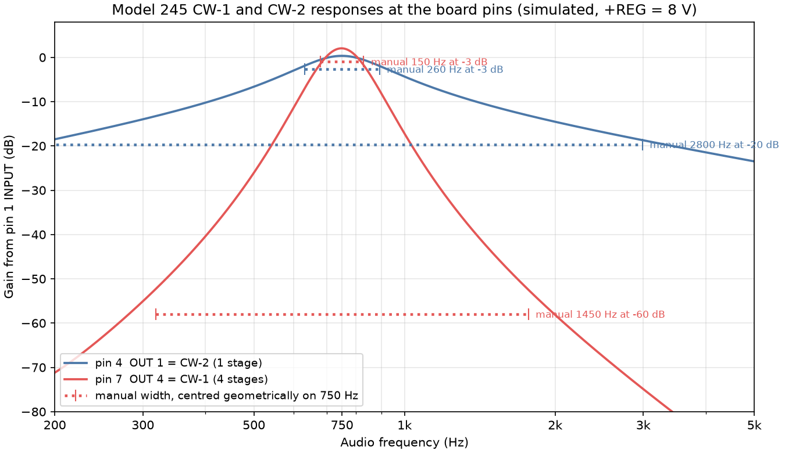
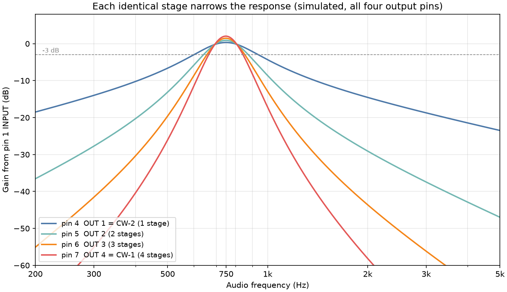
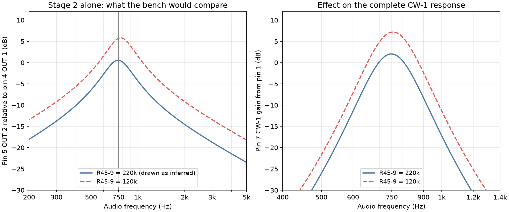

# Model 245 CW filter

## What is this board for?

The Model 245 is an optional plug-in audio filter for the Triton. A CW
(Morse) signal arrives in the speaker as a single tone, and the Triton is
designed so that a correctly tuned CW station produces a 750 Hz tone (540
manual PDF p.10 / printed p.2-5). Everything else in the receiver's
audio — other stations, hiss, static crashes — is at other frequencies.
The 245 passes a narrow band of audio centred on 750 Hz and throws away the
rest, so the wanted signal stands out of the noise and neighbouring signals
disappear.

It does this with audio, after the receiver has already turned the radio
signal into sound. The 9 MHz crystal filter on the 80282 board has already
cut the receiver down to a speech-width (a few kHz) passband; the 245
narrows that further to about 150 Hz for CW.

The MODE switch chooses how much of the filter is used:

| MODE | What the 245 contributes | What you hear |
|:--|:--|:--|
| SB-R, SB-N | nothing; the switch bypasses it | normal SSB audio |
| CW-2 | one of its four filter stages | a gentle peak at 750 Hz; highs reduced, nearby signals still audible |
| CW-1 | all four stages in series | only a narrow, "hollow" band around 750 Hz |

The 540 manual recommends CW-2 for tuning around and CW-1 when interference
is the problem (PDF p.10 / printed p.2-5). Without a 245 fitted, the radio
receives CW only in CW-2: a factory jumper on the empty socket routes the
unfiltered audio through that switch position, and CW-1 is silent.

The primary source is the [Model 245 instruction sheet](literature/Model%20245.pdf):

- PDF p.1: specifications and installation;
- PDF p.2 / printed p.3-41: operational check, pin and IC voltages, IC pin view;
- PDF p.3 / printed p.3-42: board photograph and schematic.

PDF p.4 is only bleed-through from p.3. The 540 manual shows the socket and
its wiring on the main chassis drawing (PDF p.21 / printed p.3-4) and the
board's location on PDF p.23 / printed p.3-7.

The KiCad sheet is [245_cw_filt.kicad_sch](245_cw_filt.kicad_sch). Ten-Tec's
designators R1–R20, C1–C12, IC1 and IC2 appear there as R45-1 … R45-20,
C45-1 … C45-12, IC45-1 and IC45-2, so that they do not collide with the
chassis R1, C1 and so on. This document uses the KiCad names.

## What are its pins?

The board has a single 7-pin edge connector. The Model 245 sheet names the
pins; the 540 chassis drawing gives the socket its own names. Pin numbers
are **inferred**: the order matches the socket drawing, and the instruction
to "clip off the blue jumper wire connecting pins 1 and 4" only makes sense
with IN at pin 1 and CW2 at pin 4.

| Pin | Model 245 name | 540 socket name | What it carries | DC, 245 manual (13 V supply) | DC, simulated in a 540 (8 V) | Probe point? |
|:--|:--|:--|:--|--:|--:|:--|
| 1 | INPUT | IN | audio from the 80279 product detector (FILT IN) | 0 V | 0 V | Yes |
| 2 | GND | GND | ground return | 0 V | 0 V | Yes; use as probe ground |
| 3 | +12V | +REG | supply for both op-amps | 13 V | 8 V | Yes — see below |
| 4 | OUT 1 | CW2 | stage 1 output, capacitor-coupled | 0 V | 0 V | Yes |
| 5 | OUT 2 | (no connection) | stage 2 output, direct | 6.5 V | 4.0 V | Yes |
| 6 | OUT 3 | (no connection) | stage 3 output, direct | 6.5 V | 4.0 V | Yes |
| 7 | OUT 4 | CW1 | stage 4 output, capacitor-coupled | 0 V | 0 V | Yes |

**Pin 3 is not a 12 V supply in a Model 540.** The 245 sheet calls it +12V
and its voltage table reads 13 V there, but the 540 chassis wiring takes the
socket's +REG wire to the 80280 control board's regulated +REG output, which
is about 8 V ([80280.md](80280.md)). The trace runs alongside the T (transmit
supply) wire for most of the page but has no junction with it. The 245 sheet
appears to describe the filter for Tritons in general. In a 540, expect every
"6.5 V" reading in the 245 table to be about 4 V instead.

Pins 5 and 6 are real pins with nothing connected in the 540. They are useful
for testing: they let you see the response after two and three stages.

## How does it work, component by component?

### The idea: four identical resonant stages

Each stage is an **active bandpass filter**: an op-amp with two capacitors
and three resistors that together behave like a tuned circuit (a coil and
capacitor) resonant at 750 Hz. An op-amp ("operational amplifier") is a
high-gain amplifier that, with resistors and capacitors around it, does
exactly what those components dictate. This arrangement is called **multiple
feedback**, because the output is fed back to the input through two paths,
one through each capacitor. Using an op-amp avoids audio-frequency coils,
which would be large, heavy and hum-sensitive.

One stage alone gives a fairly broad peak (CW-2). Four identical stages in
series multiply their responses: at 750 Hz each passes the signal at roughly
unity, but a signal 300 Hz away loses a little in each stage, and those losses
add up. That is why CW-1 has much steeper sides than CW-2.

The two ICs are µA747C dual op-amps. Each holds two op-amps (halves A and
B) that share a 14-pin package. Each half has its own positive supply pin
(13 for A, 9 for B), and both share the negative supply pin 4, which is
grounded here.

| Stage | Op-amp | Input R | Ground leg | Cap to output | Cap to − input | Feedback R | Output |
|:--|:--|:--|:--|:--|:--|:--|:--|
| 1 | IC45-1A (pins 1, 2, 12) | R45-1 220k | R45-2 15k + R45-5 6.8k | C45-2 | C45-3 | R45-3 470k | pin 4 via C45-4 |
| 2 | IC45-1B (pins 7, 6, 10) | R45-9 220k | R45-8 15k + R45-7 6.8k | C45-5 | C45-6 | R45-11 470k | pin 5 |
| 3 | IC45-2A (pins 1, 2, 12) | R45-12 220k | R45-13 15k + R45-14 6.8k | C45-8 | C45-9 | R45-15 470k | pin 6 |
| 4 | IC45-2B (pins 7, 6, 10) | R45-16 220k | R45-17 15k + R45-18 6.8k | C45-10 | C45-11 | R45-19 470k | pin 7 via C45-12 |

All eight capacitors in the table are 0.0022 µF.

### The input

**C45-1 (0.01 µF)** blocks DC between the radio and the filter. The filter's
inside sits at half the supply voltage (see the bias rail below), and the
80279 detector output has its own DC level; without C45-1, each would pull
the other off its operating point. Its reactance at 750 Hz is
1/(2π × 750 × 0.01 µF) ≈ 21 kΩ, small beside the 220k resistor behind it.
It begins to cut bass only below about 1/(2π × 220k × 0.01 µF) ≈ 72 Hz, far
below anything the filter passes. It is marked * on the drawing: wider
tolerance than ±5%, because its exact value does not matter.

**R45-1 (220k)** feeds the audio into stage 1. Its size sets the input
resistance — the 220k the manual quotes — so the filter barely loads the
detector. It also sets the stage's gain (below).

### One stage in detail (stage 1; the others are identical)

The node where R45-1, R45-2, C45-2 and C45-3 meet is the **summing node**.

- **R45-2 (15k) and R45-5 (6.8k)**, in series, run from the summing node to
  the bias rail, which is a signal ground. Together (21.8k) they are much
  smaller than R45-1, so most of the incoming signal current is shunted.
  This is deliberate: it lets the resonant frequency be set without
  changing the gain much. The drawing passes the non-inverting-input line
  between the two resistors with no junction dot, so they are in series. Why
  Ten-Tec used 15k + 6.8k rather than a single 22k is not documented; the
  0.9% difference shifts the centre frequency by about 0.04%.
- **C45-3 (0.0022 µF)** carries the signal from the summing node to the
  op-amp's inverting (−) input.
- **R45-3 (470k)** connects the op-amp output back to its − input. The
  op-amp drives its output to whatever keeps − equal to + (the bias rail), so
  the signal current through C45-3 has to flow on through R45-3; the output
  voltage is that current times 470k.
- **C45-2 (0.0022 µF)** feeds the output back to the summing node. This second
  feedback path is what makes the stage resonate.

The resonant frequency is where each capacitor's reactance (its AC
"resistance") equals the geometric mean of the two resistances it works
against:

> R45-1 ∥ (R45-2 + R45-5) = 220k ∥ 21.8k = 19.8 kΩ
> √(470k × 19.8k) = 96.5 kΩ
> f₀ = 1 / (2π × 0.0022 µF × 96.5 kΩ) = **749 Hz**

As a check, a 0.0022 µF capacitor's reactance at 750 Hz is
1/(2π × 750 × 0.0022 µF) = 96.5 kΩ — the same number.

The **Q** describes how sharp the peak is; bandwidth is roughly f₀ / Q:

> Q = ½ √(470k / 19.8k) = 2.43, so bandwidth ≈ 750 / 2.43 ≈ 310 Hz for one stage

The gain at the peak is R45-3 / (2 × R45-1) = 470k / 440k = 1.07 (+0.6 dB),
nearly unity. Four stages give 1.07⁴ = 1.30, or +2.3 dB, against the manual's
"app. 2.5 dB" insertion gain.

- **IC45-1A** is the active element. It inverts the signal (output swings the
  opposite way to the input at resonance) and supplies the energy that a
  passive coil-and-capacitor filter would lose.

**R45-9, R45-12 and R45-16 (220k)** connect each stage's output to the next
stage's summing node, playing the part R45-1 plays for stage 1. Stages 2–4
then repeat stage 1 part for part; the table above names them. The first
digit of R45-9's value is unreadable in the scan ("?20K"). **220k is
inferred** — Figure 45-3 below shows why 120k is implausible.

### The outputs

- **C45-4 (0.1 µF) and R45-10 (220k), pin 4 OUT 1 / CW2.** The op-amp output
  sits at half supply (4 V in a 540). C45-4 removes that DC so pin 4 rests at
  0 V, and R45-10 holds it there. Without them, turning the MODE switch onto
  CW-2 would connect a 4 V step to the 80279 audio input and produce a loud
  click. The two parts form a high-pass with a corner at
  1/(2π × 220k × 0.1 µF) ≈ 7 Hz — irrelevant to audio. C45-4's reactance at
  750 Hz is about 2.1 kΩ, so the CW2 output is not the "less than 10 Ω" the
  manual quotes; that figure can only describe the op-amp outputs themselves.
- **C45-12 (0.1 µF) and R45-20 (470k), pin 7 OUT 4 / CW1**, do the same for
  the CW-1 output; corner ≈ 3.4 Hz.
- **Pins 5 and 6 (OUT 2, OUT 3)** come straight off IC45-1B pin 10 and
  IC45-2A pin 12, at half supply. The 540 does not use them.

### The bias rail

The ICs run from a single positive supply, so their inputs and outputs need
a resting point midway between 0 V and the supply, where the audio can swing
both ways.

- **R45-4 (15k) and R45-6 (15k)** divide the supply in half: 4 V from the
  540's 8 V +REG (6.5 V from the 13 V in the 245 manual's table). Both are
  marked *: equal resistors set the midpoint and their exact value does not
  matter much.
- **C45-7 (32 µF, 10 V electrolytic)** makes the rail an AC ground. Every
  stage's + input and every ground leg (R45-5, R45-7, R45-14, R45-18) returns
  to this rail. Its reactance at 750 Hz is about 6.6 Ω, against the rail's
  7.5 kΩ source resistance (15k ∥ 15k). Without it, the four stages would
  couple to each other through the rail, and any noise on +REG would go
  straight into every stage. It also smooths the rail: supply variation
  above about 1/(2π × 7.5k × 32 µF) ≈ 0.7 Hz is filtered out. As a side
  effect, the rail takes about a second (several 0.24 s time constants) to
  settle after power is applied.
- **Supply pins:** IC45-1 and IC45-2 pins 13 and 9 go to pin 3; pin 4 to
  ground. The offset-null pins (3, 5, 8, 14) and the unused pin 11 are left
  unconnected, as the drawing notes. The stages are capacitor-coupled and run
  at about unity gain, so op-amp offset voltage cannot accumulate.

The whole board draws about 2 mA (manual: "+12 VDC @ 2 mA").

### How the radio switches it

On the 540 chassis (PDF p.21 / printed p.3-4), the 80279 FILT IN audio goes
to socket pin 1 and also to MODE switch section S1B, positions SB-R and SB-N.
S1B's CW-1 position takes socket pin 7, its CW-2 position takes pin 4, and
LOCK is open. S1B's common returns to 80279 FILT OUT, which feeds the audio
amplifier. The factory jumper between pins 1 and 4 makes CW-2 an
unfiltered position until the 245 is fitted. It must be removed when the
filter goes in, or CW-2 would connect the filter's input straight to its
output.

## What does a healthy board look like?

- Pin 3 at the radio's +REG (about 8 V in a 540); about 2 mA drawn.
- Pins 5 and 6, and IC pins 1, 2, 6, 7, 10 and 12 of both ICs, all at about
  half of pin 3. Any op-amp output stuck near 0 V or near the supply
  indicates a fault in that stage.
- Pins 1, 4 and 7 at 0 V DC.
- With a 750 Hz tone into pin 1, pins 4, 5, 6 and 7 all at roughly the input
  level (within 1–2 dB of it).
- Moving the tone a few hundred Hz away: pin 4 falls gently; pins 5, 6 and 7
  fall progressively faster.
- In the radio, the manual's listening check (PDF p.2 / printed p.3-41): band
  noise in SB-N sounds broad, CW-2 removes the highs, CW-1 leaves only a
  hollow tone around 750 Hz.

## What is each alignment adjustment actually doing?

**There are none.** The Model 245 has no trimmers and the manual gives no
alignment procedure. The centre frequency is fixed by resistor and capacitor
values (5% parts) and does not depend on the supply voltage. The only
procedure is the **operational check** on PDF p.2 / printed p.3-41. It uses
band noise rather than a test signal because noise contains every
frequency, so listening to it in SB-N, CW-2 and CW-1 compares the three
passband widths by ear in one pass. It also confirms that the MODE switch
wiring and the removed jumper are correct: if CW-2 and SB-N sound the same,
the jumper is probably still in place; if CW-1 is silent, the filter is not
powered or not seated.

## Simulation evidence

The [operation study](spice/studies/245/operation/README.md) holds the data,
and the [bench procedure](bench/245/README.md) holds the hardware checks.
The runner exports the KiCad sheet afresh on every run, so the simulated
circuit is the schematic itself. The two µA747C ICs use the project's
MC1747 macromodel. Motorola states the MC1747C is pin-for-pin and
electrically equivalent to the µA747C. Every result is read at the
board pins with nothing connected to the outputs, as on a bench.

### DC operating point

**How it works.** R45-4 and R45-6 set a half-supply rail. Each op-amp holds
its output at that rail, because its feedback resistor carries no DC current.

**What a working board should show.** Half of pin 3 at every op-amp input and
output; 0 V on the capacitor-coupled pins.

**How the simulation tests it.** It computes the operating point at 13 V
(matching the 245 manual's table) and at 8 V (the 540's +REG).

**What it showed.** The full comparison is in
[dc.csv](spice/studies/245/operation/data/dc.csv).

| Point | Manual, 13 V | Simulated, 13 V | Simulated, 8 V |
|:--|--:|--:|--:|
| IC pins 1, 2, 6, 7 (inputs) | 6.5 V | 6.50 V | 4.00 V |
| IC pins 10, 12; board pins 5, 6 (outputs) | 6.5 V | 6.54 V | 4.04 V |
| Board pins 1, 4, 7 | 0 V | 0 V | 0 V |
| Supply current | 2 mA | 3.4 mA | 2.1 mA |

**Does it meet expectations? Pass** at 13 V. Every voltage matches the manual
to the nearest 0.1 V. The model draws 3.4 mA at 13 V against the manual's
"2 mA". For reference, Motorola gives 1.7 mA typical per amplifier, but at ±15 V
(MC1747 sheet, printed p.3-84), and supply current falls with supply
voltage. The model figure is a macromodel estimate, not a measurement.

**Limits.** The 40 mV difference between output and input is the macromodel's
input-offset behaviour. Real ICs will differ by a similar few tens of
millivolts.

**Bench check — not yet performed. This is the proposal.**

| Setup | |
|:--|:--|
| Instrument | DMM, 10 MΩ input |
| Where | Pins 1, 3, 4, 5, 6, 7 and IC pins, referenced to pin 2 |
| Radio | Receive, SB-N, no signal (or board on the bench, pin 3 from a supply) |

| Point | Simulated (8 V) | Measured |
|:--|--:|:--|
| Pin 3 | 8.00 V | |
| Pins 5 and 6 | 4.04 V | |
| IC pins 1, 2, 6, 7 | 4.00 V | |
| Supply current | 2.1 mA | |

This settles whether a 540 really runs the 245 at 8 V (the chassis trace)
rather than 13 V (the 245 sheet).

### CW-1 and CW-2 against the factory specification

**How it works.** CW-2 is stage 1 alone (pin 4). CW-1 is all four stages
(pin 7).

**What a working board should show.** The manual (PDF p.1) gives:

- centre frequency 750 Hz;
- CW-1: 150 Hz wide at −3 dB (the "half power" point, where the voltage is 0.71 of the peak), 1.45 kHz wide at −60 dB (1/1000 of the voltage), and a shape factor of 7.2 (the −60 dB width divided by the −6 dB width; smaller means steeper sides);
- CW-2: 260 Hz wide at −3 dB, 2.8 kHz wide at −20 dB (1/10 of the voltage);
- insertion gain about 2.5 dB.

**How the simulation tests it.** It drives pin 1 from an ideal 1 V AC source
and sweeps 100 Hz to 10 kHz. It reads pins 4 and 7 with no load and +REG at
8 V. The sweep has 2000 points per decade, about 0.86 Hz apart near 750 Hz,
so the frequencies below are quoted to the nearest hertz. The y-axis of
Figure 45-1 is the output voltage relative to pin 1, in dB. The dotted bars
show the manual's widths, centred on 750 Hz. The manual gives only widths,
not edge frequencies, so the centring is an assumption.

**Figure 45-1.** Simulated CW-1 (pin 7) and CW-2 (pin 4) responses with the manual's specified widths.

**What it showed.**

| Quantity | Manual | Simulated |
|:--|--:|--:|
| Centre, CW-1 / CW-2 | 750 Hz | 748 / 749 Hz |
| CW-1 gain at peak | ≈ +2.5 dB | +2.0 dB (×1.26) |
| CW-2 gain at peak | — | +0.3 dB (×1.04) |
| CW-1 width at −3 dB | 150 Hz | 134 Hz |
| CW-1 width at −60 dB | 1450 Hz | 1710 Hz |
| CW-1 shape factor 60/6 dB | 7.2 | 8.6 |
| CW-2 width at −3 dB | 260 Hz | 313 Hz |
| CW-2 width at −20 dB | 2800 Hz | 3124 Hz |

In plain terms, the four-stage filter passes a band about 134 Hz wide. It
reduces a 1.5 kHz signal to about 1/160 of its strength (−44 dB), and a
2 kHz signal to about 1/800 (−58 dB). The single stage is a broad hump: it
halves a signal (−6 dB) about 220 Hz below or 320 Hz above centre, and
leaves a 1.5 kHz signal at about 1/3.6 of its strength (−11 dB).

**Does it meet expectations? Partial pass.**

- **Matches:** the centre frequency and the insertion gain.
- **Mismatches:** the simulated CW-2 is about 20% wider than the manual's
  figure, while the simulated CW-1 is about 10% narrower at −3 dB and wider at −60 dB.
- **Why it can't be fixed by adjusting one value:** four *identical* stages
  always give a CW-1 width about 0.43 times the CW-2 width. The manual's
  figures imply 0.58.
- **Likely cause:** real stages with 5% parts are each tuned slightly
  differently. Slightly different tuning widens and flattens the combined
  peak while leaving each stage's own width alone. Ten-Tec may also have
  measured through the receiver rather than at the board.
- **Status:** these explanations are untested. They are listed under
  "Simulations still to be done".

**Limits.** Values are nominal; the source is ideal and the outputs are
unloaded; the op-amp is a macromodel. The manual's widths are factory
figures whose measurement method is not stated.

**Bench check — not yet performed. This is the proposal.** The full
procedure is in [bench/245](bench/245/README.md).

| Setup | |
|:--|:--|
| Generator | Audio generator into pin 1, 100 mV RMS, ground at pin 2 |
| Readout | Scope (×10 probe) or AC voltmeter at pin 4, then pin 7; pin 1 measured as the reference |
| Supply | Pin 3 at 8.0 V (bench) or the radio's +REG; note which |
| Constraint | Keep the generator level fixed across the sweep; outputs carry no DC so no blocking capacitor is needed at pins 4 and 7 |

| Quantity | Simulated | Measured |
|:--|--:|:--|
| Peak frequency, pin 7 | 748 Hz | |
| Gain at peak, pin 7 / pin 1 | +2.0 dB | |
| −3 dB edges, pin 7 | 684 / 818 Hz | |
| −60 dB edges, pin 7 | 281 / 1992 Hz | |
| Gain at peak, pin 4 / pin 1 | +0.3 dB | |
| −3 dB edges, pin 4 | 609 / 922 Hz | |
| −20 dB edges, pin 4 | 180 / 3304 Hz | |

This measurement tells us whether real stages are tuned close together,
which matches the model, or spread apart, which would match the manual's
150/260 Hz ratio.

### Stage by stage

**How it works.** Pins 4, 5, 6 and 7 give the output after one, two, three
and four stages.

**What a working board should show.** All four curves peak near 750 Hz at
roughly unity gain. Each additional stage makes the sides steeper and the
top narrower.

**How the simulation tests it.** This is the same sweep as above, read at all
four output pins.

**Figure 45-2.** Simulated response at the four output pins: one, two, three and four stages.

**What it showed.** The −3 dB width shrinks from 313 Hz (pin 4) to 199 Hz
(pin 5), 157 Hz (pin 6) and 134 Hz (pin 7). The peak gain rises by about
0.57 dB per stage, from +0.3 dB to +2.0 dB. At 1.5 kHz each stage takes away
another 11 dB. That leaves −11, −22, −33 and −44 dB at pins 4 to 7, which
is 1/3.6 of the input after one stage and about 1/160 after four.

**Does it meet expectations? Pass.** The cascade behaves as four identical
resonators should. Each added stage narrows the band by a shrinking amount,
which is the textbook result for identical stages in series.

**Limits.** These values are nominal. Real stages will be tuned slightly
differently from each other, as described above.

**Bench check — not yet performed. This is the proposal.** Use the same setup
as the CW-1/CW-2 check. Probe pins 5 and 6 as well. Those pins carry about
4 V DC, so use AC coupling on the scope.

| Pin | Simulated peak gain | Simulated −3 dB width | Measured gain | Measured width |
|:--|--:|--:|:--|:--|
| 4 | +0.3 dB | 313 Hz | | |
| 5 | +0.9 dB | 199 Hz | | |
| 6 | +1.5 dB | 157 Hz | | |
| 7 | +2.0 dB | 134 Hz | | |

Each pin isolates one more stage, so a stage that is tuned away from the
others shows up as a skewed or flattened curve at the pin just after it.

### R45-9: 220k or 120k?

**How it works.** R45-9 feeds stage 2. It sets that stage's gain
(470k / 2R) and also shifts its centre frequency slightly.

**What a working board should show.** With 220k, stage 2 matches the other
three stages, at about +0.6 dB and 749 Hz. With 120k, the calculation gives
+5.8 dB at 777 Hz.

**How the simulation tests it.** It repeats the sweep with R45-9 changed to
120k. It plots pin 5 relative to pin 4, which isolates stage 2, and also
shows the complete CW-1 response.

**Figure 45-3.** Simulated effect of the unreadable R45-9 value, seen at board pins 4, 5 and 7.

**What it showed.**

| | R45-9 = 220k | R45-9 = 120k |
|:--|--:|--:|
| Pin 5 / pin 4 at 750 Hz | +0.57 dB (×1.07) | +5.71 dB (×1.93) |
| Stage-2 peak | 748 Hz | 775 Hz |
| CW-1 gain at peak | +2.0 dB | +7.2 dB (×2.29) |
| CW-1 −3 dB width | 134 Hz | 135 Hz |

**Does it meet expectations? Pass. It supports 220k.** With 120k, the filter
would have +7.2 dB of insertion gain, nearly three times the manual's
"app. 2.5 dB". With 220k the result is +2.0 dB. The bandwidth hardly changes
either way, so the response shape cannot settle the question. The gain can.

**Limits.** This is still an inference. Reading the colour bands on the real
R9 settles it outright.

**Bench check — not yet performed. This is the proposal.** Feed 750 Hz at
100 mV into pin 1. Measure pin 4 and pin 5 with the same instrument and
range, AC-coupled.

| Quantity | Simulated, 220k | Simulated, 120k | Measured |
|:--|--:|--:|:--|
| Pin 5 / pin 4 at 750 Hz | +0.57 dB | +5.71 dB | |
| R9 colour bands | red-red-yellow | brown-red-yellow | |

The 5 dB difference is far larger than any 5% tolerance effect, so a single
reading decides the R45-9 value.

## Simulations still to be done

Each of these is a proposal and has not been run. The bench counterparts
are also proposals.

**Component tolerance.** *Would show* how much 5% resistors and capacitors
spread the four stage frequencies, and whether that spread explains the
manual's 150 Hz / 260 Hz pair (see the CW-1/CW-2 result above). *Method:*
Monte Carlo runs at ±5% (wider on starred parts), recording the CW-1 and CW-2
widths. *Expected:* the CW-1 width varies more than the CW-2 width, and the
median CW-1 width rises above 134 Hz. *Bench:* uses the CW-1/CW-2 and
stage-by-stage measurements above.

**Input and output impedance (documented factory figures: 220 kΩ in, under
10 Ω out).** *Would show* what the 80279 detector and the 80279 IC1 input
actually see. *Method:* small-signal impedance at pin 1, and at pins 4, 5
and 7. *Expected:* about 220 kΩ at pin 1; a few ohms at pins 5 and 6; about
2.1 kΩ (C45-4's reactance) at pins 4 and 7.

| Quantity | Simulated | Measured |
|:--|--:|:--|
| Pin 1 input impedance at 750 Hz | (to run) | |
| Pin 7 output impedance at 750 Hz | (to run) | |

*Bench:* to measure input impedance, put a series resistor at pin 1 and note
the level drop. To measure output impedance, put a known load on pins 4, 5
and 7 and note the level drop.

**The manual's operational check and CW keying.** *Would show* the listening
test from p.3-41 as spectra: noise into pin 1, output spectrum at pins 4 and
7. It would also show a keyed 750 Hz CW element at pin 7: the narrow filter
delays the tone and stretches its start and end by a few milliseconds.
*Expected:* a rise time of roughly 1/(bandwidth) ≈ 7 ms for CW-1.

| Quantity | Simulated | Measured |
|:--|--:|:--|
| CW-1 10–90% rise of a keyed 750 Hz tone | (to run) | |

*Bench:* scope on pin 7 with a gated 750 Hz tone into pin 1.

**The in-radio path, FILT IN → S1B → FILT OUT.** *Would show* the filter
driven by the real 80279 detector, loading the 80279 IC1 input, with each
MODE position. *Blocked:* the 80279 sheet still contains a wire from FILT IN
to FILT OUT that stands in for the factory jumper. While that wire exists,
the full-radio netlist bypasses the 245.

## Evidence status and open questions

| Item | Status |
|:--|:--|
| Topology, all values except R45-9 | Documented (245 PDF p.3 / printed p.3-42) |
| R45-9 = 220k | Inferred; supported by Figure 45-3 against the manual's insertion gain |
| Board pin numbers 1–7 | Inferred from the socket drawing order and the 1–4 jumper note |
| Socket wiring, S1B positions, +REG source | Documented (540 PDF p.21 / printed p.3-4) |
| IC model | MC1747 macromodel; Motorola states the MC1747C is equivalent to the µA747C |
| Centre 750 Hz, ≈ +2 dB gain | Calculated and simulated; agree with the manual |
| Bandwidths | Simulated; differ from the manual by 10–20% (open) |
| Supply 8 V in a 540 vs 13 V on the 245 sheet | Open; first bench check |
| Supply current 2 mA | Model gives 2.1 mA at 8 V and 3.4 mA at 13 V; unmeasured |

Open questions:

1. Does a 540 really run the 245 at about 8 V? The chassis trace says yes. The 245
   sheet's voltage table says 13 V.
2. Why are the manual's CW-1 and CW-2 widths not in the ratio that identical
   stages give? Is it stage tuning spread, or the measurement method?
3. Should the 80279 sheet's built-in FILT IN–FILT OUT wire become a modelled
   jumper, so that the whole radio can be simulated with the 245 fitted?
