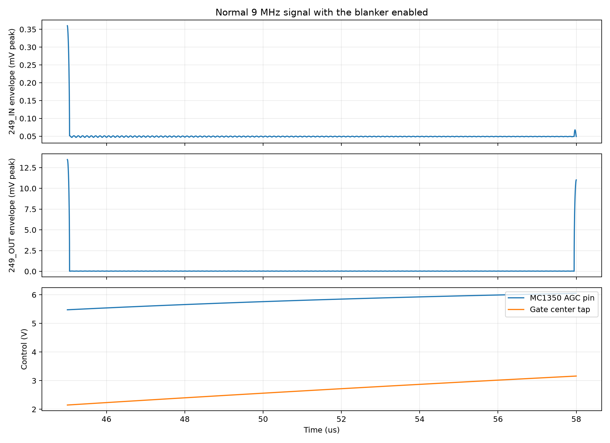
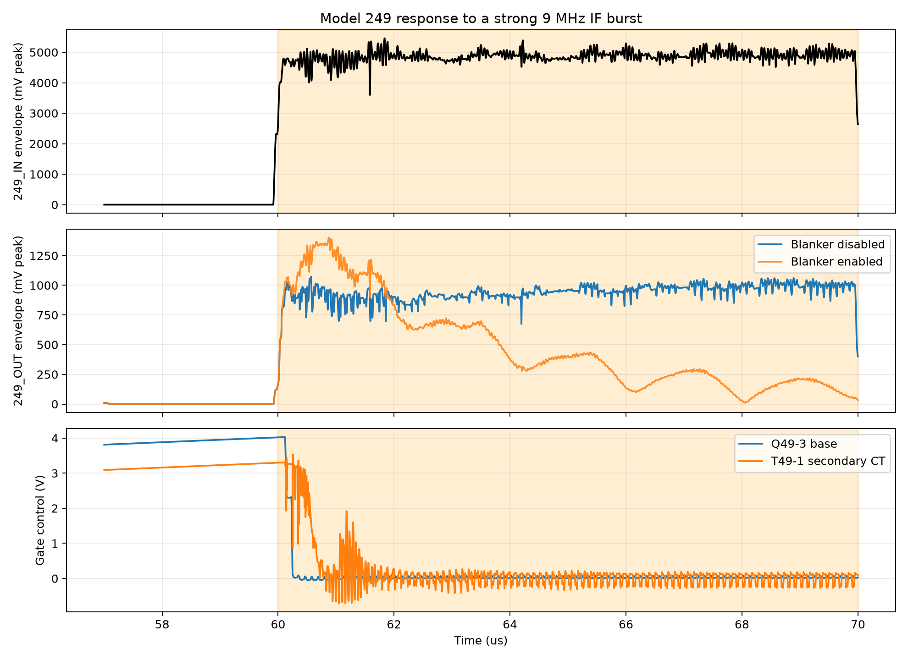

# Model 249 noise blanker

## What is this board for?

The Model 249 is an optional plug-in noise blanker for the Triton IV receiver.
It sits in the 9 MHz receive intermediate-frequency (IF) path, where the wanted
radio signal has already been converted to one fixed frequency. Its job is to
recognize a short, abnormally large pulse and briefly open the signal path so
that the receiver does not turn that pulse into a loud click.

Ten-Tec advertised the 249 as an IF noise blanker that suppresses most impulse
noise, with a front-panel switch to disable it. The Model 540 manual shows the
installed board location on PDF page 23 / printed page 3-7, but does not include
a Model 249 theory or alignment section. The circuit topology and values here
therefore follow the original Model 249 drawing dated 1976-06-02; the functional
description is traced from that circuit and is identified as an inference where
the manual is silent.

## What are its pins?

The original drawing shows two seven-position edge connectors. `NC` means no
connection on the board.

| Connector pin | Schematic net | What it carries | Useful probe point? |
|:--|:--|:--|:--|
| J49-1 pin 1 | `GND` | Chassis/signal return | Yes; preferred probe ground |
| J49-1 pin 2 | `GND` | Chassis/signal return | Yes |
| J49-1 pin 3 | `GND` | Chassis/signal return | Yes |
| J49-1 pin 4 | `+12_SW` | Switched blanker supply | Yes; it is **not** a permanent supply. The front-panel blanker switch removes it to disable detection. |
| J49-1 pin 5 | `NC` | No board connection | No |
| J49-1 pin 6 | `IN` | 9 MHz receive IF input | Yes, with a low-capacitance 10x probe |
| J49-1 pin 7 | `GND` | Input return | Yes |
| J49-2 pin 1 | `GND` | Chassis/signal return | Yes |
| J49-2 pin 2 | `NC` | No board connection | No |
| J49-2 pin 3 | `NC` | No board connection | No |
| J49-2 pin 4 | `+12` | Unswitched receiver supply for the signal gate | Yes |
| J49-2 pin 5 | `NC` | No board connection | No |
| J49-2 pin 6 | `OUT` | Blanked 9 MHz IF output | Yes, with a low-capacitance 10x probe |
| J49-2 pin 7 | `GND` | Output return | Yes |

The top-level KiCad sheet names the installed nets `249_IN` and `249_OUT` to
distinguish them from other boards' local pin names.

## How does it work, component by component?

The board contains two paths. The upper signal path normally passes the 9 MHz
IF. The lower detector path watches the same input at much higher sensitivity.
When the detector sees a large burst, it removes forward bias from two PIN
diodes. A PIN diode is an RF switch whose resistance is controlled by its DC
bias current.

### Normal 9 MHz signal path and gate

| Part | Job in the circuit |
|:--|:--|
| C49-1 | AC-couples `IN` to Q49-1 while blocking any DC arriving from the preceding board. Its 1,000 pF reactance is about 17.7 ohms at 9 MHz, so it passes the IF readily. |
| R49-1 | Feeds DC bias from the decoupled rail to the base of Q49-1. |
| R49-3 | Completes the Q49-1 base divider to ground. With R49-1 it establishes the transistor's resting current. |
| Q49-1 | Provides the first voltage gain for the normal signal path. It is a common-emitter stage: the input is at its base and the amplified, inverted signal is taken from its collector. |
| R49-2 | Is Q49-1's collector load; without it collector-current changes would not become a useful voltage signal. |
| R49-4 | Stabilizes Q49-1 emitter current against transistor gain and temperature spread. |
| Q49-2 | Is an emitter follower, a stage with near-unity voltage gain but more current drive. It drives T49-1 without heavily loading Q49-1. |
| R49-5 | Sets Q49-2 emitter current and provides its DC return. |
| C49-2 | Couples Q49-2's 9 MHz signal to the primary of T49-1 while removing Q49-2's emitter DC. |
| T49-1 | Couples the normal signal into two equal secondary halves. Its center tap receives the gate-control voltage from Q49-3, so it superimposes DC switching bias on the RF drive. |
| D49-1 | One half of the balanced MPN3404 PIN-diode gate. Forward bias makes it conduct RF; removing that bias isolates one side of the output tank. |
| D49-2 | The matching half of the balanced gate. Two diodes preserve a balanced drive and reduce direct control-pulse feedthrough. |
| L49-1 | Is the center-tapped output inductor. Together with C49-3 and stray capacitance it selects the 9 MHz IF after the diode gate. |
| C49-3 | Resonates L49-1. Using the model's approximately 3.17 uH end-to-end inductance and the documented 82 pF gives 9.87 MHz before diode and wiring capacitance; those added capacitances pull the working resonance toward 9 MHz. |
| R49-7 | Feeds DC from `+12` to the L49-1 center tap. |
| R49-6 | Returns that center tap to ground. R49-7 and R49-6 form an approximately 10:1 divider, putting the diode cathode side near one volt so Q49-3 can switch the diodes on and off. |
| C49-5 | Bypasses the L49-1 center tap at RF so its bias divider does not become part of the tuned signal path. |
| C49-4 | Couples the tuned 9 MHz signal to `OUT` and blocks the L49-1 DC bias. Its 22 pF reactance is about 804 ohms at 9 MHz, so the installed following-stage load materially affects board gain. |
| R49-8 | Isolates the Q49-1/Q49-2/Q49-3 rail from the main `+12` line. |
| C49-6 | RF-bypasses that isolated rail. R49-8 and C49-6 keep signal and gate transients out of the radio supply wiring. |

### Pulse detector and gate control

| Part | Job in the circuit |
|:--|:--|
| C49-15 | Samples `IN` into MC1350 pin 4. At 22 pF it couples fast 9 MHz pulse energy while limiting loading of the normal signal line. This is the capacitor connected to IC pin 4 on the original drawing. |
| C49-16 | AC-grounds MC1350 pin 6, so the sampled signal appears as a differential input rather than common-mode motion of both inputs. |
| IC49-1 | The MC1350 is a high-gain IF amplifier with automatic gain control (AGC). Here it magnifies impulsive 9 MHz energy for the two following detector branches. |
| R49-22 | Feeds the MC1350 from `+12_SW`; opening the front-panel switch removes detector power without interrupting the always-powered signal gate rail. |
| C49-14 | Bypasses the MC1350 supply at RF. |
| R49-21 | Feeds the center tap of L49-2 from `+12_SW`. |
| C49-12 | RF-bypasses the L49-2 center tap, making the two MC1350 outputs a balanced tuned circuit. |
| L49-2 | Is the center-tapped MC1350 output coil. Its inductance is undocumented; the SPICE value is inferred for resonance near 9 MHz. |
| C49-18 | Is the adjustable capacitor across L49-2 and the MC1350 outputs. It tunes the detector for maximum response at the 9 MHz IF. The simulation uses 40 pF as an explicit model setting, not a recovered factory adjustment. |
| R49-19 | Loads and damps the L49-2/C49-18 circuit so it does not ring indefinitely. |
| C49-13 | Couples one MC1350 output to the base of Q49-4. |
| R49-11 | Returns Q49-4's base to ground so it remains off without a detector pulse. |
| Q49-4 | Turns on for the selected pulse polarity and rapidly discharges the Q49-3 base-control node. |
| R49-10 | Normally pulls Q49-3's base upward from the decoupled rail. |
| C49-8 | Stores the gate-control voltage. With R49-10 its simple recharge time constant is 100 kohms times 560 pF, or about 56 us; transistor loading shortens the effective waveform but the calculation explains why the gate remains closed after the trigger edge. |
| Q49-3 | Is the actual gate-bias switch. On, it raises T49-1's secondary center tap and forward-biases D49-1/D49-2. Off, it lets R49-12 pull that center tap low and reverse-bias the diode pair. |
| R49-12 | Pulls the T49-1 secondary center tap to ground when Q49-3 is off and provides a defined DC return at all times. |

### Detector AGC and sustained-signal rejection

This branch keeps a strong carrier from looking indefinitely like a stream of
impulses. That function is inferred from the traced circuit; the Model 540
manual does not describe it.

| Part | Job in the circuit |
|:--|:--|
| C49-11 | Couples the opposite MC1350 output to Q49-5 so the AGC branch sees the other half of the balanced detector waveform. |
| R49-17 | Returns the Q49-5 base to ground. |
| R49-18 | Supplies a small bias path from the filtered Q49-6 emitter rail to Q49-5's base. |
| Q49-5 | Rectifies sustained detector output into a slower control signal at its collector. |
| R49-13 | Provides Q49-5's collector feed from the filtered supply. |
| C49-10 | Removes 9 MHz ripple from the Q49-5 collector while preserving its slower envelope. |
| R49-14 | Transfers the Q49-5 collector envelope to C49-9. |
| C49-9 | Stores the slower AGC control, preventing the gain from following every individual RF cycle. |
| R49-15 | Applies the stored control to the base of Q49-6. |
| Q49-6 | Is a PNP control transistor that raises MC1350 AGC voltage when sustained detector activity demands less gain. |
| R49-16 | Returns Q49-6's collector and the AGC drive network toward ground when Q49-6 is off. |
| R49-20 | Couples Q49-6's collector to MC1350 pin 5 and limits AGC current. |
| C49-17 | Bypasses RF at the MC1350 AGC pin so the gain responds to the envelope, not each 9 MHz cycle. |
| R49-9 | Isolates the Q49-5/Q49-6 supply rail from `+12`. |
| C49-7 | Bypasses that rail and gives the AGC branch a quiet RF reference. |

## What does a healthy board look like?

- With `+12` present and `+12_SW` on, a small 9 MHz signal at `IN` appears at
  `OUT` at roughly the same order of magnitude; the catalog describes nominal
  signal gain as 0 dB.
- Turning the blanker switch off removes `+12_SW` but must not open the normal
  signal path.
- A sufficiently large impulse makes Q49-4 conduct, pulls Q49-3's base low,
  and drops the T49-1 secondary center tap. The output burst then falls while
  the gate is held closed.
- A steady wanted carrier should not keep the gate permanently closed; the
  Q49-5/Q49-6 AGC branch reduces detector sensitivity to sustained energy.
- No board pin should carry DC onto the external `IN` or `OUT` coaxial path;
  C49-1 and C49-4 provide DC isolation.

## What is each alignment adjustment actually doing?

The original board drawing contains one adjustable part, C49-18. It tunes the
L49-2/MC1350 output circuit to 9 MHz so the pulse detector receives maximum IF
energy. Too little or too much capacitance moves the peak away from 9 MHz and
raises the impulse level needed to trigger Q49-4.

No Model 249 alignment procedure or step number was found in the Model 540
manual. The manual's receiver-adjustment pages therefore must not be treated
as instructions for C49-18. A safe future procedure would inject a very small,
bursted 9 MHz signal at `IN`, observe only board pins for the functional check,
and adjust C49-18 for the lowest repeatable trigger level. Directly probing
L49-2 or either MC1350 output is likely to detune the circuit because ordinary
probe capacitance is a significant fraction of the trimmer setting.

## Simulation evidence

### How this part of the circuit works

The simulation exercises both parallel paths. Q49-1/Q49-2 and T49-1 carry the
normal 9 MHz signal through the two PIN diodes to L49-1/C49-3 and `OUT`.
IC49-1 and L49-2/C49-18 detect the strong burst; Q49-4 then removes Q49-3 drive,
which drops the T49-1 center tap and opens D49-1/D49-2.

### What a working circuit should show

A small carrier should pass without operating the gate. A strong burst should
make the Q49-3 base and T49-1 center tap fall, followed by a smaller `OUT`
envelope than with the blanker disabled. Because the isolated board model has
no preceding crystal-filter group delay, its first burst cycles may escape
before the detector reacts.

### How the simulation tests it

The reproducible runner is
[`spice/tools/run_249_how_it_works.py`](spice/tools/run_249_how_it_works.py).
It exports the live Model 249 sheet, uses the root-sheet 13.28 V supply, a
50-ohm source, and an inferred 10 kohm installed-stage load in parallel with a
15 pF probe. It compares `+12_SW` off and on. A 50 uV-peak 9 MHz carrier checks
normal transfer; a deliberately strong 5 V-peak, 10 us 9 MHz burst makes the
switching sequence unambiguous. That burst is a functional stimulus, not a
factory sensitivity specification or a safe bench starting level.

Full setup, retained data, and model-fit details are in the
[study README](spice/studies/249/how-it-works/README.md).

### What the simulation showed

The enabled normal path produced -4.36 dB modeled gain, a voltage ratio of
about 0.605:1. This is 4.36 dB below the catalog's nominal 0 dB description,
but enabling the detector changed normal output by only +0.188 dB relative to
the disabled case. On the strong burst, the Q49-3 base crossed below 0.7 V
after 0.244 us and the modeled T49-1 center tap fell below zero. From 66 to
69 us, after the output tank had settled, blanking reduced burst output from
0.693 V RMS to 0.124 V RMS: 14.95 dB, or about 5.6:1 in voltage.

**Figure 49-1.** Normal 9 MHz signal passes with the blanker enabled

Figure 49-1 uses peak RF envelopes at the accessible `IN` and `OUT` pins. The
AGC and gate-center-tap traces are internal simulation insight; they should not
be probed on hardware during alignment because added capacitance can alter the
detector and gate timing.

**Figure 49-2.** Strong IF burst operates the PIN-diode gate

Figure 49-2 shows the orange enabled-output envelope falling while the disabled
blue envelope remains high. The leading peak is not suppressed in this
isolated-board model; the useful attenuation appears after the 0.244 us
detector delay.

### Does it meet expectations?

**Partial pass.** The simulation reproduces normal transfer without a material
on/off change, pulse detection, gate-control collapse, and 14.95 dB settled
burst reduction. Its -4.36 dB normal gain misses the catalog's nominal 0 dB
figure, and it does not suppress the leading edge. It also requires two
explicit fitted fixture choices: a 10 kohm following-stage load and a model-only
5.1 kohm MC1350 AGC shunt. It therefore proves that the reconstructed switching
topology works, but does not establish factory gain, blanking depth, or
sensitivity.

### Limits and evidence status

- **Documented:** 9 MHz input, nominal 0 dB signal gain, front-panel disable,
  original topology, values, and part numbers.
- **Calculated:** the quoted reactances, divider ratio, and simple 56 us
  R49-10/C49-8 recharge constant.
- **Inferred:** all three magnetic values and losses, the 10 kohm installed load,
  and the functional roles not described in the Model 540 manual.
- **Fitted:** C49-18 = 40 pF and the 5.1 kohm model-only AGC shunt. The latter
  compensates the archived MC1350 macro-model's excessive quiescent pin-5
  current and is not a physical Model 249 component.
- **Unknown:** real trigger threshold, leading-edge suppression, blanking depth,
  recovery time, magnetics, installed load, and production spread.

The transient grid is 2 ns. The 0.244 us trigger delay is resolved only to that
2 ns grid; it is a model result, not a measured board specification.

### Bench check

*Not yet performed. This is the proposal.*

| Item | Connection or setting |
|:--|:--|
| Supply | `+12` and `+12_SW` to board `GND`; use 13.28 V for comparison, current limited |
| Signal generator | 9 MHz to board `IN` through 50 ohms; begin at 10 mV peak or less |
| Output loading | Test installed in the receiver so the real following stage loads `OUT` |
| Oscilloscope CH1 | Low-capacitance 10x probe at board `IN` |
| Oscilloscope CH2 | Low-capacitance 10x probe at board `OUT` |
| Blanker control | Compare `+12_SW` on and off without moving probes or generator |
| Safety | Do not begin with the simulation's 5 V burst; increase burst level only as needed and stop if any device heats or clips continuously |

1. With `+12_SW` on, apply a small continuous 9 MHz signal and record `IN` and
   `OUT` RMS voltage.
2. Turn `+12_SW` off without changing the generator or probes and repeat.
3. Use a short 9 MHz burst, starting at the lowest generator level. Capture
   `IN` and `OUT` in one acquisition with blanking off, then on.
4. Increase burst level only until repeatable blanking appears. Do not adjust
   C49-18 between the off/on comparison.
5. If alignment is later authorized, adjust C49-18 for the lowest trigger
   level and record the exact setup before and after.

Detailed instructions are in [`bench/249/README.md`](bench/249/README.md).

| Measurement | Simulated | Measured |
|:--|--:|--:|
| Enabled normal-path gain | -4.36 dB | |
| Enabled versus disabled normal output | +0.188 dB | |
| Gate trigger delay | 0.244 us | |
| Settled strong-burst output, disabled | 0.693 V RMS | |
| Settled strong-burst output, enabled | 0.124 V RMS | |
| Settled burst suppression | 14.95 dB | |

This measurement matters because it would determine the real following-stage
load, magnetics, C49-18 setting, MC1350 bias, and MPN3404 switching behavior—the
parameters that dominate the uncertainty in the present model.

## Evidence status and open questions

The original 1976 board schematic documents the circuit itself. The Model 540
manual documents where the accessory is installed, but not how to align it.
Historical catalog material documents the 9 MHz IF, nominal 0 dB signal gain,
and impulse-noise purpose. The simulation is circuit-action evidence only.

Open questions are the original L49-1, L49-2, and T49-1 construction data; the
installed input/output impedances; the intended C49-18 procedure; the real
MC1350 AGC voltage; and measured trigger, attenuation, and recovery behavior.
