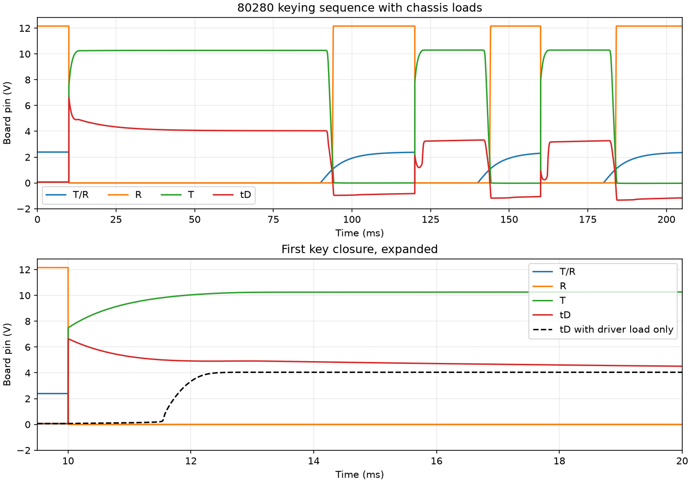
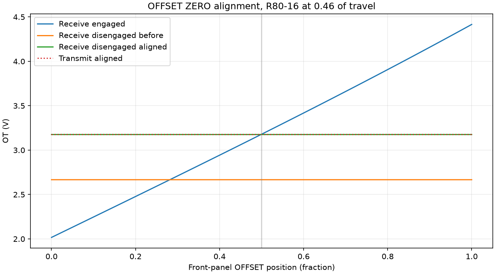
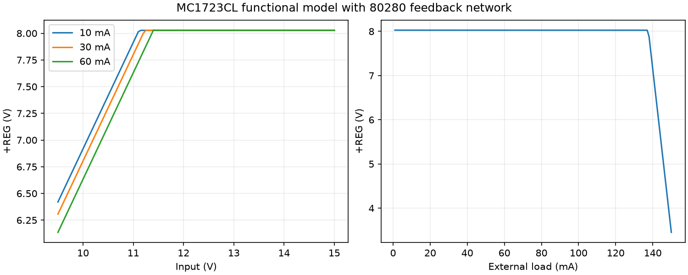

# 80280 Control Board

## What the board does

The 80280 switches the Triton IV between receive and transmit, delays the transmit
driver's first stage during CW keying, supplies approximately 8 V to circuits
whose operating points matter to tuning, and lets the operator shift the receive
frequency without carrying that setting into transmit. Ten-Tec describes these
functions and gives service voltages on PDF page 51 (printed 3-35), with the
schematic, photo and regulator pin table on PDF page 52 (printed 3-36).

## Board pins

| Pin | What it carries | Probe point |
|---|---|---|
| GND (three terminals) | Chassis return | Meter and scope reference |
| T/R | PTT or key request. A contact takes it to ground for transmit. | DMM or scope, high impedance |
| R | Switched receive supply. It falls in transmit. | DMM or scope |
| +12 | Radio DC supply, 13.8 V under the service-table conditions | DMM or scope |
| tD | Delayed transmit feed to the low-level driver and OT-TR branch | Scope for timing, DMM for settled voltage |
| T | Switched transmit supply. It falls in receive. | DMM or scope |
| OT POT (top, KiCad `OT POT`) | High end of the 10 kΩ front-panel pot | High-impedance DMM |
| +REG | Approximately 8 V regulated supply for VFO, SSB generator, and product detector | DMM or scope |
| OT | VFO varactor bias. A varactor is a diode whose capacitance changes with voltage. | High-impedance DMM |
| OT ON-OFF | Offset selection and indicator control | DMM or scope |
| OT POT (middle, KiCad `OT POT-A`) | Pot wiper, i.e. the moving contact | High-impedance DMM |
| OT POT (bottom, KiCad `OT POT-B`) | Low end of the pot | High-impedance DMM |

## How it works

**Switching and keying.** R80-2 pulls T/R up with the contact open, and R80-3
limits current into Q80-2. R80-1 limits the charging and discharging current
of C80-1, which slows contact transients. Q80-2 pulls the bases of Q80-3 and
Q80-4 low in receive, with R80-4 pulling them high when Q80-2 turns off.
Q80-4 supplies T through R80-6, while Q80-3 helps pull T down through R80-5.
These two 10 Ω resistors limit current in their respective paths. The two
transistors alternately source and sink current, meaning they drive the rail
high or drain charge from it.

R80-10 limits Q80-5 base current. When T goes high, Q80-5 pulls down the
receive switch's bases against R80-13. Q80-7 supplies R through R80-14
(10 Ω series resistance) in receive, and Q80-6 pulls R low in transmit.
R80-9 feeds tD from T and limits current when Q80-1 clamps tD toward ground.
C80-2 passes the rising edge of T through R80-8 into Q80-1's base.
R80-7 then returns the base toward ground so Q80-1 releases the clamp.
The no-load RC scale is (4.7 kΩ + 22 kΩ) × 0.1 µF ≈ 2.7 ms.
Transistor conduction and external loads change the actual delay.

**OFFSET.** R80-23 and R80-21 feed the ends of the front-panel pot and
set its span. Three 10 kΩ resistances in series between 8 V and ground
would put the unloaded ends at about 2.7 V and 5.3 V. D80-2 passes the
wiper setting to OT with a forward voltage drop. R80-22 gives OT a DC
return so it has a defined voltage when neither diode conducts. R80-18
feeds limited base current from the wiper to Q80-8, which pulls down
the anode of D80-1 while the front-panel setting is active.

R80-11 and R80-12 feed Q80-9 from T and pull its base toward ground
in receive. R80-19 allows OT ON-OFF to turn Q80-9 on independently.
R80-20 pulls OT ON-OFF up when the front-panel switch opens. Q80-9
then pulls the wiper down, turning off Q80-8 and turning on D80-1.
R80-17 and R80-15 limit the ends of R80-16's adjustment range. R80-16
sets the fixed bias that D80-1 passes to OT.

**Regulation.** IC-1, MC1723CL, compares its reference with a fraction
of the output and adjusts its internal series transistor to hold +REG.
R80-25 and R80-24 set that fraction. The nominal calculation is
7.15 V × (1 + 270 / 2200) ≈ 8.03 V. R80-26 isolates the reference
from C80-4, which filters reference noise. C80-3 shapes feedback at
high frequencies to help keep the loop stable. C80-5 bypasses supply
disturbances to ground. R80-27 senses output current as a voltage drop.
At a nominal 0.65 V sense threshold, 0.65 V / 4.7 Ω ≈ 138 mA total.

## What a healthy board looks like

- In receive, R is high and T and tD are low. Grounding T/R reverses the
  switching and tD is intended to rise after T in CW operation.
- With OFFSET engaged in receive, turning the knob changes OT. Pulling
  the knob or transmitting selects the fixed OT voltage.
- A centered OFFSET knob gives the same received beat pitch with the
  feature in or out. +REG is near 8 V.

## OFFSET ZERO adjustment

The manual's unnumbered procedure (PDF 51 / printed 3-35) uses one adjustment.
Center the front-panel OFFSET knob, push it in, and tune a steady CW beat.
Pull the knob and turn R80-16 until the same beat pitch returns. Toggle to
check the match. This adjusts the reference used when OFFSET is out or when
transmitting. If the two pitches differ, measure OT in both states. With
OFFSET out, move R80-16 toward the high end of its divider if OT is too low,
or toward the low end if OT is too high. Physical rotation depends on the
trimmer orientation, and pitch direction depends on the side of zero beat.
The board's keying delay and regulator have no factory adjustments.

## Simulation evidence

The [study](spice/studies/80280/operation/README.md) records the simulated
fixtures and the [bench procedure](bench/80280/README.md) gives pin-level checks.

### Receive and transmit DC

Q80-2 drives the T pair and Q80-5 drives the R pair. Their outputs should
exchange high and low states when the key contact closes. The model opens
and grounds T/R with +12 at 13.8 V, the knob centered and engaged, and
+REG held at 8 V. The driver diode branch loads tD, while the R and T
rails also use estimated equivalent loads. The table compares manual
values with the modeled board pins. See the [DC CSV](spice/studies/80280/operation/data/dc.csv)
for the transistor readings.

| Pin | Receive manual / model (V) | Transmit manual / model (V) |
|---|---:|---:|
| T/R | 2.1 / 2.39 | 0 / 0.00 |
| R | 12.8 / 12.16 | 0.6 / 0.00 |
| T | 0.2 / 0.06 | 10.4 / 10.28 |
| tD | 0.2 / 0.06 | 4.4 / 4.04 |

**Partial pass.** It switches states and drives tD to roughly 4 V under
load. The low-state and receive-R discrepancies matter for predicting
the behavior of connected circuits. Rail loads and transistor models
are approximate. **Bench check, proposed:** Compare the steady pin
voltages and establish the actual loading before comparing timing.

| Point | Simulated RX / TX (V) | Measured RX / TX (V) |
|---|---:|---|
| R | 12.16 / 0.00 | |
| T | 0.06 / 10.28 | |
| tD | 0.06 / 4.04 | |

### PTT and CW sequencing

The rising T edge should make Q80-1 clamp tD briefly. The driver first
stage then receives bias through its 470 Ω feed. The model applies an
80 ms contact closure followed by two 20 ms pulses. It compares the
driver load by itself with the additional 80281 relay timing-capacitor
path from the chassis. Figure 80-1 shows voltages at the board pins.

**Figure 80-1.** Board-pin waveforms during key-down and key-up. The dashed
curve isolates the driver load on tD for comparison.

**Partial pass.** With the driver branch alone, tD crosses its midpoint
about 1.73 ms after T. The saved KiCad value of 0.01 µF for C80-2 instead
gives 0.17 ms. With the modeled 80281 path present, tD instead jumps to
about 6.6 V on the first 2 µs sample after closure, while T is about 7.5 V.
Changing the residual R/T loads did not recover the delay. After key-up,
T and R cross their midpoints about 3.2 ms and 3.9 ms after contact release.
The loaded model also pulls tD below ground after release. Check that
excursion on the scope along with the initial positive jump.
The waveform recording grid is 2 µs, so differences between crossings
within the first grid interval cannot establish their order. Ten-Tec
gives a qualitative sequence and no numerical delay target.

**Bench check, proposed:** Scope T and tD in installed CW operation to
determine whether the 80281 path produces the modeled initial jump.

| Quantity | Simulated | Measured |
|---|---:|---|
| tD after T, driver branch alone | 1.73 ms | |
| Installed-case tD first sample after closure | 6.6 V at +2 µs | |
| R midpoint after key opens | 3.9 ms | |

### OFFSET selection and zero

The steering diodes should give OT a variable voltage in receive with the
knob pushed in and a fixed voltage in the other states. The model steps
the front-panel pot and R80-16 in 1% increments. It first finds the active
center voltage, then adjusts the fixed voltage to match it. Figure 80-2
shows the pin voltage before and after the adjustment.

**Figure 80-2.** Adjusting R80-16 brings the fixed OT voltage through the
center of the receive curve. The aligned transmit and disengaged receive
curves overlap.

**Functional pass.** Active OT spans 2.02–4.42 V and is 3.179 V at center.
The modeled fixed voltage moves from 2.667 V at the chosen off-center
starting setting to 3.176 V at 46% of modeled trim travel. The apparent
4 mV residual is within one trim step, about 26 mV. The diode drops, actual
pot travel, VFO loading, and beat pitch require hardware checks.

**Bench check, proposed:** Compare OT before and after toggling the knob
at center, then listen for the beat change. This checks whether matching
the voltages matches the VFO frequency on the installed radio.

| Quantity | Simulated | Measured |
|---|---:|---|
| Center OT, engaged / aligned disengaged | 3.179 / 3.176 V | |
| OT end-to-end, receive engaged | 2.02–4.42 V | |

### Regulated supply

IC-1 should hold +REG near 8 V when its input has enough voltage above
the output. The model uses the manual's feedback resistors and sense
resistor around a functional MC1723CL model. It sweeps input voltage
and external load independently, then keys the board with a 30 to
60 mA stepped external load at a fixed 13.8 V input. Figure 80-3 shows
the steady-state ranges.

**Figure 80-3.** Model line and load sweeps. The drop on the left comes
from the model's input headroom limit. The right-hand drop occurs near
the modeled current limit.

**Partial pass.** The regulated model gives about 8.03 V at 13.8 V.
The first input samples at or above 7.95 V are 11.05, 11.15, and 11.35 V
for the 10, 30, and 60 mA external loads, on a 50 mV grid. The response
stays around 8.03 V during the keyed load step in this model. Its low
input boundary follows the assumed 3 V headroom and its transient
response follows an estimated amplifier model. Installed current, actual
dropout, and brief disturbances require measurements.

**Bench check, proposed:** Measure +REG and +12 simultaneously before,
during, and after keying. This checks the modeled regulator behavior
under the actual radio load.

| Quantity | Simulated | Measured |
|---|---:|---|
| +REG at 13.8 V, 30 mA external load | 8.03 V | |
| +REG during modeled keyed load step | about 8.03 V | |

## Evidence status and open questions

The fixture follows the factory drawing. The live KiCad export has
incomplete connections and simulation properties, including the T switch,
Q80-6 base, Q80-9 emitter, C80-3/C80-5, and model paths for D80-1/D80-2 and
Q80-3/Q80-6. See the study notes for specific differences. The main
outstanding hardware check is the initial tD edge with the 80281 present.
The low-level driver schematic is labeled 80285 in the service section
(PDF 42–43 / printed 3-26–3-27) and 80286 in the chassis drawing
(PDF 21 / printed 3-4). Verify the actual driver revision and OT-TR wiring
against the radio under test.
