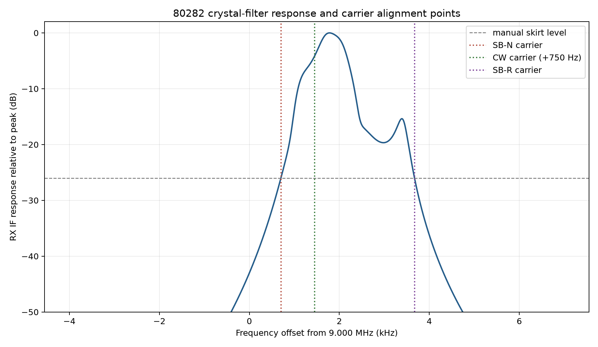
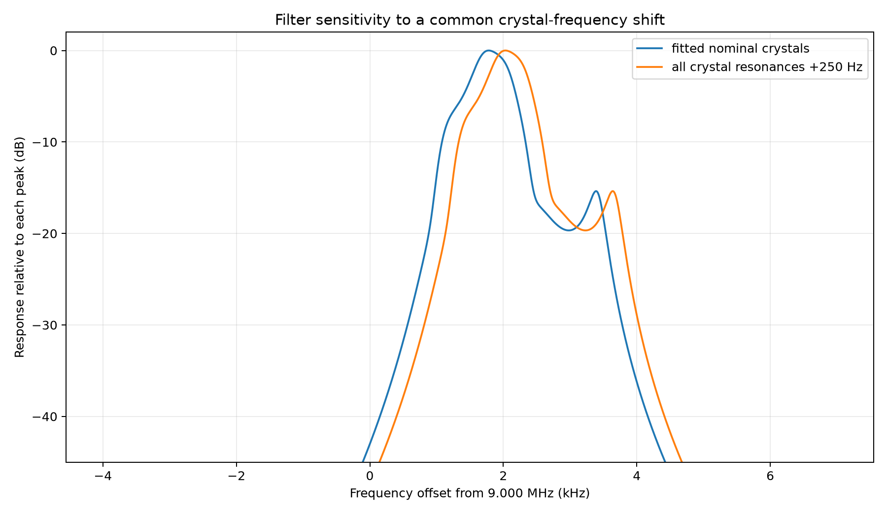

# 80282 SSB generator

## What this board is for

The 80282 board makes and selects the radio's 9 MHz single-sideband signal.  On
transmit it amplifies microphone audio, combines that audio with a 9 MHz carrier
in a balanced modulator, then passes only the wanted sideband through an
eight-crystal filter.  On receive the same filter sits between the receive mixer
and the IF amplifier, giving the receiver its selectivity.  A third circuit is
the BFO (beat-frequency oscillator): it supplies the 9 MHz signal used by the
transmit modulator and the receive product detector.

Ten-Tec describes these jobs on manual PDF page 38 / printed page 3-22, gives
the alignment and voltage tables on PDF pages 38–39 / printed pages 3-22–3-23,
and draws the board on PDF page 40 / printed page 3-24.

## Board pins

| Pin | What it carries | Useful probe point? |
|:--|:--|:--|
| `GND` | Signal and power return. | Yes; use this for instrument ground. |
| `LSB` | Mode-control voltage for Q82-1 and C82-2: about 7.2 V in SB-N, CW-2, and LOCK; 0 V in SB-R. It is not a fixed supply. | Yes with a DC meter or ×10 probe. |
| `CW` | Mode-control voltage for Q82-2 and C82-3: 13.8 V in SB-N, 7.2 V in CW-2, and 0 V in SB-R/LOCK. It is not a fixed supply. | Yes with a DC meter or ×10 probe. |
| `CWU` | Modulator-unbalance and microphone-mute control: about 6.2 V in SSB and grounded in CW/LOCK. | Yes with a DC meter. |
| `T` | Transmit gain-control voltage for CA3053 pin 7: about 10.4 V in SB-N transmit, 0.2 V in receive, and mode-dependent in CW/LOCK. It is not a fixed supply. | Yes with a DC meter; changing DRIVE changes it. |
| `+REG` | Regulated 9 V supply. | Yes; expect about 9.0 V in every mode. |
| `BFO` | 9 MHz carrier-oscillator output to the product detector. The manual gives about 6.8–6.9 V DC here. | Yes with a low-capacitance ×10 probe; a counter is better connected at R82-5/R82-6 as the manual directs. |
| `Out` | Receive: input from the RX mixer into the filter. Transmit: filtered SSB/CW output to the TX mixer. | Yes; this is the preferred pin-level RF observation point. |
| `MIC VOL-A` | One side of the off-board microphone-volume control network. | Control connection; probe only with a high-impedance audio probe. |
| `MIC VOL-B` | Other side of the off-board microphone-volume control network. | Control connection; probe only with a high-impedance audio probe. |
| `MIC` | Microphone audio input from the chassis jack and its external 6.8 kΩ/470 pF network. | Yes at audio frequencies with a ×10 probe. |
| `RX IF` | Receive: filtered 9 MHz output to the IF-AGC board. Transmit: the T82-1 secondary injects the balanced-modulator output here before the filter. | Yes with a low-capacitance ×10 probe. Do not probe internal crystal-board nodes. |

## How it works, component by component

### Carrier oscillator and mode selection

`Q82-3` is the active transistor in the roughly 9 MHz crystal oscillator and
`Y82-1` fixes its basic frequency. `R82-3` supplies base bias, `R82-4` feeds the
collector, and `R82-5` with `R82-6` sets the emitter current. The manual's
alignment counter point is the R82-5/R82-6 junction. `C82-6` bypasses the supply
end of this RF stage; 0.01 µF is only about 1.8 Ω at 9 MHz, so it keeps RF out
of the control wiring. `C82-9` couples oscillator RF into the balanced
modulator while blocking DC. `R82-7` couples the microphone-amplifier output
stage to the oscillator/modulator area as drawn, and `C82-7` couples the
oscillator to the `BFO` pin; `C82-8` supplies the BFO pin's 82 pF RF load.

`C82-1`, `C82-2`, and `C82-3` are 5–60 pF trimmers. `C82-1` is always active and
sets the high-frequency SB-R carrier. `Q82-1`, driven through `R82-1`, switches
`C82-2`; `C82-4` keeps RF off that control line. `Q82-2`, driven through
`R82-2`, switches `C82-3`; `C82-5` performs the same RF bypass job. With both
added capacitors active the carrier moves to the low skirt for SB-N. With only
C82-2 added it moves 750 Hz into the passband for CW.

### Microphone amplifier

`IC82-2` is an MC1747 dual operational amplifier. An operational amplifier is
a high-gain differential stage whose surrounding resistors set a stable,
useful closed-loop gain. `R82-15` and `R82-16` divide the 9 V supply in half,
and `C82-17` bypasses that midpoint so the two audio stages can treat it as
their AC ground.

Microphone audio enters through `C82-24`, which blocks chassis DC. `R82-21`
feeds the first non-inverting input and `C82-21` removes RF picked up by the
microphone lead. `R82-20` supplies its DC bias. `R82-18` and `R82-19` form the
first stage's feedback divider; equal 10 kΩ values give the familiar
non-inverting gain `1 + 10 kΩ / 10 kΩ = 2` when their bypass conditions apply.
`C82-20` keeps 9 MHz energy out of that feedback node.

The off-board volume control returns through `MIC VOL-A` and `MIC VOL-B`.
`C82-25` and `C82-26` provide AC coupling/bypassing around that connection so
the external control does not upset the 4.5 V DC bias. The second amplifier
uses `R82-22`, `R82-23`, `R82-24`, and `R82-25` for input, bias, and feedback;
`C82-22` and `C82-23` shunt unwanted RF. `R82-17` isolates the op-amp output
from the following RF circuitry, and `C82-16` couples the wanted audio to the
balanced modulator without carrying the op-amp's DC level.

### Balanced modulator and matching transformer

`IC82-1` is the CA3053 differential/cascode array shown as IC-1 in the manual.
A differential stage responds to the difference between two inputs; a cascode
stacks transistors so the output transistor shields the input stage from output
voltage changes. Here it mixes microphone audio with the BFO while cancelling
the carrier when both halves are balanced.

`R82-10` and `R82-11` establish the carrier-balance adjustment range. `R82-13`
is the 10 kΩ CARRIER BAL potentiometer, with `R82-12` and `R82-14` limiting and
symmetrizing its effect on the two inputs. `C82-10` and `C82-11` bypass the
bias/control node. `C82-14` and `C82-16` feed audio to the two sides; `R82-9`
and the `CWU` line deliberately upset or mute that balance in CW and LOCK.
`C82-19` bypasses RF on `CWU`. `C82-18` does the same for the `T` gain-control
line. `C82-13` and `C82-15` bypass the CA3053 output/bias nodes, and `R82-8`
isolates the audio-amplifier connection from the transformer drive.

The two halves of `L82-4` form T82-1's tuned primary and `C82-12` resonates it.
At 9 MHz, 220 pF has about 80 Ω reactance; the calculated 1.42 µH primary has
the same magnitude, which is why those starting values resonate together.
`L82-5` is the transformer's secondary and injects the modulated RF at `RX IF`.
Its 0.36 µH value and the primary-to-secondary coupling are inferred model
values. Ten-Tec says T82-1 was factory sweep-adjusted and must not be disturbed.

### Eight-crystal filter

`Y82-2` through `Y82-5` form the first four-crystal lattice section, and
`Y82-6` through `Y82-9` form the second. A lattice is a balanced bridge: paired
crystals pass the wanted narrow band while their phase relationship cancels
frequencies outside it. Individual crystal frequencies and motional parameters
are not printed in the manual.

`L3` and `C82-27` tune the `RX IF` end of the first section; `L2` and `C82-29`
tune the `Out` end of the second. Each documented 68 pF capacitor has about
260 Ω reactance at 9 MHz, matching a calculated 4.60 µH end-to-end winding.
`C82-28` is the documented 220 pF coupling/shunt capacitor between the two
sections. `R82-26` terminates `Out` in 220 Ω. Without these tuned terminations
the crystal bridge sees the wrong impedance and its passband becomes narrow,
rippled, or badly attenuated.

## What a healthy board looks like

- `+REG` is close to 9.0 V and the mode-control pins follow the manual's table.
- Q82-3 runs continuously and `BFO` carries a stable signal near 9 MHz.
- On receive, a swept 9 MHz signal applied at `Out` appears at `RX IF` only
  through the filter passband.
- On SSB transmit, microphone audio produces sidebands at `Out`, while the
  carrier can be nulled sharply with R82-13.
- SB-R and SB-N place the carrier on opposite 26 dB-down filter skirts; LOCK/CW
  is 750 Hz above the SB-N setting and returns well into the passband.
- Neither T82-1 nor the filter coils need field adjustment.

## What the adjustments are doing

### C82-1, C82-2, and C82-3 carrier alignment

The problem is not filter alignment: the sealed lattice is fixed. The three
trimmers place the oscillator on three required points of that fixed response.
They interact, so Ten-Tec alternates among them until all three conditions hold.

In manual steps 1–4 (PDF pages 38–39 / printed pages 3-22–3-23), the counter is
connected at R82-5/R82-6 and the RF meter or scope is placed at the antenna into
a dummy load. The DC-blocking capacitor protects a counter input that has DC
continuity. Setting R82-13 to an extreme intentionally leaves carrier output so
the filter response can be read without microphone audio.

Step 5 temporarily sets C82-1 to 9,001,700 Hz, near passband center. Steps 6–7
key the transmitter and raise DRIVE until the reference output is 20 V rms or
60 V peak-to-peak. The high level makes the later 26 dB reduction easy to read.
In step 8, decreasing C82-1 raises frequency until output is 1 V rms or 3 V
peak-to-peak: `20 log10(1/20) = -26.0 dB`, so this is the high skirt.

Step 9 selects SB-N, puts C82-2 at midrange, and adjusts C82-3 to the same 1 V
level on the low skirt. Step 10 selects LOCK and adjusts C82-2 until frequency
is 750 Hz above that low-skirt reading; output should return approximately to
the step-7 value because the carrier has moved into the passband. Step 11
repeats the sequence because changing any one capacitance slightly shifts the
other two conditions. If the SB-R skirt is wrong, move C82-1; if the SB-N skirt
is wrong, move C82-3; if the CW offset is wrong, move C82-2, then repeat all
three checks.

### R82-13 carrier balance

Step 12 leaves SB-N selected, keeps the same DRIVE setting, increases meter
sensitivity, and adjusts R82-13 for the deepest carrier null. The null is sharp
because equal carrier feedthrough from the two CA3053 halves cancels. If there
is no distinct minimum, first check the two 1 kΩ end resistors, CA3053 DC
voltages, BFO drive, and T82-1 continuity; do not compensate by moving T82-1.
Step 13 unkeys the transmitter.

## Simulation evidence

### Crystal-filter response and carrier placement

#### How this part of the circuit works

The receive path enters at `Out`, crosses Y82-6 through Y82-9 and the L2/C82-29
tuned termination, crosses C82-28, then crosses Y82-2 through Y82-5 and the
L3/C82-27 termination to `RX IF`. The same passive network works in reverse on
transmit. Carrier alignment places SB-N and SB-R on opposite skirts so the
unwanted sideband is rejected; CW moves 750 Hz from the SB-N skirt into the
passed band.

#### What a working circuit should show

A working network should have one useful passband near 9 MHz, two frequencies
26 dB below its peak for the SSB carriers, and a point 750 Hz above the low
skirt that has returned substantially toward peak response. A common change in
crystal resonance should move the response rather than leave it fixed.

#### How the simulation tests it

`run_80282_operation.py` exports the KiCad sheet and verifies its documented
filter parts before constructing the pin-level AC fixture. A 1 V source through
an inferred 50 Ω impedance drives `Out`; an inferred 1 kΩ fixture loads
`RX IF`. The sweep is 8.996–9.007 MHz in 5 Hz steps. Internal lattice nodes are
simulation-only because an oscilloscope probe would add capacitance comparable
with the crystal holder capacitance and detune them.

#### What the simulation showed

The fitted model peaked at 9,001,780 Hz. Its -26 dB skirt crossings were
9,000,700 Hz and 9,003,670 Hz. The modeled CW point, 750 Hz above the low skirt,
was 4.12 dB below peak. The 5 Hz sample spacing limits frequencies read directly
from the curve; interpolated crossings must not be treated as more accurate
than the uncertain model.

**Figure 82-1.** The fitted lattice response and the three carrier-alignment positions

Figure 82-2 shifts every fitted crystal resonance by 250 Hz. The response moves
with them, showing why measurements from an original filter are more valuable
than further numerical fitting.

**Figure 82-2.** A common 250 Hz crystal shift moves the modeled filter response

#### Does it meet expectations?

**Partial pass.** The circuit passes a band near 9 MHz, provides two -26 dB
skirts, and moves the CW point in the correct direction into the passband. The
modeled -3 dB width is only about 605 Hz, and the CW point is still 4.12 dB
below peak. That is not enough evidence to claim a factory-accurate SSB
passband or insertion loss.

#### Limits and evidence status

Documented: topology, 68 pF/220 pF capacitors, the 26 dB alignment ratio, the
9,001,700 Hz temporary setting, and the 750 Hz CW offset. Calculated: the
4.60 µH coil and 1.42 µH T82-1 primary starting values. Fitted: all crystal
motional parameters and paired resonances. Inferred: source/load impedances,
T82-1 secondary, and coupling coefficients. Unknown: actual filter bandwidth,
insertion loss, ripple, crystal aging, and oscillator frequencies after
alignment. No bench measurement has been made.

#### Bench check

*Not yet performed. This is the proposal.* Full instructions are in
[`bench/80282/README.md`](bench/80282/README.md).

| Setup item | Connection or setting |
|:--|:--|
| Source | Tracking generator at `Out`, below -30 dBm through 50 Ω |
| Receiver | High-impedance buffer or characterized probe at `RX IF` |
| Board | Unpowered and disconnected; ground only at `GND` |
| Sweep | 8.995–9.008 MHz; do not touch T82-1 or filter coils |

Sweep once in each direction without changing cables or terminations.

| Quantity | Simulated | Measured |
|:--|--:|--:|
| Peak | 9,001,780 Hz | |
| -3 dB bandwidth | 605 Hz | |
| Low / high -26 dB skirts | 9,000,700 / 9,003,670 Hz | |
| Response 750 Hz above low skirt | -4.12 dB | |

The measurement would determine the crystal model and real board termination
impedances, the two largest uncertainties in this simulation.

## Simulations still to be done

### Microphone gain and clipping

Show audio from `MIC` through both MC1747 stages and the external volume
control, with expected gain, bandwidth, and clipping at `MIC VOL-A/B` and the
modulator input. Bench counterpart: inject 1 kHz at `MIC` and record both
volume-control pins with DRIVE fixed. No result exists yet.

### Balanced modulation and carrier null

Run a transient 1 kHz-tone test with the fitted CA3053 model, sweep R82-13, and
measure carrier and sidebands at board pin `Out`. Expected result: a sharp
carrier minimum and two sidebands before filtering, then strong rejection of
the unwanted sideband. Bench counterpart: use a spectrum analyzer at `Out`
with a low microphone level and short transmit intervals. No result exists yet.

### BFO oscillator and trimmer interaction

Replace the present fitted small-signal crystal with parameters measured from
Y82-1, then simulate Q82-3 starting and the C82-1/C82-2/C82-3 switch states.
Expected result: SB-R and SB-N on opposite skirts and CW 750 Hz above SB-N.
Bench counterpart: record the manual counter point in all three modes without
changing the trimmers. No result exists yet.

## Evidence status and open questions

- The manual documents the circuit function, pin voltages, alignment ratio,
  and fixed capacitor values.
- Coil inductances are resonance calculations; coupling and the T82-1
  secondary are estimates.
- CA3053 transistor parameters and all crystal parameters are engineering
  models, not recovered factory models.
- The reconstructed filter formerly had two missing connections and a wrong
  C82-28 value; the present KiCad sheet now matches the manual topology at
  `RX IF`, the grounded crystal pair, and the 220 pF inter-section capacitor.
- Original-filter VNA data and BFO frequency readings are the highest-value
  next evidence. Until then, simulated bandwidth and attenuation are not
  hardware claims.
