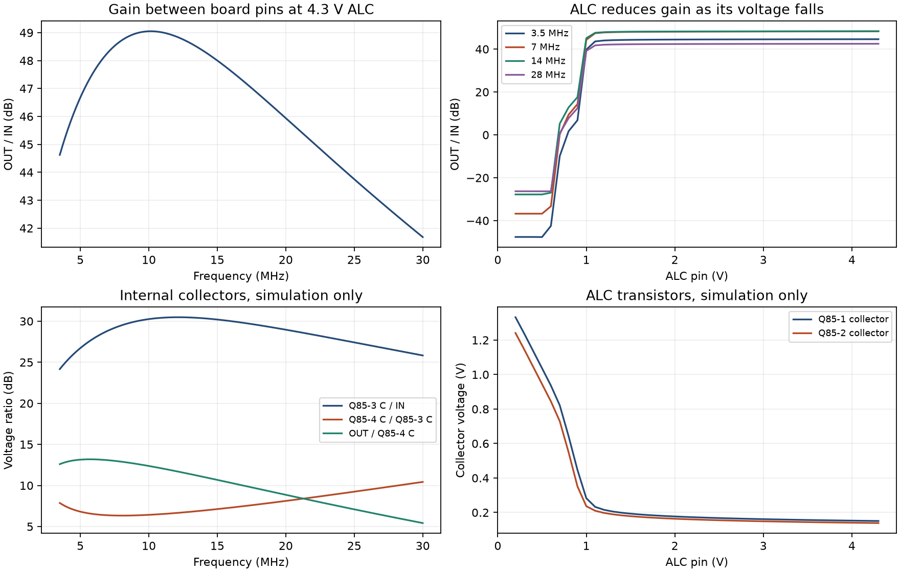
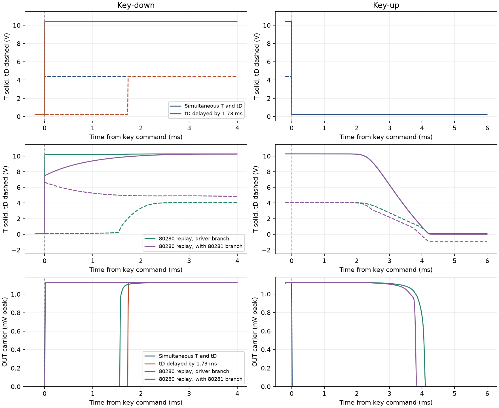
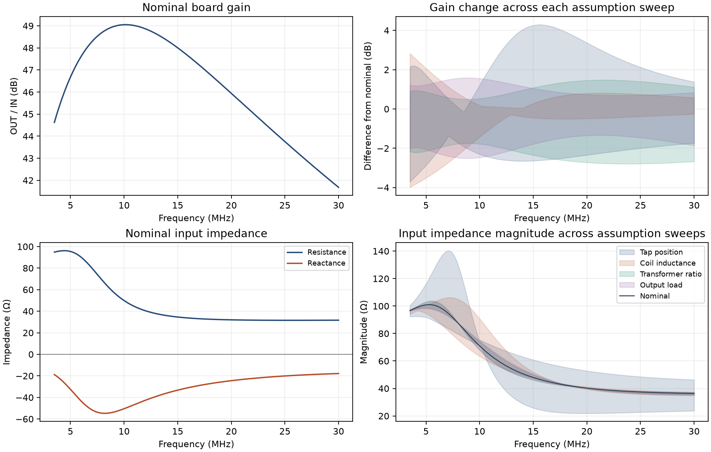

# 80285 low-level driver

## What it does

The driver raises the transmit RF signal from the mixer and band-pass filters to the level needed by the driver inside the final-amplifier assembly. Three stages do the work. The first two respond to **automatic level control** (ALC), a voltage from the radio that reduces drive when needed. The third stage has fixed bias with respect to ALC. All three are **class A** stages, meaning the transistor is biased to conduct throughout the RF cycle while that stage is enabled. CW is the radio's Morse-code mode. During CW key-down, the control board biases the last two stages before allowing the first stage to pass the RF signal. [Ten-Tec Model 540 manual, PDF 42–43 / printed 3-26–3-27](literature/540%20Triton%20Owner%20Manual.pdf)

The detailed assembly drawing and service table say 80285. The later main chassis drawing labels the board position 80286. The [KiCad sheet](80285_low_level_driver.kicad_sch) follows the 80285 detail drawing. It preserves the factory view with `IN` on the right and `OUT` on the left. [Ten-Tec Model 540 manual, PDF 21 / printed 3-4](literature/540%20Triton%20Owner%20Manual.pdf)

## Board pins

Read each side top to bottom, viewed from the top of the board as in the factory drawing. The `J85` numbers identify the drawn terminals in KiCad. The factory DC voltages below are for SB-N with DRIVE fully counterclockwise. `T` and `tD` carry switched bias feeds. Their voltages drop to 0.2 V in receive even though `+12` stays up. [Manual PDF 42–43 / printed 3-26–3-27](literature/540%20Triton%20Owner%20Manual.pdf)

| Side | KiCad ref | Pin | What it carries | Probe point |
|:--|:--|:--|:--|:--|
| Left | J85-1 | GND | Chassis return | Meter and scope reference |
| Left | J85-2 | tD | Delayed transmit feed. 0.2 V RX, 4.4 V TX. | DMM for settled voltage, scope for timing |
| Left | J85-3 | NC | Unused terminal | — |
| Left | J85-4 | +12 | Board supply. 13.0 V in the terminal table in RX and TX. | DMM or scope |
| Left | J85-5 | NC | Unused terminal | — |
| Left | J85-6 | OUT | Amplified RF to the final-amplifier assembly. 0 V DC. | Calibrated RF probe or isolated-board load |
| Left | J85-7 | GND | Chassis return at the output winding | Meter and scope reference |
| Right | J85-8 | GND | Chassis return | Meter and scope reference |
| Right | J85-9 | ALC | Gain-control input. 4.3 V both ways at minimum DRIVE. | High-impedance DMM or scope |
| Right | J85-10 | IN | RF from the selected transmit filter path. 0 V DC. | Calibrated RF probe or source on isolated board |
| Right | J85-11 | GND | Chassis return | Meter and scope reference |
| Right | J85-12 | GND | Chassis return | Meter and scope reference |
| Right | J85-13 | GND | Chassis return | Meter and scope reference |
| Right | J85-14 | T | Switched transmit feed for stages two and three. 0.2 V RX, 10.4 V TX. | DMM for settled voltage, scope for timing |

## How it works

The component numbers below preserve each original designator's final number. For example, Ten-Tec's Q3 is Q85-3 in KiCad. Component values and connections come from PDF page 43 / printed 3-27.

### Supply and first stage

- **C85-1 (100 nF)** shunts RF from `+12` to ground so signals at the collectors have a short local return. Its ideal opposition to AC, called *reactance*, is about `1/(2π × 3.5 MHz × 100 nF) = 0.45 Ω` at the bottom of the range. Without it, more RF can travel along the shared supply lead.
- **C85-2 (100 µF)** stores charge across `+12` for slower current changes when stages turn on. Without it, the local rail can dip more when the board keys or the load changes.
- **R85-1 (47 Ω)** feeds the first-stage collector supply separately and drops that rail under load. At 40 mA it drops `0.040 × 47 ≈ 1.9 V`. Without the resistor, the first stage loses that supply isolation and runs from the full rail.
- **C85-3 (100 nF)** grounds RF on the first-stage side of R85-1. Without it, RF current can develop a voltage across R85-1 and couple back into the supply path. The resistor and capacitor have a nominal `47 Ω × 100 nF = 4.7 µs` time constant before other loading.
- **C85-4 (10 nF)** carries RF from `IN` into Q85-3’s base while blocking its DC bias from the filter. It has about 4.5 Ω of reactance at 3.5 MHz. An open capacitor cuts off the RF path. A short puts base bias on `IN`.
- **R85-15 (470 Ω)** takes current from `tD` to the stage-one diode pair and limits that current. With 4.4 V at `tD` and about 1.3 V on the pair, the resistor supplies roughly `(4.4 − 1.3)/470 ≈ 6.6 mA` to the diodes and base-feed branch.
- **D85-3 and D85-4 (1N4002)** each contribute one forward drop to the stage-one bias voltage. D85-3 adds the upper drop and D85-4 adds the ground-side drop. Opening either interrupts the diode string. Shorting either removes one drop and reduces the stage’s bias.
- **R85-14 (100 Ω)** feeds that bias to Q85-3’s base and limits how directly the diode string loads the RF input. Opening it removes the intended DC bias. Shorting it connects the RF input node directly to the diode clamp.
- **Q85-3 (2N3866)** is the first amplifier. A small change at its base changes collector current. **L85-1** supplies that current through a continuous tapped winding. It develops RF voltage at the collector and feeds a fraction onward from the tap. An open winding breaks the DC feed or the RF transfer, depending on where it opens. The tap position affects both gain and loading.
- **R85-10 (10 Ω)** sits in Q85-3’s emitter return and provides *emitter degeneration*: when current rises, the resistor raises the emitter voltage, opposing the rise. Removing the resistor opens the return path. Shorting it changes the bias and gain.
- **Q85-2 (MPS6514)** controls that return. A high `ALC` voltage lets it conduct with a small collector-to-emitter voltage, so Q85-3 can draw current. Lower `ALC` weakens conduction, allowing the collector of Q85-2 and the emitter voltage of Q85-3 to rise. That reduces Q85-3’s base-to-emitter drive. **R85-11 (1 kΩ)** limits Q85-2’s base current and isolates its base from the common control line. An open R85-11 takes away the intended return control for stage one.

### Second stage

- **R85-5 (10 Ω)** and **C85-5 (10 nF)** carry RF from the L85-1 tap into Q85-4’s base. R85-5 adds a small series resistance that limits and damps transfer. C85-5 blocks the different DC voltages at the two ends. Opening either interrupts the signal. Shorting C85-5 upsets the base bias, while shorting R85-5 removes its damping. C85-5 has about 4.5 Ω of reactance at 3.5 MHz.
- **Q85-4 (2N3866)** supplies the second increment of RF gain. **L85-2** feeds its collector from `+12` and provides a tapped RF output to stage three. An open winding can interrupt the collector supply or the signal at its tap. The supply-to-tap turns fraction sets the voltage delivered to the next stage and changes the load reflected back to Q85-4.
- **R85-2 (680 Ω)** returns some of Q85-4’s collector signal to the L85-1 tap. A collector voltage swing is generally inverted relative to the base signal in this circuit. This path feeds part of that swing back to the stage input, changing gain and loading. Opening R85-2 removes that RF feedback path.
- **R85-8 (10 Ω)** sets emitter feedback in the second stage. **C85-7 (560 pF)** is across R85-8, giving RF a parallel path while preserving the DC resistor. At 14 MHz, the capacitor’s reactance is about 20 Ω, so the bypass is partial and grows stronger as frequency rises. An open C85-7 leaves full resistor feedback at RF. An open R85-8 interrupts the DC emitter current.
- **Q85-1 (MPS6514)** controls Q85-4’s emitter return in the same way Q85-2 controls stage one. **R85-13 (1 kΩ)** limits Q85-1 base drive from `ALC`. Without R85-13, `ALC` loses control of that return and Q85-4 cannot take its intended emitter current.

### Third stage and shared transmit bias

- **R85-12 (470 Ω)** supplies the stage-two and stage-three bias network from `T`. A 10.4 V feed and a roughly 1.3 V clamp give about 19 mA through R85-12, shared between the diodes and the base feed paths. Opening it leaves both stages without their intended bias.
- **D85-1 and D85-2 (1N4002)** each add one diode drop to that shared bias. D85-1 is the upper clamp diode and D85-2 returns the string to ground. An open diode breaks the clamp. A short across either drops the reference by approximately one diode drop and reduces the two stages’ bias.
- **C85-9 (100 nF)** bypasses the shared bias reference at RF. It gives RF coupled through the two base feed resistors a local return. Without C85-9, RF can more readily travel between the stage biases. `470 Ω × 100 nF = 47 µs` is an unloaded RC scale for the `T` feed. The forward-biased diodes and transistor loads change the actual charging time.
- **R85-9 (100 Ω)** biases Q85-4 from the shared reference while limiting RF loading on its base. Opening it cuts off that DC path. **R85-7 (47 Ω)** does the same job for Q85-5, with a lower resistance that drops less voltage for a given base current. Opening it takes away Q85-5’s bias.
- **R85-4 (10 Ω)** and **C85-6 (10 nF)** pass RF from the L85-2 tap to Q85-5’s base. R85-4 adds series damping and C85-6 blocks DC. An open part breaks that path. A shorted capacitor ties the transistor base to the winding’s DC voltage.
- **Q85-5 (PT3647)** supplies the final increment of drive. **R85-6 (3.3 Ω)** sets the DC emitter feedback and gives the emitter a fixed return to ground. The manual’s 0.6 V at the emitter implies `0.6/3.3 ≈ 0.18 A`. Opening R85-6 interrupts the DC path. **C85-8 (560 pF)** partly bypasses that resistor at RF. Its reactance is about 20 Ω at 14 MHz and 9.5 Ω at 30 MHz. Opening it leaves more emitter feedback at the high end.
- **T85-1** carries Q85-5’s collector current in its primary winding and transfers RF to a separate winding at `OUT`. The secondary keeps collector DC off the output cable and changes the load seen by Q85-5. Opening the primary breaks Q85-5’s DC supply. Opening the secondary breaks the RF output path. **R85-3 (470 Ω)** feeds some Q85-5 collector signal back to the L85-2 tap, affecting the third stage’s gain and input loading. Opening it removes that feedback path.

## What a healthy board looks like

- `+12` stays present in receive and transmit. `T` and `tD` are near 0.2 V in receive. The factory table gives approximately 10.4 V at `T` and 4.4 V at `tD` in transmit at minimum DRIVE.
- `IN` and `OUT` are near 0 V DC in both states. In transmit with drive applied, a small RF signal at `IN` produces a stronger signal at `OUT`.
- Reducing `ALC` reduces RF gain. At minimum DRIVE the manual lists 4.3 V at the pin.
- During CW key-down, the intended `T`-first sequence gives the last two stages time to establish bias before the first stage passes RF. Compare the actual waveforms at the pins before assigning a timing fault to this board.

## Alignment and the 7 MHz chassis filter

Ten-Tec specifies no adjustments for the three broadband stages. The 7 MHz position uses S4C/S4D on the VFO subchassis to insert an extra low-pass network, which reduces higher-frequency products from the transmit mixer. These are sections of the band switch. If a fault appears only on 7 MHz, compare the RF at the input and output of that external filter and at driver `IN`; the 80285 has no adjustment to compensate for a missing or miswired filter. [Manual PDF 21 and 42 / printed 3-4 and 3-26](literature/540%20Triton%20Owner%20Manual.pdf)

## Simulation evidence

The [operation study](spice/studies/80285/operation/README.md) describes the files and fixture. All results below come from the port wiring in a fresh KiCad export. The [bench procedure](bench/80285/README.md) gives the test connections. All bench checks are proposed.

### 1. Receive, T only, and transmit bias

**Circuit action.** `T` feeds R85-12 and D85-1/D85-2, which bias Q85-4 and Q85-5. `tD` feeds R85-15 and D85-3/D85-4, which bias Q85-3. At 4.3 V `ALC`, Q85-1 and Q85-2 conduct and permit current in the first two stages when their base bias arrives.

**Expected behavior.** With both feeds low, the RF transistors draw nearly no emitter current. With `T` up alone, Q85-4 and Q85-5 draw current. Raising `tD` enables Q85-3. The supply and control voltages are service-table inputs to this test. The transistor voltages provide the comparison.

**Test.** Solve the DC operating point with 13.0 V at `+12`, 4.3 V at `ALC`, and no RF. Change `T` and `tD` between 0.2 V and their documented transmit values. Calculate each stage current from its emitter resistor voltage drop. The Q85-3 and Q85-4 emitter and base nodes are simulation-only here. The factory voltage table marks them inaccessible. `IN` and `OUT` both settle to 0 V DC in all three cases.

| State | `T` / `tD` (V) | Q85-3 emitter (mA) | Q85-4 emitter (mA) | Q85-5 emitter (mA) |
|:--|--:|--:|--:|--:|
| Receive | 0.2 / 0.2 | <0.001 | <0.001 | <0.001 |
| T only | 10.4 / 0.2 | <0.001 | 52.0 | 193.8 |
| Transmit | 10.4 / 4.4 | 45.1 | 52.0 | 193.8 |

| Transmit check | Manual (V) | Simulation (V) |
|:--|--:|--:|
| Q85-2 collector | 0.1 | 0.14 |
| Q85-3 collector | 12.0 | 11.03 |
| Q85-4 collector | 13.8 | 12.99 |
| Q85-5 base / emitter | 1.2 / 0.6 | 1.24 / 0.64 |
| Q85-5 collector | 13.8 | 12.96 |

**Partial pass.** The model reproduces the intended bias sequence, and Q85-5’s base and emitter are within roughly 0.05 V of the documented values. The terminal table says 13.0 V at `+12`, while the transistor table shows 13.8 V on Q85-4 and Q85-5 collectors. Their winding-fed collectors largely follow the applied supply in the model. This difference in the factory references prevents a direct error comparison on those collectors. The near agreement at Q85-5’s emitter is expected because the placeholder transistor uses that voltage as a bias target. The DC values are point solves with no sweep grid. [Manual PDF 42 / printed 3-26](literature/540%20Triton%20Owner%20Manual.pdf)

**Bench check.** *Proposed. No measurements have been made.* See [bench procedure §1](bench/80285/README.md#1-bias-and-the-two-transmit-feeds).

| Instrument | Connection and setting |
|:--|:--|
| DMM | `+12`, `T`, `tD`, `ALC`, `IN`, `OUT` to `GND`, SB-N and DRIVE fully counterclockwise for the installed DC check |
| Current-limited supplies and DMM | Isolated board. Hold `+12` at 13.0 V and `ALC` at 4.3 V. Step `T` first, then `tD`, with RF off. |

| Check | Simulated | Measured |
|:--|:--|:--|
| `IN` and `OUT` DC in receive and transmit | 0 V | |
| TX Q85-5 base / emitter, if accessible | 1.24 / 0.64 V | |
| Change in `+12` supply current when `tD` rises after `T` | About 42 mA, from the R85-1 feed | |

Recording the actual supply and Q85-5’s emitter voltage under the same conditions would improve the bias comparison. The supply-current step also checks how strongly `tD` enables the first stage.

### 2. RF gain and ALC

**Circuit action.** The taps on L85-1 and L85-2 pass part of each collector’s RF swing through the coupling capacitor and series resistor to the next base. R85-2 and R85-3 return some collector signal to the preceding tap. Q85-2 and Q85-1 control how readily the emitters of Q85-3 and Q85-4 can return current to ground. Lower `ALC` raises those return voltages and reduces stage current and gain. T85-1 transfers the final RF voltage into the output load.

**Expected behavior.** With `ALC` high and both stages enabled, the board should amplify across the HF range. Lowering `ALC` should reduce `OUT/IN`. The manual gives no absolute 80285 gain or ALC threshold in its service section.

**Test.** Apply a small-signal AC source at `IN` through 50 Ω, terminate `OUT` in 50 Ω, and hold `T` and `tD` at their transmit voltages. Use 100 kHz frequency spacing from 3.5 to 30 MHz and 0.1 V spacing from 0.2 to 4.3 V at `ALC`. Gain is `20 log10(|VOUT|/|VIN|)` using the actual loaded board input. Positive dB means a larger voltage at `OUT`. Collector traces show relative contributions inside the model. Probe capacitance would add load to those collector windings and change the response, so use the board pins for the hardware comparison.

**Figure 85-1.** RF gain between the board pins and the effect of lowering ALC voltage.

**Result.** Figure 85-1 shows a sampled maximum of 49.1 dB at 10.1 MHz on the 100 kHz grid and 41.7 dB at 30 MHz for this fixture. At 14 MHz the model gives 48.3 dB at 4.3 V `ALC`, about 261 times the voltage at `IN`. It gives 45.1 dB at 1.0 V and 17.6 dB at 0.9 V. The sharp change is resolved only to the 0.1 V voltage grid. At 0.2 V the modeled 14 MHz residual is −27.8 dB, roughly 1/25 of the input voltage. The lower-right panel shows the rising collector voltages as the ALC transistors release their emitter returns.

**Partial pass.** The model reproduces broadband amplification and the direction of gain control. The gain, knee voltage and residual feedthrough depend on the estimated windings, PT3647 RF behavior, and how the MPS6514 models conduct near cutoff. The low-drive AC calculation gives no clipping, output-power, or distortion limit.

**Bench check.** *Proposed. No measurements have been made.* See [bench procedure §2](bench/80285/README.md#2-gain-and-alc).

| Instrument | Connection and setting |
|:--|:--|
| 50 Ω RF generator and calibrated RF probes | Source at `IN`, 50 Ω load at `OUT`. Use a signal level where half drive gives half output. |
| Current-limited supplies and DMM | Isolated board, `+12` 13.0 V, `T` 10.4 V, `tD` 4.4 V. Apply and verify each `ALC` setting at the pin. |

| At 14 MHz | Simulated `OUT/IN` | Measured |
|:--|--:|:--|
| `ALC` = 4.3 V | 48.3 dB | |
| `ALC` = 1.0 V | 45.1 dB | |
| `ALC` = 0.9 V | 17.6 dB | |

Measuring the knee and high-ALC gain would test the modeled controlled returns and the effective loading of the RF stages.

### 3. CW keying and the delayed first stage

**Circuit action.** When `T` rises, R85-12 charges the shared D85-1/D85-2 and C85-9 bias node, and Q85-4 and Q85-5 begin to conduct. Q85-3 gets its bias from `tD` through R85-15 and D85-3/D85-4. If the first stage stays off while the other two settle, little carrier reaches `OUT` during that interval.

**Expected behavior.** Simultaneous feeds should allow the output carrier to begin rising during the downstream bias transition. Holding `tD` low should intentionally postpone that rise. Once both feeds settle to the same values, the two controlled cases should approach the same carrier level. Each replay should follow the timing of its own `T` and `tD` waveforms.

**Test.** Drive `IN` continuously with a 3.5 MHz tone from a 50 Ω source at 10 µV peak open-circuit. Terminate `OUT` in 50 Ω. Keep `+12` at 13.0 V and `ALC` at 4.3 V. First use controlled 1 µs transitions with simultaneous feeds, then delay only the rising edge of `tD` by 1.73 ms. Also replay the first closure and release from the [80280 study](80280.md), both with and without the modeled 80281 load. The replay uses the retained `T` and `tD` voltages as ideal sources, so it preserves the earlier model’s loading assumptions. The plotted envelope is the peak amplitude of the 3.5 MHz carrier, estimated over 32 cycles every 9.14 µs. The raw replay rail samples are spaced 2 µs near the expanded first edge and 20 µs through much of the remaining trace.

**Figure 85-2.** Transmit feeds and RF carrier envelope for controlled timing and 80280 replay.

**Result.** With simultaneous feeds the model reaches half its settled carrier amplitude in the first positive-time bin, within roughly 0.01 ms of key-down on the 9.14 µs grid. With delayed `tD`, the carrier remains about 0.0017 mV peak at 1 ms. Half amplitude arrives at 1.73 ms. Both controlled cases settle near 1.13 mV peak. On key-up, their identical commanded falling edges give half amplitude at about 0.015 ms.

| Replay | Time to half amplitude on key-down | Time to half amplitude on key-up |
|:--|--:|--:|
| 80280 with only the driver branch on `tD` | 1.57 ms | 4.06 ms |
| 80280 with the modeled 80281 branch | About 0.015 ms | 3.80 ms |

The values are the first qualifying envelope samples, referenced to the key command. The 80281 replay includes the earlier study’s immediate `tD` jump and below-ground release tail. Its immediate jump removes most of the intended delay in this fixture. The slower release in both replays follows the driving rail waveforms. [80280 timing study](spice/studies/80280/operation/README.md)

**Partial pass.** The driver follows the intended `T`-first sequence when it receives one. The replay with the modeled 80281 branch fails to reproduce that waiting interval. This identifies a chassis timing question for the bench. The carrier-amplitude calculation cancels output transients that occur with either RF phase. It measures when the carrier passes. Keying spectrum and audible clicks still need a separate check.

**Bench check.** *Proposed. No measurements have been made.* See [bench procedure §3](bench/80285/README.md#3-cw-envelope-and-keying).

| Instrument | Connection and setting |
|:--|:--|
| Scope and trigger | `T`, `tD` and `OUT` relative to `GND`. Trigger on the key command. Compare with the same time base and gain. |
| RF generator and pulse sources | Isolated board. Drive `IN` at 3.5 MHz, starting at 10 µV peak open-circuit. Use a 50 Ω load at `OUT` and hold `ALC` at 4.3 V. Pulse both feeds together, then delay the `tD` rising edge. |
| Installed-radio scope, RF probe and dummy load | Select CW. Probe the same board pins with the 80281 connected. Terminate the radio’s antenna output in a rated dummy load. |

| Check | Simulated | Measured |
|:--|:--|:--|
| Controlled key-down, half amplitude with delayed `tD` | 1.73 ms | |
| Controlled settled `OUT` carrier amplitude | 1.13 mV peak | |
| 80281 replay, key-down / key-up half amplitude | About 0.015 / 3.80 ms | |

Measuring all three signals on the same time base would show where the installed radio gains or loses the intended first-stage delay and whether the modeled 80281 coupling captures the initial edge.

### 4. Input impedance and sensitivity to the windings and load

**Circuit action.** L85-1 and its tap set the load at Q85-3’s collector and feed stage two. R85-2 couples Q85-4’s collector back to the L85-1 tap, so a change in loading can alter the current drawn at `IN`. L85-2 and R85-3 couple the second and third stages in the same arrangement. T85-1 transforms the `OUT` load by approximately the square of the turns ratio. For a nominal 2:1 primary-to-secondary ratio and a 50 Ω load, the ideal primary sees `2² × 50 Ω = 200 Ω`.

**Expected behavior.** Changes at L85-1 should be visible at `IN`. Changes in transformer ratio or output load should move the RF level at `OUT`. The exact input impedance is important because it terminates the 80291 filters. A 50 Ω source is a useful fixture assumption. The manual gives no 80285 input impedance or required output termination in its service section.

**Test.** Hold `ALC` at 4.3 V, `T` and `tD` at transmit voltages, and the source at 50 Ω. Change one assumption per sweep. Try 20% and 45% of the turns from the supply end for each coil’s tap and 6 and 16 µH for each coil’s end-to-end inductance. Try 1.5:1 and 3:1 ratios at T85-1 with primary inductance fixed, and 25 Ω and 100 Ω at `OUT`. The nominal case uses 10 µH coils, one-third taps, a 2:1 ratio and a 50 Ω load. Use the same 100 kHz grid as the gain sweep. Input **impedance** is the RF voltage divided by current, including both resistance and reactance. Resistance is the in-phase part, and reactance reflects stored energy. Negative reactance on the plot indicates a capacitive input.

**Figure 85-3.** Change in gain and input impedance when varying one winding or load assumption at a time.

**Result.** In Figure 85-3 the nominal 14 MHz input has 36 Ω resistance and −36 Ω reactance, about 51 Ω in magnitude. Moving only the L85-1 tap gave 29–63 Ω in magnitude at 14 MHz and moved the gain by up to 4.3 dB on the full frequency grid. That tap produced the largest input-impedance change of the tested assumptions, up to 47 Ω in magnitude compared with the nominal curve. Reducing its inductance to 6 µH moved gain by up to 4.0 dB. At 14 MHz, changing the output load from 25 Ω to 100 Ω gave a gain range of 46.4–49.5 dB, a little over a 1.4:1 span in voltage-gain ratio.

**Partial pass.** The load and tap changes move the expected outputs, and L85-1 stands out as the first winding to measure for predicting the load on the 80291 filters. The swept values are trial assumptions. The response also depends on winding losses, coupling and stray capacitance. A single nominal impedance magnitude near 50 Ω can still have substantial reactance. [80291 filter study](80291.md)

**Bench check.** *Proposed. No measurements have been made.* See [bench procedure §4](bench/80285/README.md#4-input-impedance-and-transformerload-sensitivity).

| Instrument | Connection and setting |
|:--|:--|
| Calibrated impedance fixture or network analyzer | `IN` reference plane, weak RF drive, `ALC` 4.3 V, both transmit feeds active, isolated board |
| Calibrated 25 Ω, 50 Ω and 100 Ω loads | Connect to `OUT` in that order, with the same sources, fixture and bias throughout |
| LCR meter or low-level AC source | With power off, measure isolated L85-1 winding sections and T85-1 winding ratio at a documented frequency |

| At 14 MHz | Simulated | Measured |
|:--|:--|:--|
| `IN` with 50 Ω at `OUT` | 36 − j36 Ω | |
| `OUT/IN` with 25 Ω at `OUT` | 46.4 dB | |
| `OUT/IN` with 100 Ω at `OUT` | 49.5 dB | |
| L85-1 end-to-end / tap from supply end | 10 µH / one-third of turns assumed | |

Measuring L85-1 and the powered `IN` impedance would let the 80291 study use a board-specific termination. The load comparison would help distinguish transformer effects from gain changes within the driver.

## Evidence status and open questions

- **Documented.** Terminal voltages, topology, component values shown on the drawing, the intended `T`/`tD` sequence and the absence of a driver alignment. The 7 MHz low-pass network is switched off-board. [Manual PDF 21 and 42–43 / printed 3-4 and 3-26–3-27](literature/540%20Triton%20Owner%20Manual.pdf)
- **Calculated.** Reactances, emitter currents inferred from resistor drops, and the ideal load transformation for a specified turns ratio.
- **Inferred or estimated.** Winding inductance, tap fractions, coupling and ratio, Q85-5 RF parameters, and the 50 Ω fixture terminations. The [model notes](spice/models/README.md#80285-low-level-driver) give the sources and assumptions for each model. The chassis timing replays come from simulated traces retained by the 80280 study.
- **Unknown on hardware.** Nominal input and output impedances, stage and total RF gain, ALC threshold and attenuation, actual key-down and key-up envelope, and Q85-5’s manufacturer pin numbering and RF model. None of the proposed bench checks have been performed.

### Simulations still to be done

**Keying spectrum.** The manual connects sequential keying with clickless CW. Once the installed `T` and `tD` edges are captured, replay them and compare spectrum at `OUT` for a repeated CW pattern, using the same RF drive and output load in each case. Look for lower far-out energy when the carrier stays low during the initial bias transition. Also inspect release, where the replay suggests the chassis may determine the tail. The [bench procedure §3](bench/80285/README.md#3-cw-envelope-and-keying) gives the trigger and safe loading setup. The hardware counterpart is a spectrum capture from driver `OUT` with a calibrated RF sampler, into the same impedance used for the envelope check. It would test whether the measured edge shape explains the off-carrier energy. *Proposed. No measurements have been made.*

| Quantity | Simulated | Measured |
|:--|:--|:--|
| Off-carrier level versus offset for a repeated CW pattern | Pending measured key waveforms | |
