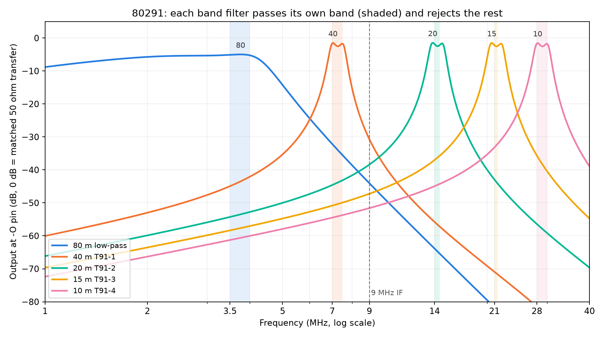
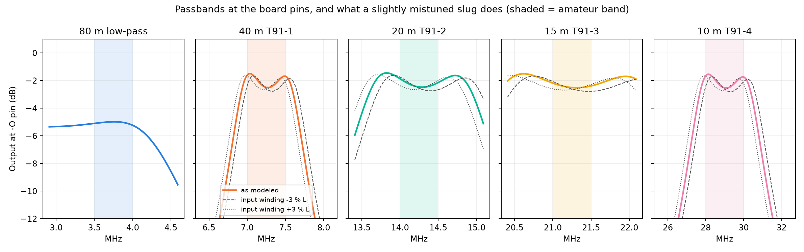
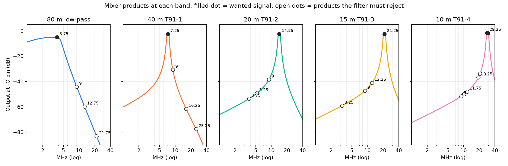
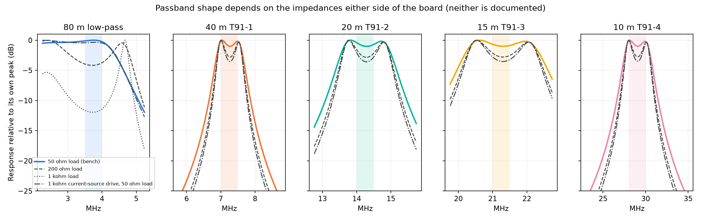

# 80291 band-pass filters

## What this board is for

On transmit, the 80287 transmit mixer moves the 9 MHz SSB or CW signal to the
operating band. It does this by mixing it with the VFO signal. A mixer always
produces more than the one frequency you want. Out of its `OUT` pin come:

- the wanted product;
- a second sum or difference product on the wrong frequency;
- some of the VFO signal leaking straight through;
- some of the 9 MHz signal leaking straight through.

The 80291 board removes everything except the wanted product before the
80285 driver amplifies it. Left in, the unwanted signals would be amplified
all the way to the antenna and radiated as spurious emissions.

The board holds five filters, one per band, and the BAND switch selects one.
Four are **double-tuned band-pass filters**: two tuned circuits, each passing
a narrow range of frequencies, coupled together so the pair passes a flat,
wider range. The fifth, for 80 m, is a **low-pass filter**, which passes
everything below a corner frequency. On 80 m the wanted signal (3.5–4.0 MHz)
is below every unwanted product, so a low-pass is enough.

Ten-Tec describes the board on manual PDF page 41 / printed page 3-25:
"doubled tuned, over-coupled bandpass units for all but the 3.5 MHz band. A
five pole low pass filter is used on this band. These filters are very broad
and require no field alignment." The same page has the schematic, a board
photograph, and the only test the manual gives, a resistance check. The board
is passive and has no supply or voltage table.

## Board pins

The board plugs in with two rows of seven pins. The manual's drawing is
viewed from the top of the board. The right-hand row is the input from the
transmit mixer; the left-hand row is the output to the driver. On the KiCad
sheet the input pins end in `-I` and the output pins in `-O`.

| Pin | What it carries | Useful probe point? |
|:--|:--|:--|
| `GND` (4 pins, both ends of both rows) | Chassis return | Yes; instrument ground |
| `3_5-I` | 80 m: mixer output into C91-1 | Yes with the board out; in the radio it is the mixer output |
| `7.0-I`, `14_0-I`, `21_0-I`, `28_0-I` | Mixer output into the tap of each transformer's input winding | Yes with the board out; low impedance, so a ×10 probe barely disturbs it |
| `3_5-O` | 80 m filtered output to the driver | Yes |
| `7.0-O`, `14_0-O`, `21_0-O`, `28_0-O` | Filtered output from the tap of each transformer's output winding | Yes; this is where the bench checks read the result |

No pin carries a supply voltage, and none should show DC in the radio. Only
the selected band's pair of pins is in use at any time. The BAND switch S4
section F connects 80287 `OUT` to one `-I` pin, and section E takes one `-O`
pin on to the 80285 driver. The 80285 is not yet drawn in this project, so
the S4E pole is still unconnected on the main sheet.

The four transformers' tuned circuits are deliberately not brought out to
pins. Their hot ends are not probe points: a ×10 probe adds 10–15 pF, which
is more than the 10 pF that tunes the 10 m filter.

## How it works, component by component

### The four band-pass filters: T91-1 to T91-4

Each band-pass filter is one shield can (the manual's T1 to T4; T91-1 to T91-4
on the KiCad sheet) holding two slug-tuned windings. A **slug** is a threaded
ferrite core screwed into the coil form; screwing it in raises the coil's
inductance and lowers the frequency it resonates at.

Each winding has a capacitor from its top end to ground. The winding and its
capacitor form a **tuned circuit**: at one frequency, the resonant
frequency, they pass signal far more readily than at any other.

| Can | Band | Input winding (unit A) and its capacitor | Output winding (unit B) and its capacitor |
|:--|:--|:--|:--|
| T91-1 (T1) | 40 m, 7.0–7.5 MHz | unit A with C91-6, 82 pF | unit B with C91-5, 82 pF |
| T91-2 (T2) | 20 m, 14.0–14.5 MHz | unit A with C91-7, 56 pF | unit B with C91-8, 56 pF |
| T91-3 (T3) | 15 m, 21.0–21.5 MHz | unit A with C91-10, 22 pF | unit B with C91-9, 22 pF |
| T91-4 (T4) | 10 m, 28.0–30.0 MHz | unit A with C91-11, 10 pF | unit B with C91-12, 10 pF |

Signal flows the same way in every can:

1. The mixer drives a **tap** a little way up the input winding from the
   grounded end.
2. The input winding's tuned circuit rings at the band frequency.
3. The two windings share the can, so some of the input winding's magnetic
   field passes through the output winding. That **magnetic coupling** drives
   the output tuned circuit.
4. The output winding is also tapped, and the tap feeds the `-O` pin.

**Why each capacitor has its value.** The manual gives the capacitors but not
the inductances. Each winding's inductance is therefore calculated: it must
resonate with its capacitor, plus about 4 pF of winding and board stray
capacitance (estimated), at band centre:

```text
L = 1 / ((2π f)² × C)
T91-1: 1 / ((2π × 7.25 MHz)²  × 86 pF) = 5.60 µH
T91-2: 1 / ((2π × 14.25 MHz)² × 60 pF) = 2.08 µH
T91-3: 1 / ((2π × 21.25 MHz)² × 26 pF) = 2.16 µH
T91-4: 1 / ((2π × 29.0 MHz)²  × 14 pF) = 2.15 µH
```

The 20, 15 and 10 m windings all come out at about 2.1 µH. Ten-Tec probably
used one coil part for the three upper bands and set the band with the
capacitor alone (inferred). The small 10 and 22 pF values are why the stray
estimate matters. A few picofarads of stray is a quarter of the total on
10 m, which is also why nothing should be clipped onto a hot end.

**Why the signal goes in and out at a tap.** A tuned circuit at resonance
looks like a high resistance across its ends, several thousand ohms here.
The mixer and driver work at tens of ohms. A tap works like the secondary of
a step-down transformer: impedance changes with the square of the turns
ratio. For T91-1 the model puts the tap at about 9 % of the turns from
ground (estimated), so:

```text
(1 / 0.092)² ≈ 118
50 Ω at the tap ≈ 5,900 Ω across the whole winding
```

That load sets how sharp the tuned circuit is. **Q**, the quality factor,
measures sharpness: the circuit's −3 dB bandwidth is roughly its resonant
frequency divided by Q. T91-1's winding has a reactance of 255 Ω at 7.25 MHz,
so 5,900 Ω across it gives a Q of about 23. With the coil's own losses
(estimated unloaded Q of 100), each loaded tuned circuit has Q ≈ 19. Tap
higher and Q falls, so the filter gets broader but rejects less; tap lower
and the reverse.

**What "over-coupled" means.** The coupling coefficient k says what fraction
of one winding's field reaches the other. Two tuned circuits are **critically
coupled** when k equals 1/Q: the response then has a single flat top. With k
larger than 1/Q they are **over-coupled**: the response splits into two humps
with a shallow dip between, and the passband widens to roughly k × f0. The
model uses k = 0.08 against 1/Q ≈ 0.053, so k × Q = 1.5 (estimated). That
gives two humps with a dip of about 1 dB between them, a −3 dB width near 10 % of the
band frequency, and wide enough coverage that small tuning errors do not
matter. This is the "very broad" behaviour the manual describes.

### The 80 m low-pass filter

The 80 m wanted product is 3.5–4.0 MHz. Every unwanted product on this band
is higher: 9 MHz IF leak, 12.5–13 MHz VFO leak, and the 21.5–22 MHz sum
product (VFO table, PDF page 26 / printed page 3-10). A low-pass with its
corner just above 4 MHz therefore does the whole job.

- **C91-1 (1500 pF)** is in series with the input. The manual calls it a
  blocking capacitor: it is why the `3_5-I` pin reads infinite resistance.
  Its reactance at 3.75 MHz is 1 / (2π × 3.75 MHz × 1500 pF) = 28 Ω. That is
  negligible in series with the mixer, which behaves as a current source, a
  drive whose current does not depend on what it feeds. On the bench, driven
  from a 50 Ω generator, it causes the slow roll-off below 2 MHz in
  Figure 91-1. The circuit already has a blocking capacitor on the mixer
  board (C87-9), and the manual does not say why a second is needed (open
  question).
- **R91-1 (47 Ω)** goes to ground at the filter input. The mixer is a
  current source, and a low-pass filter only has the response it was
  designed for when it sees a defined resistance at each end. R91-1 provides
  that source resistance, about 47 Ω, so a fixed current from the mixer
  produces a defined voltage at the filter's input. It is also the 47 Ω the
  manual says to read at the output pin: the ohmmeter sees it through L91-1
  and L91-2, which have almost no DC resistance. Without it the filter would
  ring and peak at its corner, as the 1 kΩ case in Figure 91-4 shows.
- **C91-2 (1500 pF), L91-1, C91-3 (1500 pF), L91-2 and C91-4 (750 pF)** form
  the five-pole low-pass, each part counting as one pole. The capacitors
  shunt high frequencies to ground. The coils, drawn on iron or ferrite
  cores, block high frequencies in series. At 3.75 MHz, a 1500 pF capacitor
  is 28 Ω, 750 pF is 57 Ω, and a 2.7 µH coil is 64 Ω. These are comparable
  with the 47–50 Ω circuit, so they shape the passband without blocking it.
  At 9 MHz the capacitors fall to 12 Ω and the coils rise to 153 Ω, so the
  IF leak is strongly attenuated.

The manual does not give the coil values. L91-1 and L91-2 = 2.7 µH each is an
estimate. Fitting the documented capacitors for a flat 3.5–4.0 MHz passband
gives 2.4–3.1 µH for any load from 47 Ω up to an open circuit.

## What a healthy board looks like

- **Resistance from each signal pin to `GND`:** zero on every band-pass pin;
  infinite at `3_5-I`; 47 Ω at `3_5-O`. These are the manual's figures.
- **Each band through 50 Ω at both ends:** the whole amateur band passes with
  a couple of dB of loss, a little more on 80 m because of R91-1, and no more
  than about 1 dB of variation across the band.
- **Band-pass response shape:** two gentle humps, roughly symmetric about
  the band centre.
- **Out of band:** the 9 MHz and VFO frequencies come out at least about
  30 dB down on every band.
- **Slugs:** all eight slugs undisturbed. The wax or paint seal, if present,
  should be intact.

## What each alignment adjustment is doing

The manual gives **no alignment procedure** for this board. It says the
filters are broad and "require no field alignment" (PDF page 41, printed
page 3-25). The slugs were set at the factory.

There are still eight adjustments, two per can. Each slug sets the resonant
frequency of one tuned circuit, so each can has two independent settings.
The input-winding slug and the output-winding slug each move one of the two
humps in Figure 91-2. Turning both the same way moves the whole passband.
Turning only one tilts the top of the passband and makes the two humps
unequal.

The design makes this forgiving. A ±3 % change in one winding's inductance
(the simulation's stand-in for a slug turned a fraction of a turn) moves the
passband edges by under 1 % and costs at most 0.3 dB in the band
(Figure 91-2).

If a previous owner has turned slugs, the symptoms are these:

- low drive on one end of a band only;
- a lopsided response when swept, with one hump clearly taller than the other;
- on 10 m, weak output in either the 28.0 or the 29.5 segment.

Re-aligning needs two conditions satisfied, and so two adjustments made
alternately. **This is a project suggestion, not a Ten-Tec procedure.**

1. Sweep with 50 Ω at both ends, as in the bench check below.
2. Move the two slugs in the same direction until the passband is centred on
   the band.
3. Move them in opposite directions until the two humps are equal.

Never align by peaking the output at a single frequency. That pulls both
circuits onto one frequency and leaves an over-coupled pair badly lopsided.

The 80 m low-pass has no adjustment.

## Simulation evidence

The study is in
[`spice/studies/80291/operation/`](spice/studies/80291/operation/README.md),
regenerated by `spice/tools/run_80291_operation.py`. It exports this KiCad
sheet, checks every documented part and connection, and measures at the
board pins only.

### Passbands and slug tolerance

#### How this part of the circuit works

The selected `-I` pin drives a tap on the input winding. Each tuned circuit
is damped by the impedance at its tap, and the coupling between the two
windings sets how far the two humps of the response separate. On 80 m, R91-1
terminates the input and the five-pole low-pass shapes the response.

#### What a working circuit should show

- **Band-pass filters:** each covers its whole amateur band (10 m: all of
  28.0–30.0 MHz) with a twin-humped, nearly flat top and steep skirts.
- **Low-pass:** flat to just above 4 MHz, then falling fast.
- **Slugs:** small changes to one slug should not move a band edge out of the
  passband.

#### How the simulation tests it

A 50 Ω generator with 2 V EMF drives each `-I` pin, and a 50 Ω resistor loads
each `-O` pin: exactly the bench arrangement. The sweep runs 0.5–40 MHz in
10 kHz steps. 0 dB means the output equals what the generator would put
straight into 50 Ω, so the plotted number is the filter's insertion loss.
Two extra runs change the inductance of every input winding by −3 % and
+3 %.

#### What the simulation showed



**Figure 91-1.** Each 80291 filter passes its own band (shaded) and rejects the others; the 9 MHz IF is marked



**Figure 91-2.** The passbands at the board pins, with every mixer-side winding detuned by ±3 % inductance

| Filter | Output across the band | −3 dB edges |
|:--|--:|:--|
| 80 m low-pass | −5.2 to −5.0 dB | upper corner 4.44 MHz |
| 40 m T91-1 | −2.5 to −1.5 dB | 6.87–7.65 MHz |
| 20 m T91-2 | −2.5 to −1.9 dB | 13.50–15.04 MHz |
| 15 m T91-3 | −2.5 to −2.2 dB | 20.13–22.44 MHz |
| 10 m T91-4 | −2.5 to −1.5 dB | 27.47–30.62 MHz |

In voltage terms, −2.5 dB is about three-quarters of the voltage and −5 dB
about 56 %. A 1 dB variation across a band is roughly a 12 % change in drive,
far less than the DRIVE control's range.

The 80 m filter looks lossier on the bench only because R91-1 sits across
the generator's 50 Ω and absorbs about half the current. Driven by the
mixer's current source in the radio, R91-1 is the intended termination. The
study's high-impedance-drive run shows the 80 m passband flat within 0.1 dB
in that case (`metrics.csv`, case `mixer-drive`).

With ±3 % on each input winding, every band stays inside its −3 dB edges.
The edges move by 0.7–0.9 %, and the worst in-band output falls only from
−2.5 to −2.8 dB. Edge frequencies are read off a 10 kHz grid.

#### Does it meet expectations?

**Partial pass.** The sheet produces five correctly placed filters with the
broad, two-humped, alignment-tolerant behaviour the manual describes. The
passband widths, however, follow from the estimated taps and coupling, which
were chosen for 50 Ω terminations. They show that the estimates are
self-consistent. They are not an independent confirmation of the hardware.

#### Limits and evidence status

- **Documented:** topology, all capacitors, R91-1, and band coverage.
- **Calculated:** the four winding inductances.
- **Estimated:** stray capacitance, unloaded Q, tap positions, k = 0.08, and
  2.7 µH for L91-1/L91-2.
- **Unknown:** the real terminations, coil losses, and factory slug settings.
  No measurement exists.

#### Bench check

*Not yet performed. This is the proposal.* Full procedure:
[`bench/80291/README.md`](bench/80291/README.md), section 2.

| Setup item | Connection or setting |
|:--|:--|
| Board | Out of the radio; nothing else connected |
| Generator | 50 Ω, about 0 dBm sine, to the band's `-I` pin |
| Receiver | Scope or RF voltmeter on the band's `-O` pin through a 50 Ω feed-through |
| Reference | Generator straight into the same feed-through = 0 dB |
| Do not disturb | Any slug |

Record the reference first, then insert the board without changing cables or
level.

| Filter | Frequencies (MHz) | Simulated (dB) | Measured (dB) |
|:--|:--|--:|--:|
| 80 m | 3.5 / 3.75 / 4.0 | −5.1 / −5.0 / −5.2 | |
| 40 m T91-1 | 7.0 / 7.25 / 7.5 | −1.6 / −2.5 / −1.7 | |
| 20 m T91-2 | 14.0 / 14.25 / 14.5 | −1.9 / −2.5 / −2.1 | |
| 15 m T91-3 | 21.0 / 21.25 / 21.5 | −2.2 / −2.5 / −2.4 | |
| 10 m T91-4 | 28.0 / 29.0 / 30.0 | −1.7 / −2.5 / −1.7 | |

This pins down the estimated coupling and coil Q. Hump spacing gives k; loss
at the hump peaks gives Q.

### Rejection of the unwanted mixer products

#### How this part of the circuit works

Each band has its own set of mixer products. On 80 m and 40 m the radio uses
VFO − 9 MHz, so the sum VFO + 9 MHz is unwanted. On 20, 15 and 10 m it uses
VFO + 9 MHz, so the difference is unwanted. On every band, some VFO and some
9 MHz signal also leak through the mixer. The selected filter has to pass
the one wanted frequency and attenuate the rest.

#### What a working circuit should show

Every unwanted product should be well down relative to the wanted one. The
hardest case should be 40 m, whose 9 MHz IF leak is only 1.75 MHz above the
band. The manual's 80285 page (PDF page 42, printed page 3-26) is consistent
with this: on 7 MHz only, S4C/S4D switch in a further low-pass filter "to
reduce higher order mixer products".

#### How the simulation tests it

Using the same 50 Ω bench sweep, the runner reads the output at each mixer
product. The frequencies come from the manual's VFO table (PDF page 26 /
printed page 3-10) at mid-segment. 10 m is checked at both its 28.0 and its
29.5 MHz segments.

#### What the simulation showed



**Figure 91-3.** The wanted mixer product (filled) and the products each filter must reject (open) on every band

| Band | Weakest rejection | Other products |
|:--|:--|:--|
| 80 m | 9 MHz IF leak, 39 dB | VFO 55 dB; sum 78 dB |
| 40 m | 9 MHz IF leak, 28 dB | VFO 59 dB; sum 75 dB |
| 20 m | 9 MHz IF leak, 36 dB | VFO 47 dB; difference 51 dB |
| 15 m | VFO leak at 12.25 MHz, 39 dB | IF 45 dB; difference 57 dB |
| 10 m | VFO leak at 20.75 MHz (29.5 segment), 32 dB | IF 50 dB; differences 46–48 dB |

28 dB is a voltage ratio of about 25 to 1; 39 dB is about 90 to 1.

#### Does it meet expectations?

**Partial pass.** The pattern is plausible: 40 m is the weak case, the band
Ten-Tec gave an extra low-pass, and the true sum and difference products are
suppressed hardest. Absolute figures depend on the estimated magnetics and
50 Ω terminations, and on how much leakage the mixer really produces, which
is not modelled here.

#### Limits and evidence status

- **Documented:** the frequency plan, and the extra 7 MHz low-pass in the
  80285.
- **Calculated:** product frequencies.
- **Estimated:** the response depth.
- **Unknown:** real terminations and the radio's actual spurious output.

#### Bench check

*Not yet performed. This is the proposal.* Same setup and reference as the
passband check; full procedure in [`bench/80291/README.md`](bench/80291/README.md).

| Filter | Frequency (MHz) | What it is | Simulated (dB) | Measured (dB) |
|:--|--:|:--|--:|--:|
| 80 m | 9.0 | IF leak | −44.0 | |
| 40 m T91-1 | 9.0 | IF leak | −30.7 | |
| 20 m T91-2 | 9.0 | IF leak | −38.4 | |
| 15 m T91-3 | 12.25 | VFO leak | −41.0 | |
| 10 m T91-4 | 20.75 | VFO leak, 29.5 segment | −33.7 | |

Skirt depth tests the estimated tap positions and coupling independently of
the passband shape.

### Dependence on the impedances either side of the board

#### How this part of the circuit works

The taps are low on each winding, so a tap only makes sense if the circuits
either side are low impedance. A higher impedance damps the tuned circuits
less, raises their Q, and with k fixed pushes the pair further into
over-coupling.

#### What a working circuit should show

If the real terminations are near 50 Ω, the shapes of Figure 91-1 hold. If
they are much higher, each band-pass response should narrow, with a deeper
dip between humps. The low-pass should develop a peak near its corner.

#### How the simulation tests it

The bench sweep is repeated three more ways:

- with a 200 Ω load;
- with a 1 kΩ load;
- with a 1 kΩ current-source drive and a 50 Ω load, standing in for a
  high-impedance mixer output.

Each curve is plotted relative to its own peak, so shape can be compared
regardless of level.

#### What the simulation showed



**Figure 91-4.** Passband shape for 50 Ω, 200 Ω, and 1 kΩ loads and for a high-impedance drive, each relative to its own peak

- **200 Ω:** every band is still covered, but the variation across the band
  grows to about 2.8 dB on 40 m and 10 m, and 1.3 dB on 20 m.
- **1 kΩ:** the 40 m filter's −3 dB width shrinks to 6.91–7.18 MHz and the
  10 m filter's to 27.63–28.73 MHz. Neither covers its band any longer. The
  80 m low-pass peaks 9.4 dB at 4.67 MHz, and its passband sits about 12 dB
  below that peak.
- **High-impedance drive:** identical band-pass shapes to the 1 kΩ load. The
  two windings are alike, so it does not matter which end the high
  impedance is on.

#### Does it meet expectations?

**Pass**, as a test of the design reasoning: the filters only behave as the
manual describes when both ends are low impedance. This is a sensitivity
result, not a claim about the radio.

#### Limits and evidence status

The 80285 input impedance and the 80287 output impedance are both
undocumented. They are the largest uncertainty on this board, larger than any
of the estimated magnetics.

#### Bench check

*Not yet performed. This is the proposal.* See
[`bench/80291/README.md`](bench/80291/README.md), section 3. It is the
passband check with the 50 Ω feed-through replaced by a 1 kΩ resistor and a
×10 probe.

| Filter | Quantity | Simulated | Measured |
|:--|:--|--:|--:|
| 40 m T91-1 | −3 dB edges | 6.91–7.18 MHz | |
| 10 m T91-4 | −3 dB edges | 27.63–28.73 MHz | |
| 10 m T91-4 | Output at 29.0 MHz relative to peak | −3.5 dB | |

Comparing this with the 50 Ω sweep separates tap position from coupling,
which one sweep alone cannot.

### Resistance to chassis

#### How this part of the circuit works

Every band-pass pin connects through a tap and a few turns of wire to
ground. The 80 m input goes through C91-1, which blocks DC. The 80 m output
goes through L91-2 and L91-1 to R91-1.

#### What a working circuit should show

The manual's figures: zero, infinite, and 47 Ω.

#### How the simulation tests it

A DC analysis pushes 1 mA into every pin and divides the resulting voltage by
1 mA.

#### What the simulation showed

| Pin | Manual | Simulated |
|:--|:--|--:|
| `3_5-I` | infinite | open (10¹² Ω leakage floor) |
| `3_5-O` | 47 Ω | 47 Ω |
| every band-pass pin | zero | 0.02 Ω |

#### Does it meet expectations?

**Pass.** This is the one check that does not depend on any estimate. It
confirms the sheet's topology and the corrected direction of its pins.

#### Limits and evidence status

The documented figures are reproduced exactly. The 0.02 Ω is the model's
tap-section loss resistance, not a real winding resistance.

#### Bench check

*Not yet performed. This is the proposal.* See
[`bench/80291/README.md`](bench/80291/README.md), section 1. Use an ohmmeter
from each signal pin to `GND`, board out of the radio, leads nulled first.

| Pin | Simulated | Measured |
|:--|--:|--:|
| `3_5-I` | open | |
| `3_5-O` | 47 Ω | |
| `7.0-I` / `7.0-O` | 0 Ω / 0 Ω | |
| `14_0-I` / `14_0-O` | 0 Ω / 0 Ω | |
| `21_0-I` / `21_0-O` | 0 Ω / 0 Ω | |
| `28_0-I` / `28_0-O` | 0 Ω / 0 Ω | |

This catches broken taps, leaky C91-1, or a failed R91-1 before any RF test.

## Simulations still to be done

### Mixer, filter and driver together

- **What it would show:** the real passband and spurious levels in the
  radio, with 80287 `OUT` driving the selected filter and the 80285 input
  loading it. This replaces the 50 Ω assumptions in every result above.
- **Method:** once the 80285 sheet exists, connect S4E to its `IN` pin and
  run the 80287 transmit fixture through the band switch on each band. Read
  the spectrum at 80291 `-O`.
- **Expected:** the wanted product well above every other product, with 40 m
  the weakest case.
- **Bench counterpart:** with the radio transmitting into a dummy load and
  DRIVE low, a spectrum analyser on the `-O` pin through a high-impedance
  probe.

*Not yet performed.*

| Band | Wanted minus worst spur, simulated | Measured |
|:--|--:|--:|
| 40 m | not yet simulated | |
| 10 m | not yet simulated | |

### 80285 input impedance

- **What it would show:** the load the 80291 actually works into, the single
  largest unknown above.
- **Method:** an AC impedance sweep at the 80285 `IN` pin once that board is
  drawn.
- **Expected:** low, under a few hundred ohms, if the 80291 taps are to make
  sense.
- **Bench counterpart:** a VNA or a 50 Ω bridge at the driver's `IN` pin,
  with the 80291 removed and the radio in transmit at minimum drive.

*Not yet performed.*

| Band | Simulated input impedance | Measured |
|:--|--:|--:|
| 7.25 MHz | not yet simulated | |
| 29.0 MHz | not yet simulated | |

## Evidence status and open questions

- **Documented** (PDF page 41 / printed page 3-25):
  - topology and every capacitor value;
  - R91-1;
  - the band-pass/low-pass split;
  - the pin resistances;
  - "no field alignment".
- **Calculated:** winding inductances from resonance at band centre.
- **Estimated:**
  - 4 pF stray capacitance;
  - unloaded Q of 100;
  - tap positions;
  - k = 0.08;
  - L91-1 and L91-2 at 2.7 µH.
- **Unknown:**
  - the 80287 output and 80285 input impedances;
  - real coil construction and the factory slug settings;
  - why a blocking capacitor is needed both here (C91-1) and on the mixer
    (C87-9);
  - whether the second slug in each can is adjusted from below. The
    photograph shows one slug opening per can, while the schematic draws
    both windings as adjustable.
- **Corrections made to the KiCad sheet against the manual:**
  - The input and output labels had been swapped. The mixer side is now
    `-I`.
  - A duplicated C91-1 is now C91-2.
  - The grounds of C91-2, C91-3 and C91-4 had not been connected.
  - The windings are now T91-1 to T91-4, one two-unit part per can, matching
    the manual's T1 to T4.
