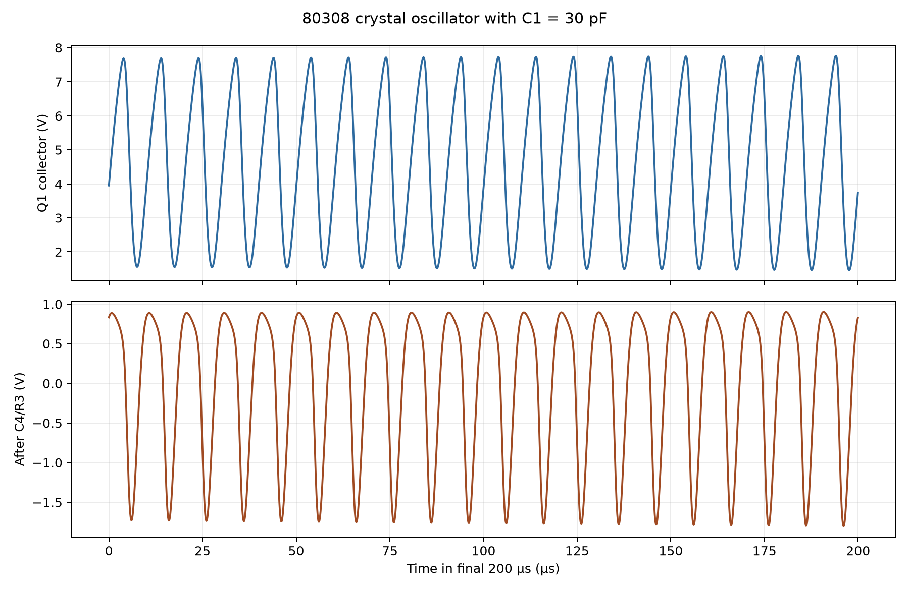
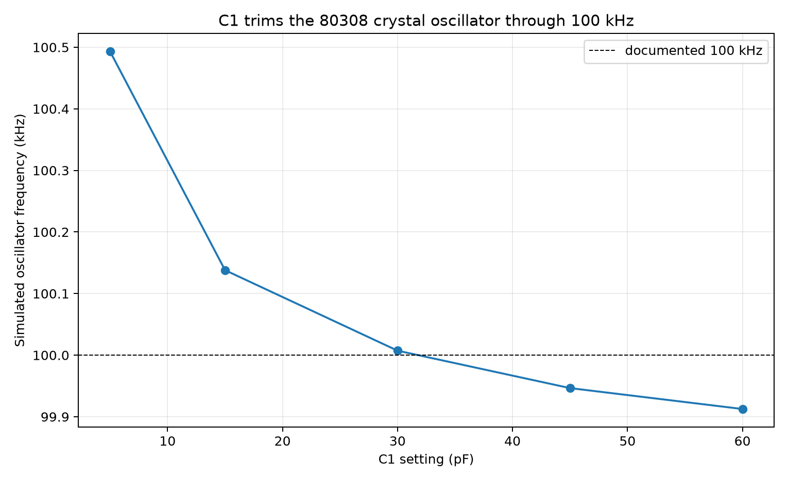
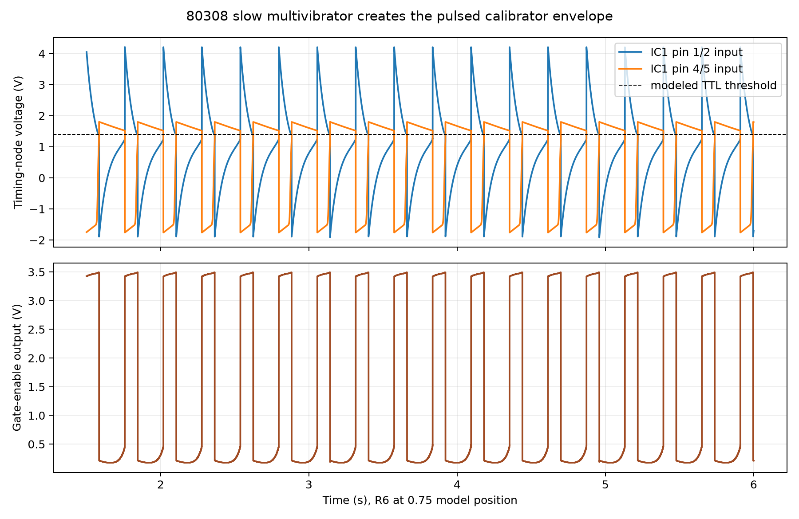
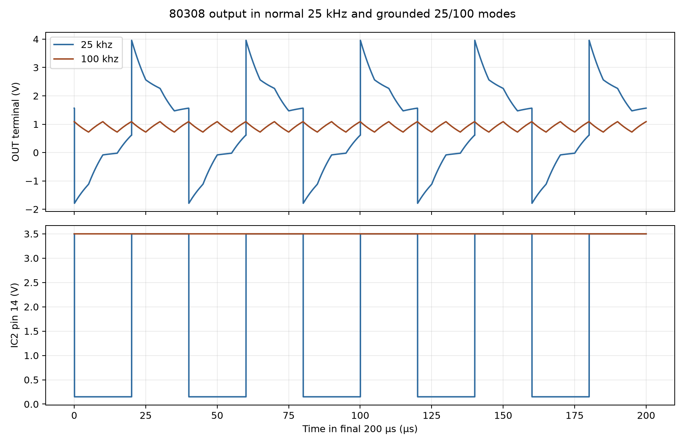
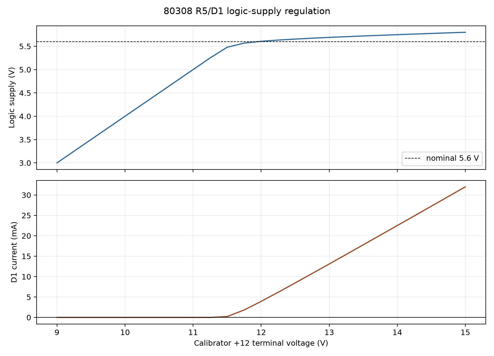

# 80308 crystal calibrator

## What this board is for

The 80308 board gives the receiver known frequency markers every 25 kHz. Its
100 kHz crystal oscillator supplies the accurate reference; a two-stage divider
adds the intermediate 50 and 25 kHz states, and a slow gate turns the markers
into an easily recognized pulsed tone. When CALIBRATE is pulled on, the board
also pulls the RF-amplifier `DEFEAT` line low so the strong marker does not
overload the receiver.

Ten-Tec describes this operation on manual PDF page 36 / printed page 3-20 and
draws the board on PDF page 37 / printed page 3-21. The front-panel operating
instructions are on PDF page 9 / printed page 2-4. The manual calls the crystal
and trimmer `Y1` and `C1`; the project references are `Y08-1` and `C08-1` so
they remain unique in the complete radio.

## Board pins

| Pin marking | What it carries | Useful probe point? |
|:--|:--|:--|
| `25/100` | Normally open. Grounding it suppresses the divided 25 kHz contribution, leaving the direct 100 kHz output. | Use as a control connection, not a measurement point. Ground only to the adjacent board/chassis ground. |
| `OUT` | Composite calibrator signal: divided 25 kHz plus a smaller direct 100 kHz component in normal operation. | Yes. Use a ×10 oscilloscope probe or a high-impedance counter input. |
| `GND` | Signal and power return. | Yes; preferred instrument ground. |
| `N.C.` | No connection. | No. Do not use as a tie point. |
| `DEFEAT` | Open/high at about 3.9 V with the calibrator off; IC08-1 pulls it to about 0.1 V when on. | Yes for a DC meter. It is shared with the RF-amplifier gain-control circuit. |
| `+12` | Switched calibrator supply: the manual gives 13.8 V on and 0 V off. It is not a permanently live 12 V rail. | Yes for a DC meter. |
| `GND` | Second board return connection. | Yes. |

## How the circuit works, component by component

### The 100 kHz reference oscillator

`Q08-1` (MPS6514) is the active device in the crystal oscillator. `R08-2`
feeds its collector from the switched 13.8 V supply; using the manual's 5.3 V
collector reading gives approximately `(13.8 - 5.3) / 2.2 kΩ = 3.9 mA` through
that resistor. `R08-1` returns a small amount of collector bias to the base so
the transistor can start.

`Y08-1` is the frequency-determining 100 kHz crystal. `C08-1`, adjustable from
5 to 60 pF, changes the crystal's load and trims the oscillation to exactly
100 kHz. `C08-2` bypasses the base at RF; its reactance at 100 kHz is about
`1.59 kΩ`. `C08-3` bypasses the supply side of the collector circuit; 3 nF is
about `531 Ω` at 100 kHz. Without these two capacitors the transistor's bias and
feedback path would be much more sensitive to wiring and supply impedance.

`C08-4` couples the oscillator into the logic without passing collector DC.
Its 200 pF reactance is about `8.0 kΩ` at 100 kHz. `R08-3` limits the current
into the TTL input and, together with `R08-4`, shapes the drive pulse.
`R08-4` supplies a defined return to ground; without it the first
logic input could float and respond to noise.

### The slow pulse generator and carrier gate

The first two NAND sections of `IC08-1` (SN7400) form an astable
multivibrator—two inverting stages cross-coupled so they repeatedly change
state. `C08-6` (200 µF) couples the first output to the second input, while
`C08-7` (33 µF) couples the second output back to the first input. `R08-7`
discharges the `C08-6` timing node; its simple time constant is
`3.3 kΩ × 200 µF = 0.66 s`. `R08-6` is the 10 kΩ SPEED control and sets the
charge/discharge path for `C08-7`, whose maximum `RC` product is about 0.33 s.
At either end of the control travel one timing node is held in a stable state,
so the pulsing stops as Ten-Tec states.

The third NAND section receives the 100 kHz oscillator on one input and the
slow multivibrator on the other. It therefore passes bursts of 100 kHz rather
than a continuous marker. `R08-9` couples this direct 100 kHz path to `OUT`.

The fourth NAND section has both inputs tied high. When its regulated supply is
present its output is low, pulling `DEFEAT` down. When the board is unpowered,
the RF-amplifier circuit supplies the approximately 3.9 V off-state level.

### The 25 kHz divider and output

`IC08-2` (SN7476) contains two J-K flip-flops. A J-K flip-flop is a one-bit
memory element; with J and K high it toggles on each active clock edge and
therefore divides frequency by two. The unconnected J, K, preset, and clear
pins deliberately use original TTL's tendency to read an open input as high.
The first stage takes gated 100 kHz to 50 kHz and clocks the second stage,
which produces 25 kHz.

`C08-8` AC-couples the 25 kHz divider output to `OUT`; its reactance at 25 kHz
is about `636 Ω`. `R08-8` gives `OUT` a 2.2 kΩ return to ground. `R08-9` adds
the direct 100 kHz signal, so normal output contains a strong 25 kHz component
and a smaller 100 kHz component. Grounding `25/100` asynchronously fixes the
divider state, removing the 25 kHz transitions while leaving the direct path.

### Logic supply regulator

`R08-5` and `D08-1` form a shunt regulator: `R08-5` limits current and the
1N752A zener holds the IC supply near 5.6 V. At 13.8 V, the resistor has about
`(13.8 - 5.6) / 100 Ω = 82 mA` available for both ICs and the zener. `C08-9`
bypasses the regulated rail; its 10 nF reactance at 100 kHz is about `159 Ω`.
`C08-5` provides broader 0.1 µF decoupling on the incoming switched supply.
Without these capacitors, logic switching current could modulate the oscillator
and create unwanted sidebands.

## What a healthy board looks like

- With CALIBRATE off: `+12` is 0 V and `DEFEAT` is about 3.9 V with RF gain full on.
- With CALIBRATE on: `+12` is about 13.8 V, the IC rail is near 5.6 V, and `DEFEAT` falls near 0.1 V.
- `OUT` carries pulsed markers at 25 kHz spacing; grounding `25/100` leaves 100 kHz spacing.
- The pulse rate changes through the useful portion of R08-6 travel and stops near either extreme.
- C08-1 can bring the oscillator into zero beat with WWV; it should not sit hard against an end stop.
- The receiver signal level drops while calibrating, but does not disappear completely.

## What the adjustments are doing

### C08-1 frequency adjustment

The electrical problem is crystal and stray-capacitance tolerance: the
oscillator must be exactly 100 kHz for every 25 kHz marker to be useful. C08-1
is the single independent frequency adjustment. Increasing its capacitance
lowers frequency in the model; decreasing it raises frequency.

Ten-Tec's procedure is to receive WWV at 10 or 15 MHz, zero-beat the station,
then turn on the calibrator and adjust C08-1 until its pulsed zero beat
coincides with WWV (manual PDF pages 11–12 / printed pages 2-6–2-7, and PDF
page 36 / printed page 3-20). WWV supplies the frequency standard; the pulsing
makes the internally generated marker easy to distinguish. A wrong result is
a beat note that speeds up instead of approaching zero: increase C08-1 if the
calibrator is high, decrease it if the calibrator is low. Do not use the dial
skirt alone as the standard.

### R08-6 speed adjustment

R08-6 changes how quickly the timing capacitors cross the TTL threshold. It is
one adjustment for listening preference, not a frequency-standard alignment.
Move it away from either end until the marker pulses reliably, then choose a
comfortable rate. If the marker becomes continuous or disappears, move the
control back toward the operating region.

## Simulation evidence

The detailed setup, retained CSVs, and reproduction command are in
[`spice/studies/80308/operation/README.md`](spice/studies/80308/operation/README.md).
The studies are staged because a several-tenths-of-a-second pulse period and a
10 µs carrier period cannot both be shown clearly in one plot.

### Crystal oscillator and C08-1 alignment

**How it works.** Q08-1 supplies gain, Y08-1 selects the resonant frequency,
and C08-1 pulls the loaded resonance. C08-4/R08-3 deliver the waveform to
IC08-1 without placing a scope probe directly across the crystal.

**What a working circuit should show.** It should start, produce a stable
waveform close to 100 kHz, and cross 100 kHz somewhere within C08-1's 5–60 pF
range. The manual gives 5.3 V at the collector and a base reading printed as
`-2.0 V`.

**How the simulation tests it.** A 13.8 V transient run uses the schematic
Q08-1 network and a fitted motional model for Y08-1. Five C08-1 settings were
run from 5 to 60 pF. Collector and post-C08-4 nodes are internal,
simulation-only observations; probing the crystal or base on hardware adds
capacitance and can move or stop the oscillator.

**Figure 08-1.** Q08-1 collector waveform and the signal delivered through C08-4/R08-3

**Figure 08-2.** The fitted oscillator model crosses 100 kHz within C08-1's adjustment range

**What it showed.** C08-1 at 30 pF produced 100,007 Hz, a 6.30 V peak-to-peak
collector waveform, 2.70 V peak-to-peak after C08-4/R08-3, and 4.63 V
collector DC. Increasing C08-1 from 5 to 60 pF moved frequency from 100.493 to
99.913 kHz. The sweep contains only five capacitor settings, so it resolves
the adjustment curve in 10–15 pF steps; 30 pF is not claimed as a factory
setting.

**Does it meet expectations? Partial pass.** Startup, amplitude, adjustment
direction, and the 100 kHz crossing are reproduced. Collector DC is about
12.6% below the manual's 5.3 V and remains within the manual's general ±15%
service tolerance. The modeled base average is +0.70 V, not the manual's
printed `-2.0 V`; that discrepancy requires hardware measurement and may
reflect waveform-sensitive 1970s meter readings or an inadequate Q1/crystal
model.

**Limits and evidence status.** Frequency and component values are documented.
The Y08-1 motional values are fitted, and simulated amplitude is not a factory
specification.

**Bench check — not yet performed; this is the proposal.**

| Item | Setup |
|:--|:--|
| Instruments | Frequency counter, ×10 oscilloscope probe, high-impedance DC meter |
| Connections | Counter/scope to board `OUT`; meter to Q08-1 collector, then base; all grounds to board `GND` |
| Controls | CALIBRATE on, R08-6 in its pulsing region, `25/100` grounded for the clearest 100 kHz reading |
| Safety | Do not probe directly across Y08-1 or C08-1; probe capacitance will change the adjustment |

| Quantity | Simulated | Measured |
|:--|--:|--:|
| Frequency at selected C08-1 setting | 100.007 kHz | |
| Q08-1 collector DC | 4.63 V | |
| Q08-1 collector waveform | 6.30 V p-p | |
| Q08-1 base DC | +0.70 V | |

This measurement would determine the unknown crystal motional resistance and
resolve the base-voltage discrepancy. Detailed procedure:
[`bench/80308/README.md`](bench/80308/README.md).

### Slow pulse generator

**How it works.** IC08-1's first two gates, C08-6, C08-7, R08-6, and R08-7
form the slow multivibrator. The third gate uses its output as the enable for
the 100 kHz carrier.

**What a working circuit should show.** The enable must alternate between TTL
low and high through a useful part of R08-6 travel and stop at both extremes.

**How the simulation tests it.** Twelve R08-6 positions from 0.02 to 0.98 were
run for six seconds with the actual timing values. The 0.75 position is shown.

**Figure 08-3.** The timing nodes cross the modeled TTL threshold and produce the pulsed enable

**What it showed.** Positions 0.70, 0.75, and 0.80 oscillated at 3.44, 3.85,
and 4.71 Hz respectively, with periods of 0.291, 0.259, and 0.212 s. Positions
near both ends latched with no continuing transitions.

**Does it meet expectations? Pass for function, partial for control range.**
The required pulsing and end-stop behavior appear, but the narrow simulated
operating window is strongly dependent on the fitted TTL threshold and output
impedance. It is not a prediction of the physical knob's calibrated position.

**Limits and evidence status.** Capacitor and resistor values are documented;
the SN7400 transfer curve and exact pot mapping are fitted.

**Bench check — not yet performed; this is the proposal.**

| Item | Setup |
|:--|:--|
| Instruments | Oscilloscope or frequency counter with period mode |
| Connections | Probe board `OUT`, referenced to board `GND` |
| Controls | CALIBRATE on; sweep R08-6 slowly from end to end |
| Safety | Use a ×10 probe and do not short the adjacent IC pins |

| R08-6 condition | Simulated pulse rate | Measured pulse rate |
|:--|--:|--:|
| Model position 0.70 | 3.44 Hz | |
| Model position 0.75 | 3.85 Hz | |
| Model position 0.80 | 4.71 Hz | |
| Either extreme | stopped | |

This check would fit the real SN7400 switching threshold and the useful R08-6
travel.

### Divider and `25/100` mode

**How it works.** The gated 100 kHz clocks the two SN7476 stages. Their divided
25 kHz output enters `OUT` through C08-8 while R08-9 also supplies direct
100 kHz.

**What a working circuit should show.** Normal mode should have a dominant
25 kHz component. Grounding `25/100` should remove it while retaining 100 kHz.

**How the simulation tests it.** A 2 ms fast transient uses the actual IC
models, R08-8, R08-9, and C08-8. The slow gate is held on so individual carrier
cycles are visible. Results are measured at the board `OUT` terminal.

**Figure 08-4.** Board `OUT` in normal 25 kHz mode and with `25/100` grounded

**What it showed.** Normal mode contained 3.55 V p-p at 25 kHz plus 0.313 V
p-p at 100 kHz. With `25/100` grounded, the residual fitted 25 kHz component
was only 67 µV p-p while the 100 kHz component remained 0.320 V p-p.

**Does it meet expectations? Pass.** The divider, composite output, and mode
selection all operate in the documented direction.

**Limits and evidence status.** Frequencies and topology are documented.
Amplitudes depend on fitted TTL levels and the modeled load at `OUT`.

**Bench check — not yet performed; this is the proposal.**

| Item | Setup |
|:--|:--|
| Instruments | ×10 oscilloscope and frequency counter |
| Connections | Both instruments to board `OUT` and `GND` |
| Controls | CALIBRATE on; record once with `25/100` open and once grounded |
| Safety | Ground `25/100` only to board/chassis ground; do not apply voltage |

| Mode | Simulated dominant output | Measured dominant output |
|:--|--:|--:|
| `25/100` open | 25 kHz, 3.55 V p-p component | |
| `25/100` grounded | 100 kHz, 0.320 V p-p component | |

This check would establish the actual `OUT` load and TTL output amplitudes.

### Logic regulator and DEFEAT output

**How it works.** R08-5/D08-1 supply the logic while IC08-1's fourth gate
pulls `DEFEAT` low. The off-state voltage comes from the RF-amplifier side.

**What a working circuit should show.** The logic rail should remain near
5.6 V at the manual's 13.8 V input. `DEFEAT` should be about 0.1 V on and
3.9 V off.

**How the simulation tests it.** The regulator is swept from 9 to 15 V with a
fitted 60 mA logic load. A separate transient includes a 10 kΩ pull-up to
3.9 V representing the RF-amplifier side and observes the board terminal.

**Figure 08-5.** D08-1 regulation voltage and available zener current versus switched supply

**What it showed.** At the 13.75 V sweep sample, the rail was 5.735 V and D08-1
carried 20.15 mA. The model entered the defined 5.4 V-or-higher regulation
region at 11.5 V. `DEFEAT` was 0.163 V powered and 3.89996 V unpowered.

**Does it meet expectations? Pass.** Logic voltage is within 2.4% of 5.6 V;
the DEFEAT values reproduce the manual's approximately 0.1/3.9 V states.

**Limits and evidence status.** The 1N752A voltage and manual terminal readings
are documented. The 60 mA package load, zener curve, and external 10 kΩ pull-up
are fitted values.

**Bench check — not yet performed; this is the proposal.**

| Item | Setup |
|:--|:--|
| Instruments | Two high-impedance DC meters or a two-channel oscilloscope |
| Connections | Logic rail at D08-1 cathode; second channel at board `DEFEAT`; common to board `GND` |
| Controls | RF gain full clockwise; switch CALIBRATE off, then on |
| Safety | Do not ground the 5.6 V rail; current through R08-5 is roughly 80 mA |

| Quantity | Simulated | Manual | Measured |
|:--|--:|--:|--:|
| Logic rail, on | 5.735 V | 5.6 V | |
| `DEFEAT`, on | 0.163 V | 0.1 V | |
| `DEFEAT`, off | 3.900 V | 3.9 V | |

This check would fit the combined SN7400/SN7476 supply current and the real
RF-amplifier pull-up impedance.

## Evidence status and open questions

- **Documented:** topology, all board component values, 100/25 kHz operation,
  C08-1 and R08-6 functions, 5.6 V regulation, terminal voltages, and the WWV
  alignment method.
- **Calculated:** reactances, time constants, resistor currents, simulated
  periods, frequencies, and voltage components quoted above.
- **Fitted:** SN7400/SN7476 behavioral parameters, 60 mA logic load, zener
  curve, external DEFEAT pull-up, and Y08-1 motional model.
- **Unknown:** the original crystal's motional parameters, real logic supply
  current, actual `OUT` loading, why the manual reports Q08-1 base at `-2.0 V`,
  and the physical R08-6 position corresponding to the model's operating window.

No bench check in this document has yet been performed; every measured column
is intentionally blank.
