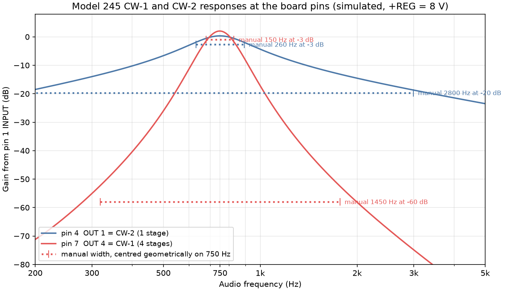
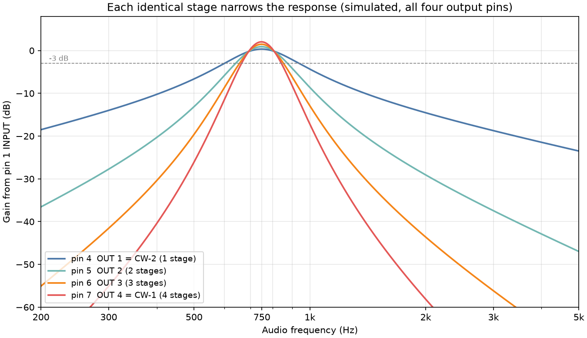
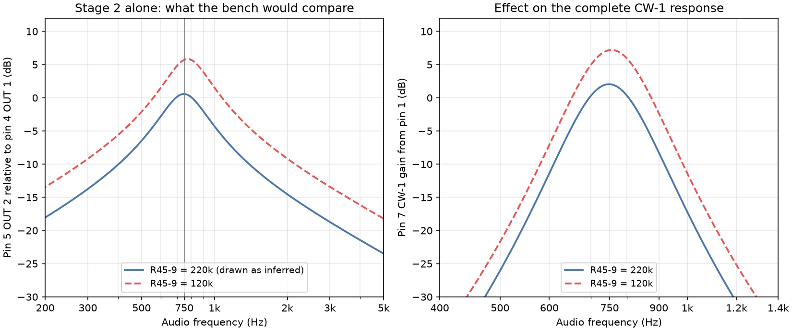

# Model 245 operation study

See the [board explanation](../../../../245.md) for what these results mean,
and the [bench procedure](../../../../bench/245/README.md) for the matching
hardware checks. Regenerate everything from the repository root:

```powershell
python spice/tools/run_245_operation.py
```

The runner requires KiCad 10 (`kicad-cli`), ngspice and Matplotlib. Set
`KICAD_CLI` or `NGSPICE_EXE` to use other installations. Generated decks,
raw files and logs go to `spice/generated/245-operation/`, which is not
versioned.

## Source circuit

Each run starts with a fresh SPICE export of
[245_cw_filt.kicad_sch](../../../../245_cw_filt.kicad_sch). The runner checks
the export before simulating and refuses to run if any of these is missing:

- the input network, R45-9, both output coupling capacitors, C45-7 and the bias feed;
- both ICs exported as 14-pin `MC1747` subcircuits.

The circuit is therefore the schematic, not a transcription. The runner adds
only:

- `VREG` on the `+REG` net (board pin 3);
- `VIN`, an ideal source with 1 V AC and 0 V DC, on the `IN` net (board pin 1);
- for run `ac-r9-120k`, R45-9 changed from 220k to 120k.

Outputs (pins 4–7) are unloaded, as on a bench with a high-impedance probe.
The µA747C is represented by the project's
[MC1747 macromodel](../../../models/MC1747.sub). Motorola states the MC1747C
is pin-for-pin and electrically equivalent to the µA747C
([datasheet](../../../../datasheets/MC1747_MC1747C_Motorola_1976.pdf), printed
p.3-83).

## Assumptions

- +REG is 8.0 V for the nominal runs. The 540 chassis wiring (PDF p.21 /
  printed p.3-4) feeds socket +REG from the 80280 regulator, about 8 V. The
  13 V runs reproduce the conditions of the 245 sheet's voltage table
  (PDF p.2 / printed p.3-41).
- R45-9 = 220k is an inference. The scan reads "?20K".
- Component values are nominal. Tolerance is not modelled here.
- The macromodel's small-signal response does not change with supply, so
  `ac-13v` matches `ac-nominal` to better than 0.0001 dB. That is a property
  of the macromodel. It confirms that only the bias point moves, but it does
  not prove a real 747 behaves identically at 8 V and 13 V.

## Retained data

| File | Contents |
|:--|:--|
| [`data/dc.csv`](data/dc.csv) | Board pins and IC45-1/IC45-2 pins: manual voltage at 13 V and simulated voltage at 13 V and 8 V. Last row: supply current. |
| [`data/response.csv`](data/response.csv) | `ac-nominal`: gain from pin 1 to pins 4, 5, 6 and 7, in dB, 100 Hz–10 kHz. |
| [`data/r9.csv`](data/r9.csv) | Pin 5 relative to pin 4, and pin 7 gain, for R45-9 = 220k and 120k. |
| [`data/metrics.csv`](data/metrics.csv) | Peaks, widths at −3, −6, −20 and −60 dB, shape factor, R45-9 comparison and supply check. |
| [`manifest.csv`](manifest.csv) | One row per simulator run: analysis, supply, R45-9, source, load and purpose. |

The sweeps use 2000 points per decade, about 0.86 Hz apart near 750 Hz.
Peak frequencies are grid points and accurate to that spacing. Band edges
are linearly interpolated between grid points. Widths are quoted to 0.1 Hz
in the CSV, but are meaningful only to about 1 Hz.

## Figures



**Figure 45-1.** Simulated CW-1 (pin 7) and CW-2 (pin 4) responses with the
manual's specified widths. The dotted bars are centred geometrically on
750 Hz, because the manual gives widths, not edges.



**Figure 45-2.** Simulated response at the four output pins, after one,
two, three and four stages.



**Figure 45-3.** Simulated effect of the unreadable R45-9 value, seen at
board pins 4, 5 and 7.
