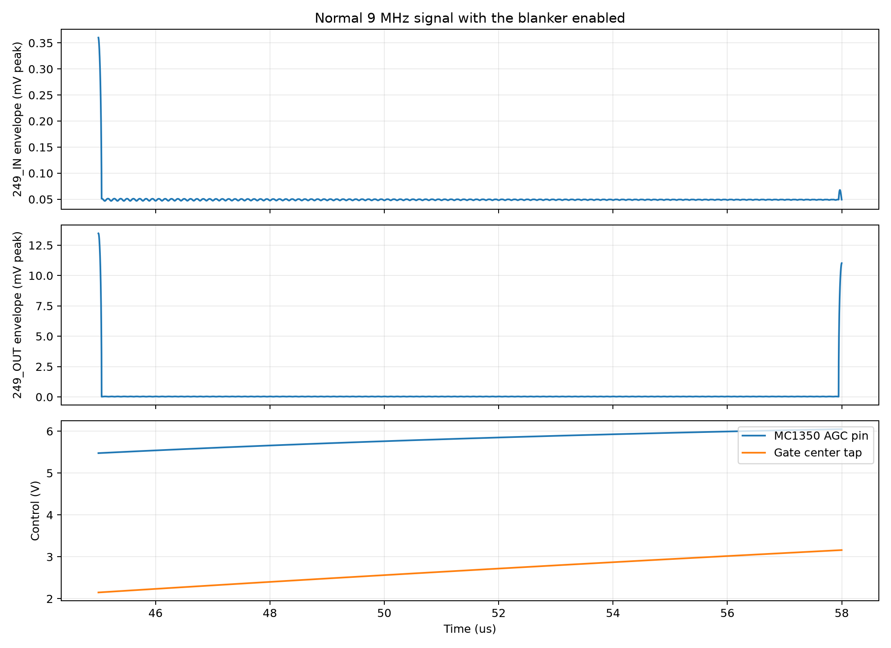
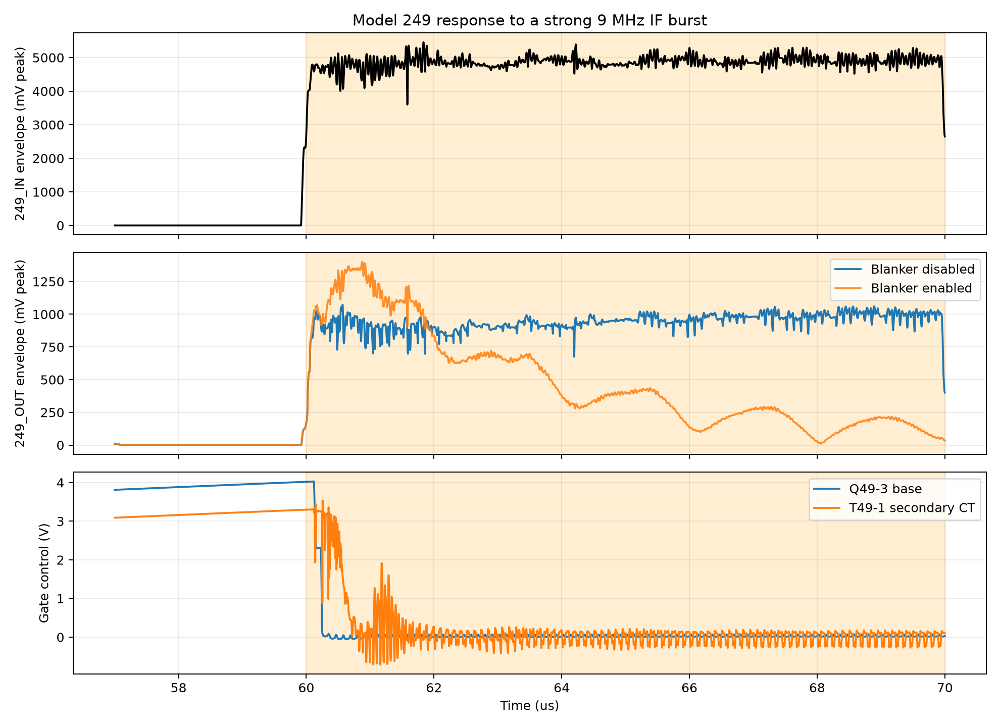

# Model 249 normal transfer and impulse gating

## Question answered

Does the reconstructed Model 249 pass an ordinary 9 MHz IF signal and operate
its balanced PIN-diode gate when the detector sees a much larger burst?

## How this part of the circuit works

The ordinary IF path is `IN` through C49-1, Q49-1, Q49-2, C49-2, T49-1,
D49-1/D49-2, L49-1/C49-3, and C49-4 to `OUT`. Q49-3 normally raises T49-1's
secondary center tap, forward-biasing both PIN diodes so they pass RF.

C49-15 samples the same input into IC49-1. The MC1350 and L49-2/C49-18 provide
high, tuned detector gain. A sufficiently large output through C49-13 turns on
Q49-4, which discharges C49-8 and pulls Q49-3 off. R49-12 then pulls the
T49-1 center tap down and the PIN diodes isolate the output tank. The opposite
MC1350 output drives Q49-5/Q49-6, which form the slower AGC branch intended to
prevent sustained signals from holding maximum detector gain.

## What a working circuit should show

- A small 9 MHz carrier should appear at `OUT` at roughly unity voltage ratio
  under the installed load; historical catalog data calls the signal gain 0 dB.
- A strong burst should drive Q49-4, pull the Q49-3 base and T49-1 center tap
  down, and reduce the later `OUT` envelope relative to a disabled run.
- Removing `+12_SW` should disable the detector without breaking the
  always-powered signal path.

## How the simulation tests it

Run from the project root with KiCad closed:

```powershell
python spice/tools/run_249_how_it_works.py
```

The runner exports `mod_249.kicad_sch` afresh and verifies that every expected
active-device and magnetic subcircuit appears in the netlist. It reads the live
root-sheet V1 value, presently 13.28 V, and performs two otherwise identical
transients:

| Case | `+12` | `+12_SW` | Meaning |
|:--|--:|--:|:--|
| Disabled | 13.28 V | 0 V | Signal path only |
| Enabled | 13.28 V | 13.28 V | Detector and gate active |

The source impedance is 50 ohms. The installed following stage is represented
by an inferred 10 kohm load at `OUT`, in parallel with 15 pF of probe/input
capacitance. The continuous signal is 9 MHz at 50 uV peak. From 60 to 70 us,
the source adds a deliberately strong 5 V-peak 9 MHz burst. This long burst is
used to separate detector delay, output-tank settling, and steady blanking. It
is not a calibrated ignition waveform, a factory trigger level, or a safe
starting amplitude for hardware.

The transient calculation grid is 2 ns. The retained timeline is reduced to
10 ns spacing; quoted trigger timing is resolved only to the calculation grid.

Two model fixtures need explicit attention:

- C49-18 is set to 40 pF, within its reconstructed 5-60 pF range. This is an
  inferred 9 MHz setting, not a recovered alignment position.
- A 5.1 kohm **model-only** shunt is placed from MC1350 AGC pin 5 to ground.
  The archived transistor macro-model otherwise sources enough quiescent AGC
  current to cut itself off in the board's 4.7 kohm + 10 kohm return. Motorola's
  published maximum-gain test returns pin 5 through 5.1 kohm. The shunt is a
  fitted correction to the legacy macro-model and is not on the physical board.

## What the simulation showed

| Measurement | Result |
|:--|--:|
| Enabled normal input | 34.90 uV RMS |
| Enabled normal output | 21.12 uV RMS |
| Enabled normal voltage gain | 0.605 V/V, -4.363 dB |
| Disabled normal voltage gain | 0.590 V/V, -4.584 dB |
| Enabled versus disabled normal output | +0.188 dB |
| Q49-3 base before burst | 3.513 V |
| T49-1 secondary center tap before burst | 2.790 V |
| Q49-4 base peak during burst | 0.816 V |
| Gate trigger delay to Q49-3 base below 0.7 V | 0.244 us |
| Q49-3 base minimum | -0.0527 V |
| T49-1 center-tap minimum | -0.712 V |
| Disabled output, 66-69 us | 0.693 V RMS |
| Enabled output, 66-69 us | 0.124 V RMS |
| Settled burst suppression | 14.95 dB, about 5.6:1 voltage |



**Figure 49-1.** Normal 9 MHz signal passes with the blanker enabled

Figure 49-1 plots peak RF envelopes at the accessible board pins. The internal
AGC and gate-center-tap voltages are included only to explain why the carrier
continues through the gate. A scope probe on the real detector tank could alter
its tuning; bench comparison should be made at `IN` and `OUT`.



**Figure 49-2.** Strong IF burst operates the PIN-diode gate

In Figure 49-2, the Q49-3 base falls about 0.244 us after the burst begins.
The enabled-output envelope then decays while the disabled output remains near
its steady burst level. The first peak is not reduced: the isolated board has
no model of the upstream receiver/filter delay that normally gives a noise
detector advance warning.

## Does it meet expectations?

**Partial pass.** The reconstructed detector operates Q49-4, Q49-3, and the
balanced diode gate in the expected direction. After settling, it reduces the
continued burst by 14.95 dB, and enabling the detector changes normal output by
only 0.188 dB. However, the modeled normal gain is -4.36 dB rather than the
historical nominal 0 dB, the leading peak escapes, and absolute results rely on
fitted detector bias and inferred load/magnetic parameters. This study shows
how the circuit switches; it does not establish original-board sensitivity,
gain, or complete installed-radio noise suppression.

## Limits and evidence status

- **Documented:** topology, component values, 9 MHz operation, nominal 0 dB
  signal gain, and front-panel disabling switch.
- **Calculated:** voltage ratios and dB conversions from the retained CSV.
- **Inferred:** L49-1, L49-2, T49-1, the 10 kohm installed load, and 15 pF
  combined probe/following-stage capacitance.
- **Fitted model parameters:** C49-18 = 40 pF and the 5.1 kohm MC1350 AGC
  model-only shunt.
- **Unknown hardware behavior:** trigger threshold, leading-edge suppression,
  blanking depth and duration, installed impedances, magnetic Q/coupling, and
  device spread.

The CSV sweep spacing is 2 ns internally and 10 ns in the retained timeline.
The 0.244 us trigger delay therefore has 2 ns simulation-grid resolution; it
must not be presented as a measured hardware value.

## Bench check

*Not yet performed. This is the proposal.*

### Setup

| Item | Connection or setting |
|:--|:--|
| Board installation | Prefer the normal receiver socket so the real following IF stage loads `OUT` |
| DC supply | Verify 13.28 V at `+12` and, when enabled, `+12_SW`, relative to board `GND` |
| Generator | 9 MHz burst generator through 50 ohms to board `IN`; begin at 10 mV peak or less |
| Oscilloscope CH1 | Low-capacitance 10x probe at `IN` |
| Oscilloscope CH2 | Low-capacitance 10x probe at `OUT` |
| Control state | Compare `+12_SW` off and on without moving probes or changing generator level |
| Safety | Do not apply the simulation's 5 V burst as the starting hardware test; stop for heating, continuous clipping, or abnormal supply current |

### Procedure

The full sequence is in [`bench/249/README.md`](../../../../bench/249/README.md).

1. Record continuous-signal input/output RMS voltage with blanking on and off.
2. Apply the lowest available short burst and capture `IN` and `OUT` together.
3. Increase burst amplitude only until a repeatable difference appears between
   blanking off and on.
4. Keep generator, probes, receiver controls, and C49-18 fixed between the two
   comparison acquisitions.
5. Record leading peak, settled burst envelope, trigger-to-attenuation delay,
   and recovery time at the board pins.

### Results

| Measurement | Simulated | Measured |
|:--|--:|--:|
| Enabled normal-path gain | -4.36 dB | |
| Enabled versus disabled normal output | +0.188 dB | |
| Gate trigger delay | 0.244 us | |
| Settled burst output, disabled | 0.693 V RMS | |
| Settled burst output, enabled | 0.124 V RMS | |
| Settled burst suppression | 14.95 dB | |

This check matters because it would replace the fitted AGC correction and
inferred 10 kohm load with the real MC1350 bias, following-stage impedance,
magnetics, diode capacitance, and installed-radio timing.
