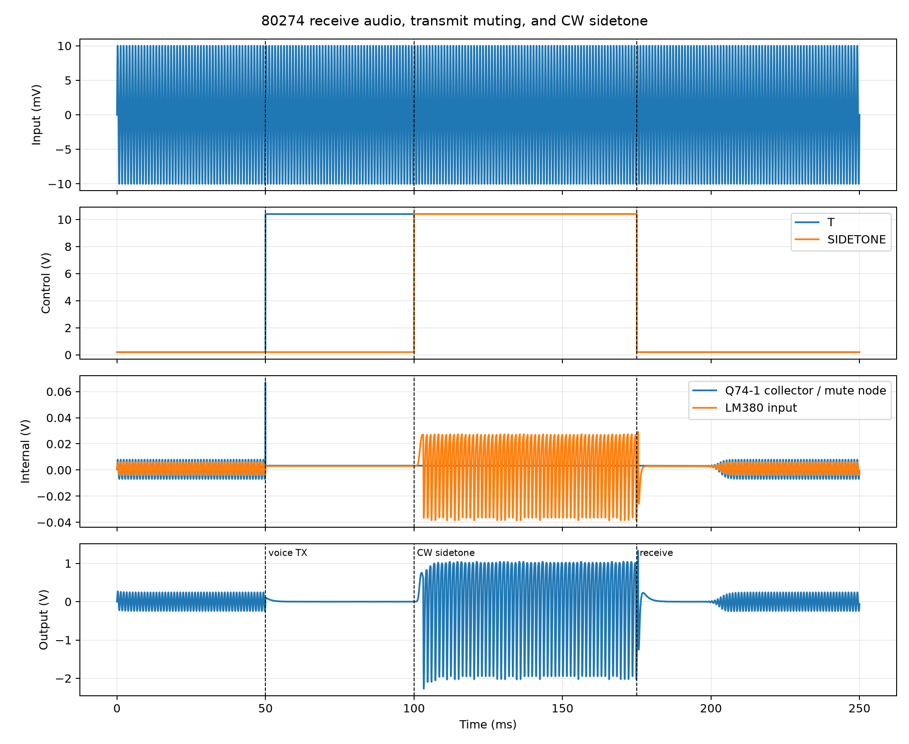
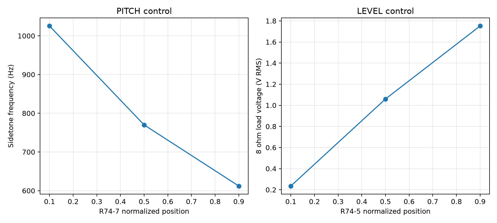

# 80274: receive audio, transmit muting, and CW sidetone

## Question answered

Does the reconstructed 80274 board reproduce the three functions described by
Ten-Tec: amplify received audio, mute that audio during transmit, and generate
an audible sidetone during CW transmit even while received audio remains muted?

## How this part of the circuit works

The manual says received audio enters the board at `INPUT` and reaches pin 2 of
U74-1, the LM380 audio power amplifier. R74-3 and R74-4 form the series input
path. C74-2 shunts high-frequency energy at the LM380 input, C74-10 filters its
half-supply bypass point, and C74-8 bypasses supply noise. The amplified signal
leaves LM380 pin 8 and passes through C74-6, which blocks the amplifier's DC
midpoint while passing audio to the board `OUTPUT` pin. R74-11 and C74-9 form
the small output-stability network shown by Ten-Tec.

During transmit, the `T` terminal rises. D74-1 charges C74-1 and supplies base
current through R74-1 to Q74-1. Q74-1 then pulls the R74-3/R74-4 junction close
to ground, preventing received audio from reaching the LM380. R74-2 discharges
C74-1 after `T` falls. This stored charge is the short delay that Ten-Tec says
slightly delays audio turn-on when the radio returns to receive.

Q74-2 is a unijunction-transistor relaxation oscillator: a circuit that charges
a capacitor until the transistor abruptly discharges it, then repeats. R74-7
and R74-8 set the charging resistance and therefore the pitch. The 8.2 V
zener D74-2, R74-12, R74-13, and C74-11 establish and filter the oscillator's
base supply. Q74-3 is its CW enable switch. `SIDETONE` drives Q74-3 through
R74-9, while C74-7 filters that control. When Q74-3 conducts, C74-5 becomes the
oscillator timing capacitor to ground. C74-4, R74-6, and C74-3 couple and shape
the oscillator waveform for the R74-5 level control. R74-14 feeds its wiper to
the LM380 input. R74-4 isolates this injection point from Q74-1, so sidetone can
be heard while the received-audio path is grounded.

This interpretation follows manual PDF page 34 / printed page 3-18. Component
values and connections follow PDF page 35 / printed page 3-19.

## What a working circuit should show

- With `T=0.2 V` and `SIDETONE=0.2 V`, a 1 kHz signal at `INPUT` should appear
  amplified at `OUTPUT`.
- With `T=10.4 V` and `SIDETONE=0.2 V`, Q74-1 should suppress that signal.
- With both controls at 10.4 V, a sidetone should appear at `OUTPUT` while the
  received 1 kHz signal remains muted.
- Raising R74-7's effective resistance should lower sidetone pitch. Raising
  the R74-5 wiper should raise output level.
- After `T` returns to 0.2 V, received audio should return after the C74-1,
  R74-1, and R74-2 delay.

## How the simulation tests it

Run from the project root with KiCad closed:

```powershell
python spice/tools/run_80274_how_it_works.py
```

The runner exports `80274_audio_power_amp.kicad_sch` afresh. It reads V1's
live 13.28 V value from `triton_540.kicad_sch`. The top sheet connects the
board output through the normally closed J8 contact to LS1; the disposable
fixture represents that closed contact and speaker by one 8 ohm resistor from
board `OUTPUT` to ground. No other speaker resistance is tested.

The board receives a continuous 1 kHz, 10 mV-peak input. R74-5 and R74-7 begin
at their electrical midpoints. The transient performs this sequence:

| Time | `T` | `SIDETONE` | State |
|---:|---:|---:|:--|
| 0-50 ms | 0.2 V | 0.2 V | Receive audio |
| 50-100 ms | 10.4 V | 0.2 V | Voice-transmit mute |
| 100-175 ms | 10.4 V | 10.4 V | CW sidetone |
| 175-250 ms | 0.2 V | 0.2 V | Return to receive |

The transient calculation step is 2 us. Measurements and figures use that
grid; the retained timeline CSV is reduced to 20 us spacing to keep it
manageable. Separate runs check normalized R74-7 and R74-5 positions 0.10,
0.50, and 0.90. These are electrical model positions, not calibrated
front-panel marks.

## What the simulation showed

| Measurement | Simulated result |
|:--|--:|
| Receive input | 7.071 mV RMS at 1 kHz |
| Receive output into 8 ohms | 171.892 mV RMS |
| Receive voltage ratio | 24.31 V/V |
| Receive load power | 3.693 mW |
| LM380 pin 8 DC level in receive | 6.693 V |
| Muted output | 96.86 uV RMS |
| Modeled receive-audio suppression | 64.98 dB |
| Midpoint sidetone | 771.3 Hz, 1.056 V RMS |
| Midpoint sidetone load power | 139.4 mW |
| 90% receive-audio recovery after `T` falls | 30.406 ms |

The approximately 65 dB suppression is a voltage ratio of about 1,775:1.
It is a model result, not a published Ten-Tec mute specification.



**Figure 74-1.** Receive, mute, sidetone, and recovery states

Figure 74-1 shows the continuous input, the two control voltages, the internal
mute and LM380 input nodes, and the accessible board `OUTPUT` voltage. The
internal nodes are explanatory simulation traces; a hardware check should use
the board pins so a probe does not disturb the oscillator.

The R74-7 position sweep moved modeled pitch from 1,025.3 Hz at 0.10 through
769.8 Hz at 0.50 to 612.1 Hz at 0.90. The R74-5 sweep changed 8 ohm-load
voltage from 0.235 V RMS through 1.060 V RMS to 1.751 V RMS. Pitch changed by
less than 0.2% across the level sweep, so the two controls are substantially
independent in the model.



**Figure 74-2.** Sidetone pitch and level controls

## Does it meet expectations?

**Functional pass.** The fitted circuit reproduces all three manual-described
operating states. Q74-1 strongly suppresses received audio during voice
transmit. Enabling Q74-3 starts the Q74-2 oscillator and routes sidetone around
that mute. R74-7 moves pitch in the expected direction, R74-5 controls level,
and received audio returns after the expected RC-controlled delay.

## Limits and evidence status

- **Documented:** circuit topology, component values, the roles of Q74-1,
  Q74-2, Q74-3, R74-5, and R74-7, and the 0.2/10.4 V control states.
- **Live project value:** the simulation supply is the root-sheet V1 value of
  13.28 V. The manual's service table uses 13.8 V.
- **Inferred:** the speaker is represented by a purely resistive 8 ohm load.
  The manual pages do not state LS1 impedance.
- **Fitted models:** `LM380_fitted.sub` and `MPSU01_fitted.lib` are
  datasheet-constrained engineering models, not recovered manufacturer SPICE
  models. The 2N4870 model came from the user's local SPICE library.
- **Unknown hardware behavior:** installed-device spread, speaker impedance
  versus frequency, distortion, noise, thermal behavior, physical pot
  settings, and the actual mute depth and recovery delay.

Sidetone frequency is measured from interpolated output zero crossings on a
2 us time grid. Timing should not be read more finely than that grid, and the
reported decimal places exist mainly to make reruns comparable.

## Bench check

*Not yet performed. This is the proposal.*

### Setup

| Item | Connection or setting |
|:--|:--|
| DC supply | `+12` to `GND`; 13.28 V for direct comparison, current limit 0.5 A |
| Signal generator | `INPUT` to `GND`; 1 kHz, 20 mV peak-to-peak |
| Load | 8 ohm, at least 5 W, from `OUTPUT` to `GND` instead of the speaker |
| Oscilloscope CH1 | 10x probe at board `INPUT` |
| Oscilloscope CH2 | 10x probe at board `OUTPUT` |
| T control | Switch between 0.2 V and 10.4 V, referenced to board `GND` |
| SIDETONE control | Switch between 0.2 V and 10.4 V, referenced to board `GND` |
| Board controls | R74-5 and R74-7 initially at their measured electrical midpoints |
| Safety | Do not short LM380 pin 8; make measurements at the AC-coupled board `OUTPUT` pin |

### Procedure

The detailed instrument sequence and safety checks are in
[`bench/80274/README.md`](../../../../bench/80274/README.md). In summary:

1. Power the board and let the LM380 bypass point settle.
2. Apply the 1 kHz input with both control lines at 0.2 V. Record input and
   output RMS voltage.
3. Raise only `T` to 10.4 V without moving the generator or controls. Record
   residual 1 kHz output.
4. Raise `SIDETONE` to 10.4 V. Record sidetone frequency and RMS voltage.
5. Return both controls to 0.2 V and measure the delay until the 1 kHz output
   reaches 90% of its settled receive amplitude.
6. Move R74-7 and R74-5 separately, recording frequency and level. Do not move
   the other control between comparison readings.

### Results

| Measurement | Simulated | Measured |
|:--|--:|--:|
| Receive output | 171.892 mV RMS | |
| Receive load power | 3.693 mW | |
| Muted output | 96.86 uV RMS | |
| Mute suppression | 64.98 dB | |
| Midpoint sidetone frequency | 771.3 Hz | |
| Midpoint sidetone output | 1.056 V RMS | |
| Midpoint sidetone load power | 139.4 mW | |
| 90% receive recovery delay | 30.406 ms | |

This check matters because it would constrain the uncertain 2N4870 timing
behavior, fitted LM380/MPSU01 response, real control positions, and actual
speaker-loading conditions. A detailed instrument procedure should be placed
in `bench/80274/README.md` when hardware testing is scheduled.
