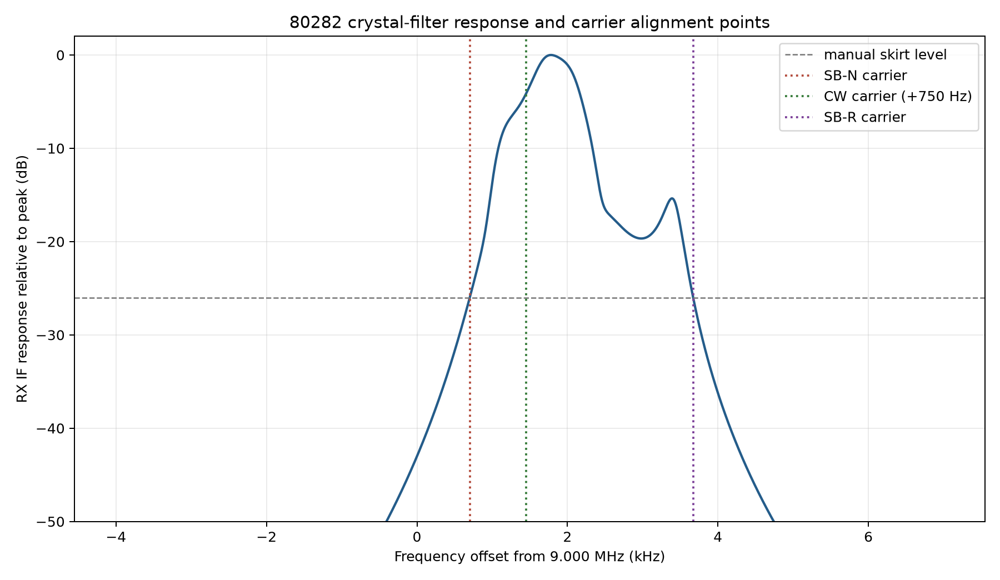
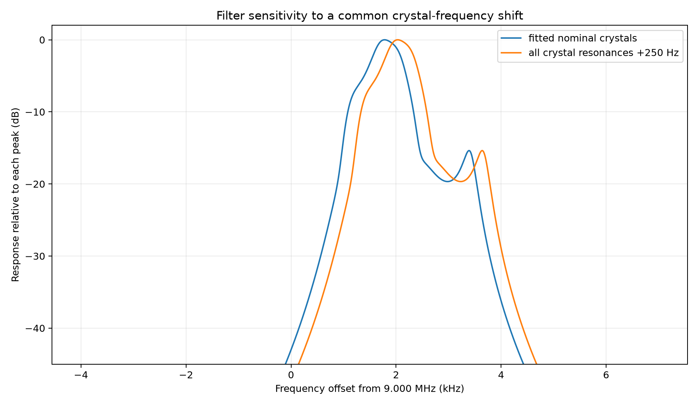

# 80282 filter operation and carrier alignment

This study asks whether the reconstructed eight-crystal lattice passes a band
near 9 MHz and whether Ten-Tec's three carrier settings land on the parts of
that response described by the alignment procedure.  The retained CSVs and
figures are regenerated by `spice/tools/run_80282_operation.py`.

## Circuit and evidence

The runner first exports `80282_ssb_generator.kicad_sch` and refuses to run if
the two 68 pF coil capacitors, the 220 pF inter-section capacitor, the two
center-tapped coil models, or the 220 ohm `Out` termination do not match.  It
then places a 1 V AC source through 50 ohms at board pin `Out`, a 1 kohm
fixture load at board pin `RX IF`, and sweeps the exact lattice connections.
Those fixture impedances are inferred starting values, not Ten-Tec data.

The manual supplies neither individual filter-crystal frequencies nor their
motional resistance, inductance, capacitance, and holder capacitance.  The
paired resonances and the `22 ohm / 20 fF / 3 pF` crystal parameters are fitted
engineering values.  A common +250 Hz crystal shift is included to show the
sensitivity of conclusions to that missing evidence.

## Results

The 5 Hz linear grid found a peak at 9,001,780 Hz.  Interpolated crossings,
rounded to the grid resolution, were 9,000,700 Hz and 9,003,670 Hz at 26 dB
below that peak.  A CW point 750 Hz above the low skirt landed at about
9,001,450 Hz, 4.12 dB below the modeled peak.  That is
the right direction and returns substantially into the passband, as the manual
expects, but it is not close enough to call the fitted filter final.  The
modeled -3 dB width was only about 605 Hz.

**Figure 82-1.** The fitted lattice response and the SB-N, CW, and SB-R carrier positions used by the manual's alignment sequence

**Figure 82-2.** Moving every fitted crystal resonance by 250 Hz moves the filter response, illustrating why original-crystal measurements matter

Verdict: **partial pass**.  The schematic topology produces a usable 9 MHz
band-pass response with the expected carrier-placement ordering, but the
undocumented crystal parameters and terminations do not yet reproduce a
credible full SSB passband.  The absolute gain and bandwidth are model results,
not factory specifications or measurements.

## Files

- `data/filter-response.csv`: every 5 Hz sweep point, nominal and +250 Hz case
- `data/metrics.csv`: peak, bandwidth, skirt crossings, and CW placement
- `figures/filter-and-carrier-alignment.png`: Figure 82-1
- `figures/crystal-frequency-sensitivity.png`: Figure 82-2
- `manifest.csv`: command and retained-run identity

## Bench counterpart

Measure insertion response from board pin `Out` to board pin `RX IF` with the
board unpowered and disconnected, using the impedance-isolation procedure in
`bench/80282/README.md`.  This has not yet been performed.  It would replace
the fitted crystal frequencies and terminations with evidence from the actual
filter.
