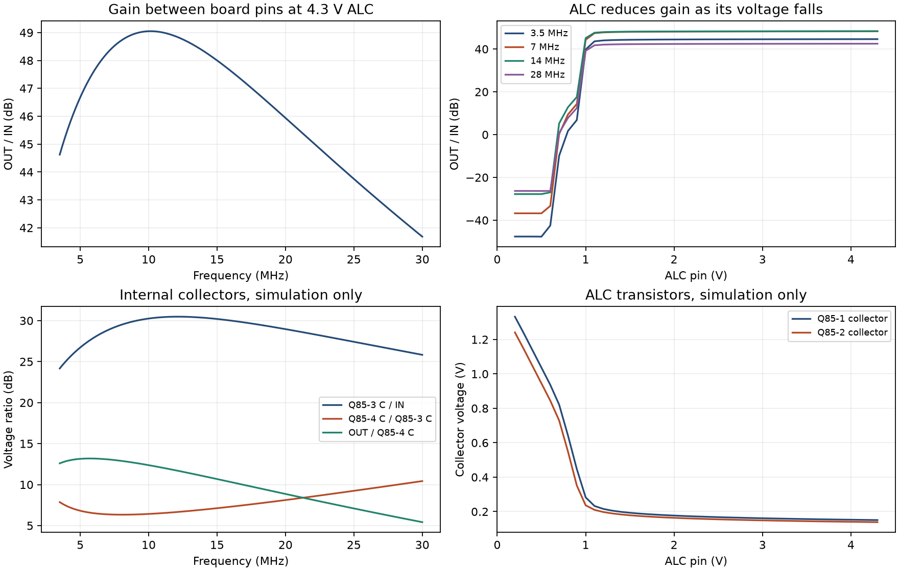
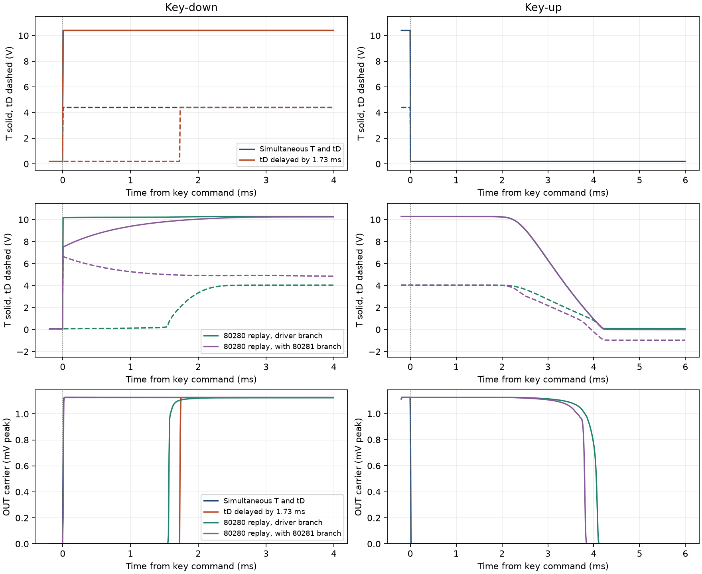
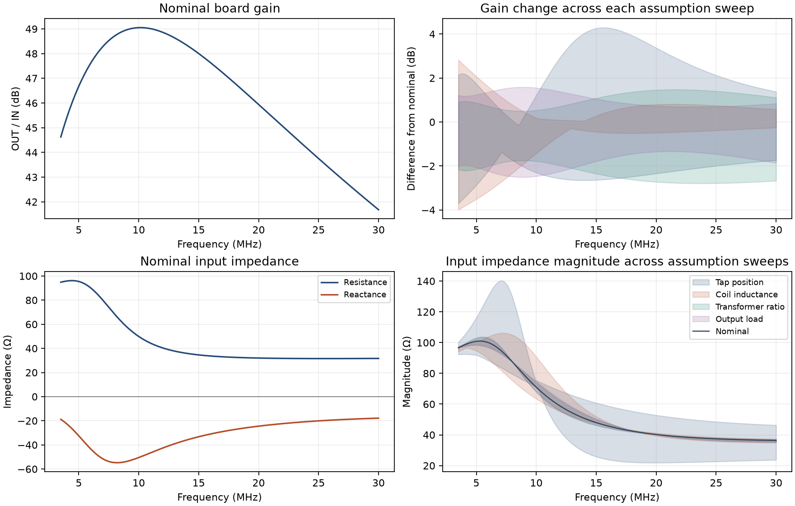

# 80285 driver operation study

See the [board README](../../../../80285.md) for circuit action and model results, and the [bench procedure](../../../../bench/80285/README.md) for proposed measurements.

## Regenerate

Run from the repository root with Python, NumPy, Matplotlib, KiCad 10 and ngspice. The `KICAD_CLI` and `NGSPICE_EXE` environment variables can select the executables. The runner also looks on PATH and in the local installation paths.

```powershell
uv run --with matplotlib --with numpy python spice/tools/run_80285_operation.py
```

The runner exports `80285_low_level_driver.kicad_sch` as a standalone sheet and checks that it contains all 36 simulated circuit elements and the three model includes. It maps KiCad’s GND to SPICE node 0 and names the board ports and transistor terminals for analysis. Companion boards and final-amplifier load are represented at the pins. Raw decks and logs are disposable and go under `spice/generated/80285-operation/`. `manifest.csv` records the actual runs.

## Fixtures

- **Bias.** 13.0 V at `+12` and 4.3 V at `ALC`. Toggle `T` from 0.2 V to 10.4 V and `tD` from 0.2 V to 4.4 V. These are the documented terminal voltages from the Model 540 manual PDF page 42 / printed 3-26. Emitter currents come from voltage drops across the three emitter resistors.
- **RF and ALC.** 50 Ω source and load, both transmit feeds high, linear AC analysis at 100 kHz spacing from 3.5 through 30 MHz. ALC is stepped in 0.1 V increments from 0.2 to 4.3 V with a separate DC point at each setting. Gain compares actual RF voltage at `OUT` to actual RF voltage at `IN`. The source-to-output column uses the open-circuit generator voltage as reference. Input impedance is `VIN / ((VSOURCE − VIN) / 50 Ω)`, with complex phasors carrying amplitude and phase.
- **Keying.** 3.5 MHz at 10 µV peak open-circuit, 50 Ω source and load. The two controlled cases step the feeds together or delay `tD` by 1.73 ms with 1 µs rise and fall times. Both have the same commanded release. The two other cases replay `T` and `tD` from 80280 [`driver-only-td.csv`](../../80280/operation/data/driver-only-td.csv) and [`keying.csv`](../../80280/operation/data/keying.csv). For each replay the first 10 ms key-down and 90 ms key-up edges are run in separate windows, starting from their preceding DC bias. Replay point spacing is 2 µs near the expanded first edge and 20 µs elsewhere in the retained trace. The replay drives the 80285 through ideal sources and leaves the 80280 load calculation unchanged. A 32-cycle coherent amplitude estimate gives one envelope value every 9.14 µs. Two driver copies with opposite carrier phase cancel the output pulse common to both copies before measuring carrier amplitude. The retained envelope excludes that common pulse.
- **Sensitivity.** At 4.3 V `ALC`, vary one assumption at a time. Each tapped coil is varied independently to 20% and 45% of the turns from the supply end and to 6 and 16 µH end-to-end. Vary T85-1’s primary-to-secondary turns ratio to 1.5:1 and 3:1 with a fixed 10 µH primary, and vary the `OUT` load to 25 and 100 Ω. Defaults are 10 µH, one-third tap, 2:1 ratio, and 50 Ω. The plotted ranges describe only these perturbations.

## Results and data

| File | Contents |
|:--|:--|
| `data/bias.csv` | Board pin and transistor voltages plus calculated emitter currents for the three bias states |
| `data/rf.csv` | Nominal pin gain, internal collector ratios and complex input impedance on the frequency grid |
| `data/alc.csv` | Pin gain and Q85-1/Q85-2 collector voltages at 42 ALC values and six frequencies |
| `data/keying.csv` | `T`, `tD` and coherent RF amplitude at `OUT` around each key edge. The two controlled cases share one computed key-up trace. |
| `data/sensitivity.csv` | Nominal profile and twelve individual changes to winding or load assumptions |



**Figure 85-1.** RF gain between the board pins and the effect of lowering ALC voltage.



**Figure 85-2.** Transmit feeds and RF carrier envelope for controlled timing and 80280 replay.



**Figure 85-3.** Change in gain and input impedance when varying one winding or load assumption at a time.

## Limits

The 80285 models are listed in the [model index](../../../models/README.md#80285-low-level-driver). The PT3647 is a DC-biased approximation. Its RF behavior, the winding values, and the real chassis source and load impedances still need hardware checks. The keying replay inherits the simplified 80280 and 80281 models. The RF envelope verifies when the modeled carrier passes. It leaves occupied bandwidth, key-click audibility, compression, output power and distortion open.
