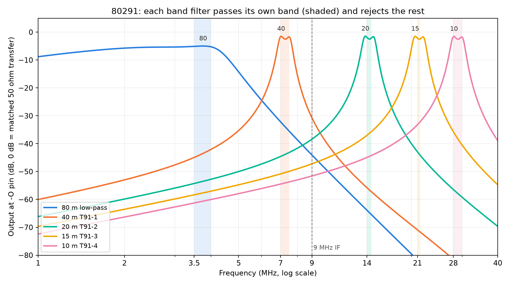
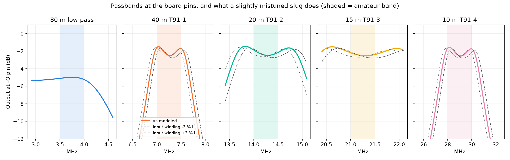
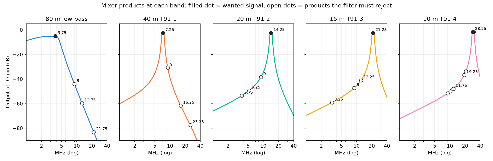
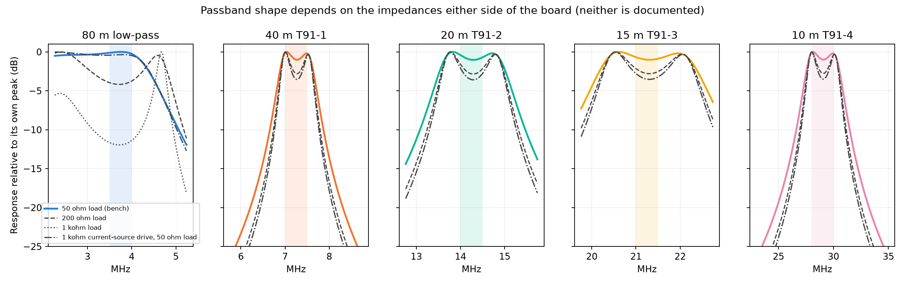

# 80291 band-filter operation

This study asks four questions about the 80291 band filters, all answered at
the board pins:

1. Does each filter pass its own amateur band and reject the others?
2. How strongly does each one reject the unwanted transmit-mixer products?
3. Does a slightly mistuned slug matter, as the manual's "no field alignment"
   claim suggests it should not?
4. How much does the passband depend on the undocumented impedances either
   side of the board?

It also reproduces the manual's one documented test of this board, the
resistance from each pin to chassis.

The retained CSVs and figures are regenerated by
[`spice/tools/run_80291_operation.py`](../../../tools/run_80291_operation.py).
The board explanation is in [`80291.md`](../../../../80291.md).

## Circuit and evidence

The runner exports `80291_bandpass.kicad_sch` and refuses to run unless the
export contains every documented capacitor, R91-1, both low-pass coils, and
the four transformers with their windings connected to the correct pins.
Mixer-side windings (unit A) must go to the `-I` pins and driver-side windings
(unit B) to the `-O` pins. The exported circuit is then used unchanged; only
test fixtures are added around it.

The manual documents the topology, every capacitor value, R91-1, and the
pin resistances (PDF page 41, printed page 3-25). It gives no inductance,
tap, coupling, or Q, and nothing about the impedances either side of the
board. The model values in
[`spice/models/80291_bandpass_magnetics.lib`](../../../models/80291_bandpass_magnetics.lib)
are **calculated** (winding inductance, from resonance with the documented
capacitor at band centre) or **estimated** (4 pF stray, unloaded Q of 100,
tap position, winding-to-winding coupling K = 0.08, and 2.7 µH for L91-1 and
L91-2). The taps and coupling were chosen for 50 Ω at each tap. Results at
50 Ω therefore partly confirm the design assumptions rather than test them
independently. The [Results](#results) section separates the two.

| Run | Source at `-I` pin | Load at `-O` pin | Purpose |
|:--|:--|:--|:--|
| `bench` | 50 Ω generator | 50 Ω | Reference case; reproducible with the board unplugged |
| `load-200` | 50 Ω generator | 200 Ω | Unknown 80285 input impedance |
| `load-1k` | 50 Ω generator | 1 kΩ | Unknown 80285 input impedance |
| `mixer-drive` | 1 kΩ Norton (current) source | 50 Ω | A high-impedance mixer output |
| `detune-minus` / `detune-plus` | 50 Ω generator | 50 Ω | Every mixer-side winding at −3 % / +3 % inductance |
| `dc` | 1 mA into every pin | none | The manual's ohmmeter check |

All AC runs sweep 0.5–40 MHz on a 10 kHz linear grid. Frequencies read from
the CSVs are quantized to 10 kHz. In all AC runs, 0 dB means 1 V at the `-O`
pin from a 2 V-EMF generator: the voltage the generator would put across a
50 Ω load connected directly. In the `bench` case this makes the figures
insertion loss.

## Results

**Pin resistance (independent of the estimates).** The model gives open
circuit (10¹² Ω, the simulator's leakage floor) at `3_5-I`, 47 Ω at `3_5-O`,
and 0.02 Ω at every band-pass pin. This matches the manual exactly: infinite,
47 Ω, and zero.

**Passbands at 50 Ω.** Each band-pass filter passes its whole amateur band
with 1.5–2.5 dB loss and about 1 dB of ripple. The two humps of an
overcoupled pair are visible in Figure 91-1. The low-pass loses about 5 dB on
the bench: R91-1 sits across the 50 Ω generator and takes half the drive
current. With the mixer's high-impedance drive, R91-1 instead becomes the
filter's source termination.

| Filter | Band (MHz) | In-band output (dB) | −3 dB edges (MHz) |
|:--|:--|--:|:--|
| 80 m low-pass | 3.5–4.0 | −5.24 to −4.98 | upper corner 4.44 |
| 40 m T91-1 | 7.0–7.5 | −2.51 to −1.49 | 6.87–7.65 |
| 20 m T91-2 | 14.0–14.5 | −2.48 to −1.86 | 13.50–15.04 |
| 15 m T91-3 | 21.0–21.5 | −2.52 to −2.18 | 20.13–22.44 |
| 10 m T91-4 | 28.0–30.0 | −2.54 to −1.54 | 27.47–30.62 |

Where these edges fall follows directly from the estimated taps and coupling.
They show that the estimates make a self-consistent filter. They are not an
independent check of the hardware.

**Figure 91-1.** Each 80291 filter passes its own band (shaded) and rejects the others; the 9 MHz IF is marked

**Figure 91-2.** The passbands at the board pins, with every mixer-side winding detuned by ±3 % inductance

**Slug tolerance.** A ±3 % inductance change on the mixer-side winding moves
each passband's −3 dB edges by 0.7–0.9 % in frequency, about half the 1.5 %
retuning of that one winding. The lowest in-band output falls
by at most 0.3 dB, to −2.81 dB. The amateur band stays inside the −3 dB
edges in every case. This supports the manual's statement that the filters
"require no field alignment".

**Mixer products** (`data/mixer-products.csv`, bench fixture, relative to the
wanted signal):

| Band | Worst unwanted product | Rejection |
|:--|:--|--:|
| 80 m | 9 MHz IF leak | 39 dB |
| 40 m | 9 MHz IF leak | 28 dB |
| 20 m | 9 MHz IF leak | 36 dB |
| 15 m | VFO leak at 12.25 MHz | 39 dB |
| 10 m | VFO leak at 20.75 MHz (29.5 segment) | 32 dB |

The 40 m filter has the least margin, because 9 MHz is only 1.75 MHz above its
band. That is consistent with the manual's note (PDF page 42, printed page
3-26) that a further low-pass is switched in on 7 MHz "to reduce higher order
mixer products". The sum and
difference products are rejected by 46–78 dB.

**Figure 91-3.** The wanted mixer product (filled) and the products each filter must reject (open) on every band

**Termination sensitivity.** As the load rises from 50 Ω to 1 kΩ, the tanks
lose damping. The band-pass responses narrow and the dip between the humps
deepens. At 1 kΩ the −3 dB edges shrink to 6.91–7.18 MHz on 40 m and
27.63–28.73 MHz on 10 m, so neither filter covers its band any longer.

The 80 m low-pass becomes peaky: +9.4 dB at 4.67 MHz, with the passband
12 dB below that peak. A 1 kΩ current-source drive with a 50 Ω load gives
the same band-pass shapes. The filters are symmetric, so swapping a high
impedance from the output to the input changes nothing.

The real tap impedances must therefore be low, a few tens to a few hundred
ohms, for the filters to work as the manual describes. The 80285 input and
80287 output impedances are the most important unknowns on this board.

**Figure 91-4.** Passband shape for 50 Ω, 200 Ω, and 1 kΩ loads and for a high-impedance drive, each relative to its own peak

Verdict: **partial pass.** The KiCad topology reproduces every documented
check (pin resistances, five filters on five bands, a low-pass on 80 m). It
also shows the broad, alignment-tolerant behaviour the manual describes. The
passband widths and rejection figures depend on estimated magnetics and on
assumed 50 Ω terminations. They are not factory specifications or
measurements.

## Files

- `data/response.csv`: every 10 kHz point for every run and band (dB at the `-O` pin)
- `data/metrics.csv`: peak, in-band minimum/maximum, and −3 dB edges per run and band
- `data/mixer-products.csv`: output at each transmit-mixer product, bench fixture
- `data/dc-resistance.csv`: simulated pin resistance beside the manual's figure
- `figures/band-overview.png`: Figure 91-1
- `figures/passbands-and-detune.png`: Figure 91-2
- `figures/mixer-product-rejection.png`: Figure 91-3
- `figures/termination-sensitivity.png`: Figure 91-4
- `manifest.csv`: command and retained-run identity

## Bench counterpart

The 80291 is a plug-in board, so every check here can be repeated with the
board out of the radio. Use a 50 Ω generator, a 50 Ω feed-through
termination, and an ohmmeter, following
[`bench/80291/README.md`](../../../../bench/80291/README.md). Not yet
performed. The measurement would replace the estimated taps, coupling, and
Q with the real board's values.
