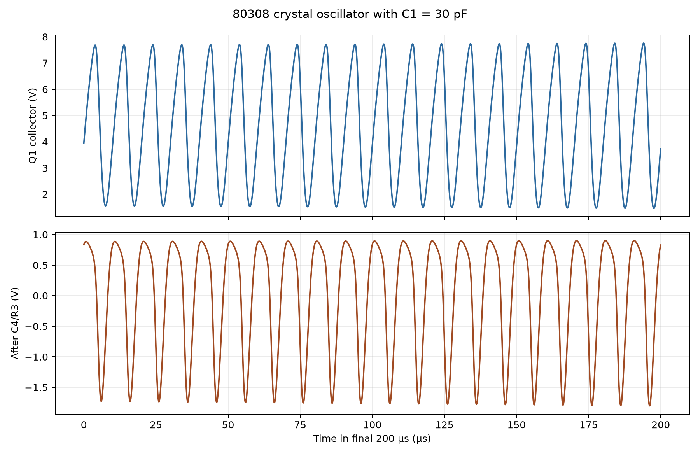
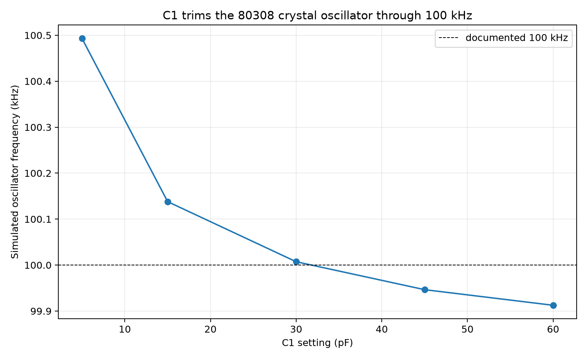
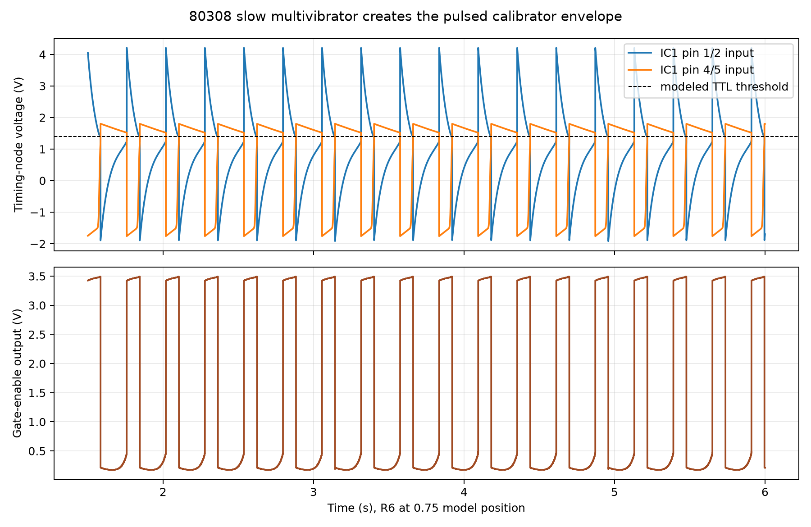
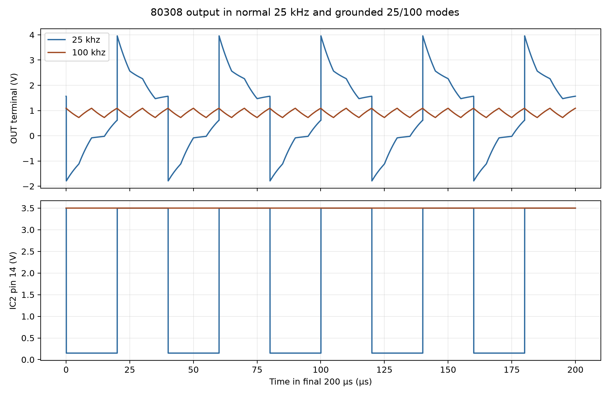
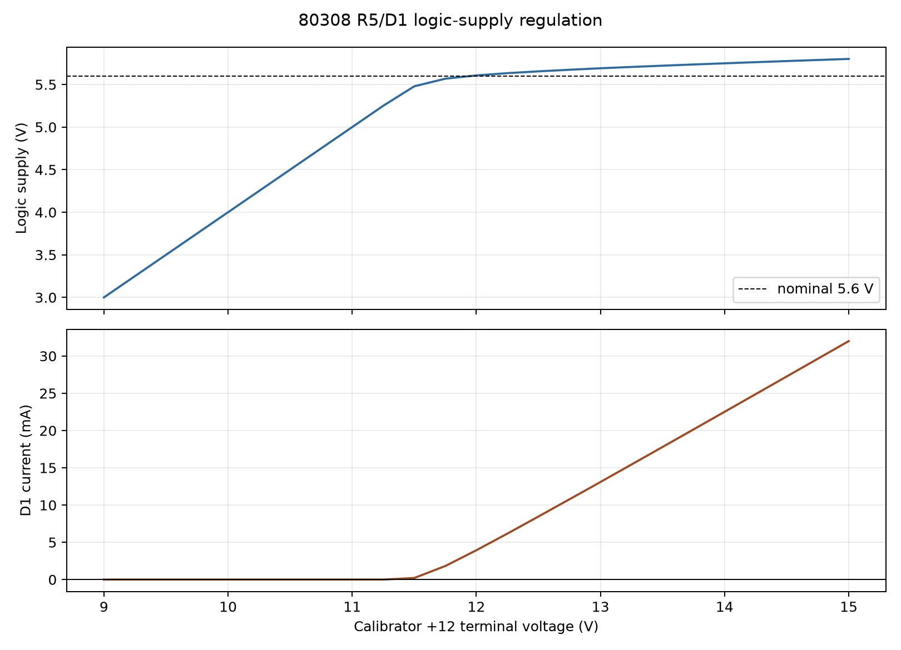

# 80308 normal operation and adjustment study

This retained study supports the simulation sections in [`80308.md`](../../../../80308.md).
It separates the slow pulse envelope from the 100 kHz carrier so each time
scale is numerically resolved and readable.

## Configuration and retained data

- `data/oscillator-tuning.csv`: Q08-1 results at five C08-1 settings.
- `data/oscillator-waveform.csv`: final 200 µs at the setting nearest 100 kHz.
- `data/slow-gate-summary.csv`: R08-6 sweep and pulse periods.
- `data/slow-gate-waveform.csv`: representative R08-6 = 0.75 waveform.
- `data/output-waveforms.csv`: final 200 µs in normal and grounded modes.
- `data/regulator-sweep.csv`: 9–15 V regulator sweep in 0.25 V steps.
- `data/measurements.csv`: compact numerical summary.

The runner exports `80308_crystal_calibrator.kicad_sch` first and refuses to
continue unless the corrected capacitor values and all four model assignments
are present. Generated netlists, raw files, and logs are disposable under
`spice/generated/80308-operation/`.

## Results



**Figure 08-1.** Q08-1 collector waveform and the signal delivered through C08-4/R08-3



**Figure 08-2.** The fitted oscillator model crosses 100 kHz within C08-1's adjustment range



**Figure 08-3.** The timing nodes cross the modeled TTL threshold and produce the pulsed enable



**Figure 08-4.** Board `OUT` in normal 25 kHz mode and with `25/100` grounded



**Figure 08-5.** D08-1 regulation voltage and available zener current versus switched supply

The oscillator sweep found 100.493, 100.138, 100.007, 99.946, and 99.913 kHz
at 5, 15, 30, 45, and 60 pF. The slow-gate model oscillated from 3.44 to
4.71 Hz at model positions 0.70–0.80 and stopped toward both ends. At `OUT`,
normal mode was dominated by a 3.55 V p-p 25 kHz component; grounding
`25/100` removed that component and left 0.320 V p-p at 100 kHz. At the
13.75 V DC-sweep sample the logic rail was 5.735 V.

## Evidence limits

The schematic values, frequencies, and manual voltages are documented. The
crystal motional values, TTL transfer curves, logic current, zener curve, and
external DEFEAT pull-up are fitted. These simulations demonstrate the intended
circuit action but are not measurements or factory amplitude specifications.

## Reproduce

```powershell
python spice\tools\run_80308_operation.py
```
